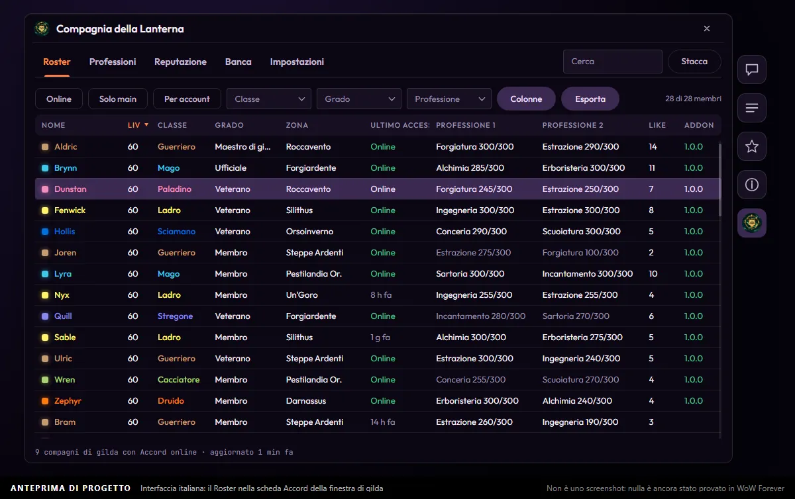
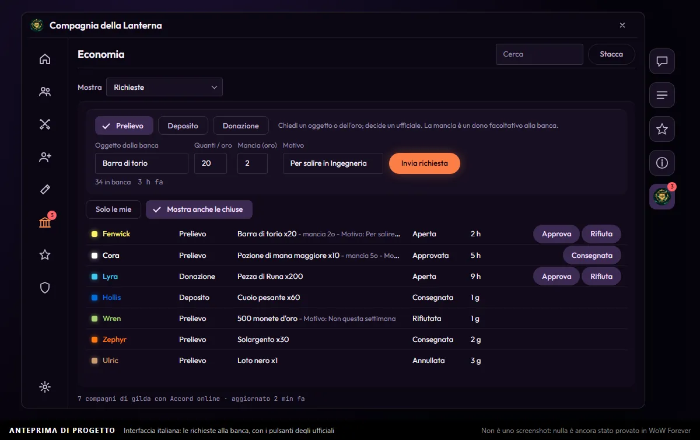
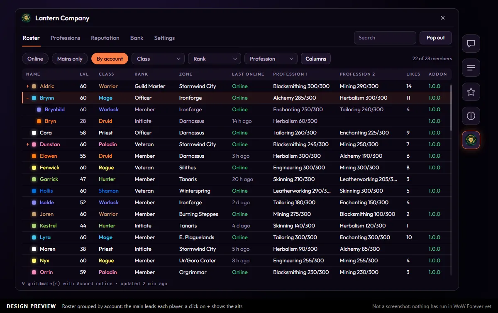
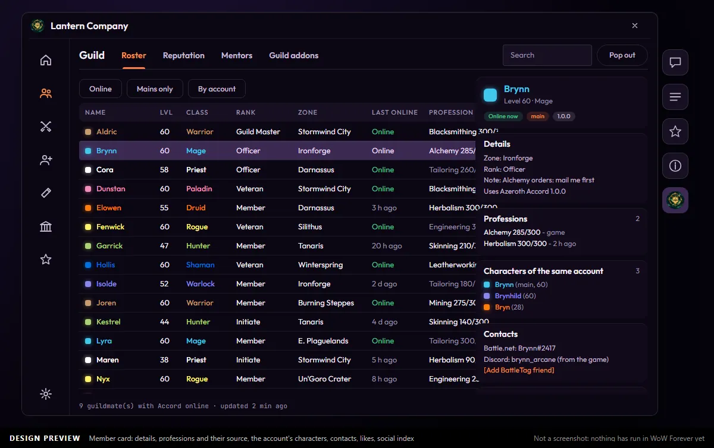
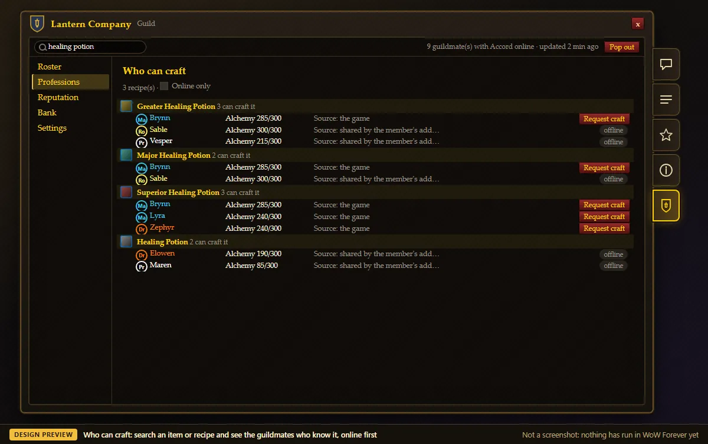
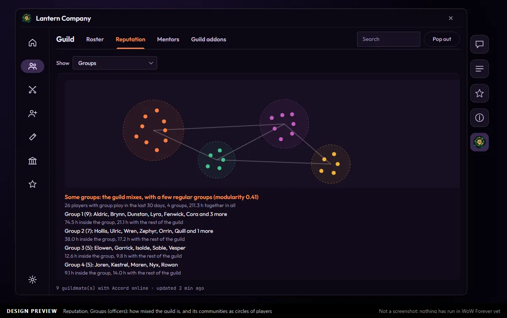

# Azeroth Accord

**Una finestra della Gilda più ricca per World of Warcraft: Forever.** Azeroth Accord aggiunge alla finestra della Gilda una scheda **Accord** con ciò che manca al pannello del gioco: roster esteso con professioni e ricette, tutti i personaggi dello stesso account, contatti Battle.net e Discord, like tra compagni, un indice sociale che mostra se la gilda gioca insieme o si divide in gruppetti, e la banca di gilda con richieste di prelievo, deposito e donazioni.

> **Stato: le milestone M1 (fondamenta), M2 (roster), M3 (professioni), M4 (reputazione), M5 (banca di gilda) e M6 (impostazioni, italiano, rifinitura, diagnostica, pacchetto, immagini) sono complete nel codice e aspettano le prove in gioco** ([M1](docs/checklists/M1.md), [M2](docs/checklists/M2.md), [M3](docs/checklists/M3.md), [M4](docs/checklists/M4.md), [M5](docs/checklists/M5.md), [rilascio](docs/checklists/release.md), in inglese): esistono la scheda Accord, la finestra autonoma, la sincronizzazione di gilda, la vista **Roster** (ordinabile, filtrabile, raggruppata per account), la **scheda del membro**, i personaggi di un account, i **contatti** (BattleTag, Discord, richiesta di amicizia), la vista Impostazioni, la registrazione silenziosa del gioco di gruppo e ora la vista **Professioni**: l'elenco delle ricette di un membro aperto da una cella di professione, **chi può creare** un oggetto (prima i membri online, raggruppati per giocatore) e **Request craft**, un sussurro con il link della ricetta che invii tu. Con M4 la vista **Reputation** aggiunge i **like** (dalla scheda del membro o dalla vista: anonimi, uno per giocatore, registrati dall'addon di un ufficiale online), l'**indice sociale** (il proprio; gli ufficiali vedono quello di tutti), la **mappa dei gruppi** per gli ufficiali e **Someone new** per giocare con qualcuno di nuovo; Con M5 la vista **Banca** mostra la banca di gilda dall'ultima visita di un membro con l'addon (scheda per scheda, il denaro, un elenco di oggetti con ricerca; le schede che il tuo grado non vede restano nascoste), tiene il **registro della banca** oltre quello del gioco (senza doppioni), classifica le **donazioni** per giocatore e disegna il denaro della gilda nel tempo, e gestisce le **richieste** (prelievo, deposito, donazione: un membro chiede, gli ufficiali approvano, rifiutano o segnano come consegnata; gli ufficiali vedono un contatore sulla tab e una casella, e ognuno è avvisato quando la sua richiesta viene decisa). Ogni milestone si pubblica come versione di prova per la gilda del proprietario quando la sua prova passa, da `v0.1.0` a `v0.6.0` (le correzioni alzano l'ultimo numero, come `v0.6.1`); non c'è ancora un download. Le prossime milestone, da M7 a M15, sono pianificate nella [roadmap](ROADMAP.md); `v1.0.0` arriva quando sono tutte finite. L'interfaccia è anche in **italiano**. Con M6 la pagina **Impostazioni** (personaggio principale, avvisi della banca, colonne del roster, dati salvati e *Cancella i dati della gilda*) è nel pannello Accord e nella finestra impostazioni del gioco; vedi [Settings](docs/wiki/Settings.md), in inglese. Il manuale ha ora le immagini: anteprime di progetto di ogni vista principale (non screenshot). Prima di `v0.6.0`, M6 continua con i passi da M6.8 a M6.17: Accord prende l'aspetto dell'altro addon del proprietario, Finland Dragon Credit Points (temi, font, barra del titolo e schede), e aggiunge una pagina Informazioni con i crediti e il manuale in italiano.

[English](README.md) · [Roadmap](ROADMAP.md) · [Specifiche](docs/specs/README.md) · [Decisioni](docs/adr/README.md) · [Manuale (inglese)](docs/wiki/Home.md)

## Come appare

| | |
|---|---|
|  |  |
|  |  |
|  |  |

> **Anteprime di progetto, non screenshot.** Sono disegnate dal layout e dai testi dell'addon, con personaggi e oggetti inventati e grafica originale, perché l'addon non è ancora stato provato nel gioco. Le prime tre sono in italiano, le altre in inglese. [Tutte le anteprime](docs/specs/mockups/previews/README.md) (in inglese) · [come si fanno](docs/specs/mockups/README.md).

## Funzioni previste

| Area | Cosa offre |
|---|---|
| **Scheda Accord** | Una quinta tab sotto Chat, Membri, Vantaggi e Info; lo stesso pannello si apre anche in una finestra a parte (`/accord`) |
| **Roster esteso** | Tabella ordinabile e filtrabile: livello, classe, grado, zona, ultimo accesso, professione 1 e 2, like, indice sociale, contatti |
| **Alt** | Clic su un personaggio: tutti i personaggi dello stesso account Battle.net sul reame, senza chiedere |
| **Contatti** | BattleTag e Discord di ogni membro con l'addon, copia con un clic, richiesta d'amicizia BattleTag nativa |
| **Professioni** | Clic sulla professione di un membro: le sue ricette; ricerca "chi sa fare…"; richiesta di crafting |
| **Like** | Un like da ogni account a ogni altro account, mai a se stessi, irrevocabile, totali anonimi |
| **Indice sociale** | Con quanti compagni diversi gioca davvero ciascuno (compagni effettivi), una mappa dei gruppi della gilda e i suggerimenti "gioca con qualcuno di nuovo" |
| **Banca di gilda** | Contenuto dall'ultima visita di un membro, registri, donazioni, richieste di prelievo e deposito approvate dagli ufficiali |

Tutto resta **dentro la gilda**: l'addon comunica solo sui canali addon nascosti della gilda, senza server, senza internet e senza telemetria.

## Contribuire

Vedi [CONTRIBUTING.md](CONTRIBUTING.md) (in inglese). Le specifiche sono in italiano.

## Licenza

[GNU GPL v3.0](LICENSE). Addon amatoriale, non affiliato a Blizzard Entertainment.
