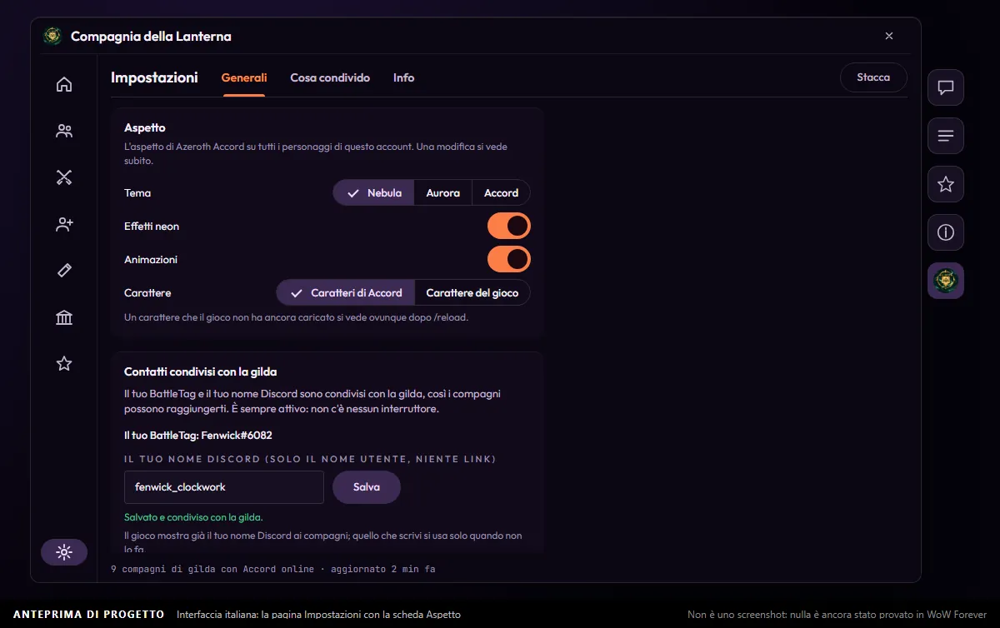
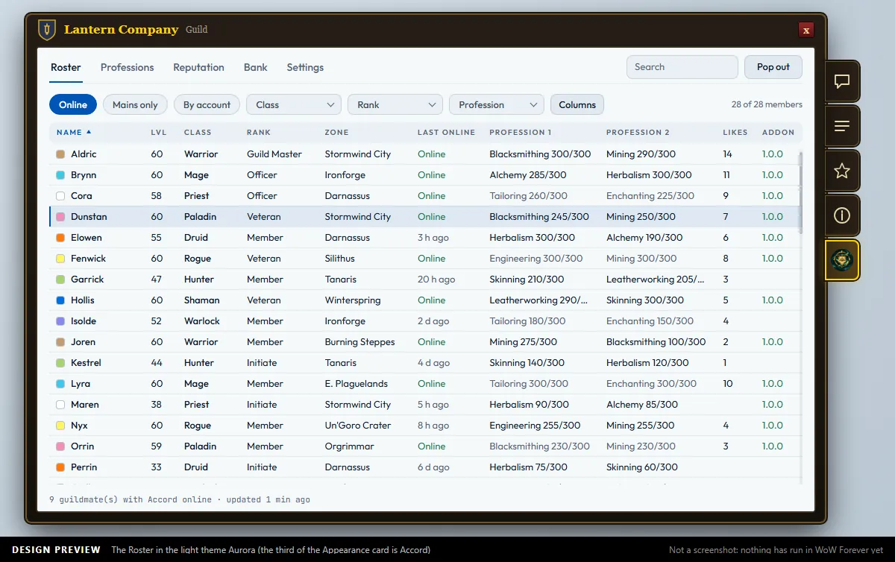
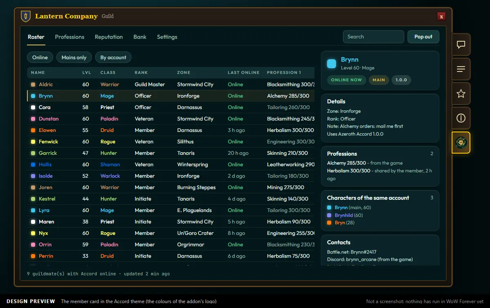

# Azeroth Accord

**Una finestra della Gilda più ricca per World of Warcraft: Forever.** Azeroth Accord aggiunge alla finestra della Gilda una scheda **Accord** con ciò che manca al pannello del gioco: roster esteso con professioni e ricette, tutti i personaggi dello stesso account, contatti Battle.net e Discord, like tra compagni, un indice sociale che mostra se la gilda gioca insieme o si divide in gruppetti, e la banca di gilda con richieste di prelievo, deposito e donazioni.

> **Stato: le milestone M1 (fondamenta), M2 (roster), M3 (professioni), M4 (reputazione), M5 (banca di gilda), M6 (impostazioni, italiano, rifinitura, diagnostica, pacchetto, immagini), M7 (fiducia nei dati: etichette di provenienza, la gilda degli alt, modalità demo, backup personale, "Cosa condivido", rafforzamento) M8 (strumenti per ufficiali: cronologia del roster, account inattivi, coda di pulizia da fare a mano, note degli ufficiali, esportazione; richieste in banca scelte dal suo contenuto, con una mancia facoltativa), M9 (Centro azioni: un solo elenco, avvisi, ore di quiete, riepilogo all'accesso; il cercagruppi della gilda; gli addon della gilda) M10 (calendario, raid, roster della season) e M11 (loot e manuale di gilda) sono complete nel codice. L'ultimo rilascio è `v0.11.0`** (2026-11-26), dopo `v0.10.0`, `v0.9.0` e `v0.8.0`: versioni di prova pubblicate, per decisione del proprietario, prima delle prove in gioco, che restano aperte ([M1](docs/checklists/M1.md), [M2](docs/checklists/M2.md), [M3](docs/checklists/M3.md), [M4](docs/checklists/M4.md), [M5](docs/checklists/M5.md), [M7](docs/checklists/M7.md), [M8](docs/checklists/M8.md), [M9](docs/checklists/M9.md), [M10](docs/checklists/M10.md), [rilascio](docs/checklists/release.md), in inglese): esistono la scheda Accord, la finestra autonoma, la sincronizzazione di gilda, la vista **Roster** (ordinabile, filtrabile, raggruppata per account), la **scheda del membro**, i personaggi di un account, i **contatti** (BattleTag, Discord, richiesta di amicizia), la vista Impostazioni, la registrazione silenziosa del gioco di gruppo e ora la vista **Professioni**: l'elenco delle ricette di un membro aperto da una cella di professione, **chi può creare** un oggetto (prima i membri online, raggruppati per giocatore) e **Request craft**, un sussurro con il link della ricetta che invii tu. Con M4 la vista **Reputation** aggiunge i **like** (dalla scheda del membro o dalla vista: anonimi, uno per giocatore, registrati dall'addon di un ufficiale online), l'**indice sociale** (il proprio; gli ufficiali vedono quello di tutti), la **mappa dei gruppi** per gli ufficiali e **Someone new** per giocare con qualcuno di nuovo; Con M5 la vista **Banca** mostra la banca di gilda dall'ultima visita di un membro con l'addon (scheda per scheda, il denaro, un elenco di oggetti con ricerca; le schede che il tuo grado non vede restano nascoste), tiene il **registro della banca** oltre quello del gioco (senza doppioni), classifica le **donazioni** per giocatore e disegna il denaro della gilda nel tempo, e gestisce le **richieste** (prelievo, deposito, donazione: un membro chiede, gli ufficiali approvano, rifiutano o segnano come consegnata; gli ufficiali vedono un contatore sulla tab e una casella, e ognuno è avvisato quando la sua richiesta viene decisa). Si scarica dalla pagina *Releases* del repository e aspettati problemi: nessuno l'ha ancora verificata su WoW Forever. Da M9 in poi ogni milestone completata esce come `v0.<milestone>.0` (le correzioni alzano l'ultimo numero, come `v0.8.1`). **M9 è arrivata con la `v0.9.0`**, non ancora provata nel gioco ([checklist di M9](docs/checklists/M9.md), in inglese): il **Centro azioni** (un solo elenco di ciò che ti aspetta) con il **centro notifiche** (la cronologia degli avvisi, con riga in chat, riquadro sullo schermo o suono), le **ore di quiete** (gli avvisi aspettano in combattimento, nelle istanze e nelle ore scelte) e un **riepilogo all'accesso** di ciò che è cambiato dall'ultima sessione ([Centro azioni](docs/wiki/Action-Center-it.md)); un **cercagruppi solo per la gilda** (annunci con i ruoli, candidature al capo in sussurro, inviti, la vista **Gruppi**, e lo stesso gruppo messo anche **in privato** nel Group Finder del gioco con un clic del capo, se il gioco lo permette: [Gruppi](docs/wiki/Groups-it.md)); e la tabella **Addon della gilda** (quali addon usano i membri, con il conteggio di ciascuno; chi li usa lo vedono solo gli ufficiali; un interruttore smette di condividere il proprio elenco: [Addon della gilda](docs/wiki/Guild-Addons-it.md)). Le prossime milestone, da M12 a M16, sono pianificate nella [roadmap](ROADMAP.md); `v1.0.0` arriva quando sono tutte finite. M12 è cominciata: il testo di reclutamento per gli ufficiali (M12.2), le prove dei nuovi membri (M12.3), la lista di benvenuto (M12.4) e i mentori (M12.5) sono nel codice, nascosti finché la milestone non è completa. L'interfaccia è anche in **italiano**. Con M6 la pagina **Impostazioni** (la card **Aspetto**: tema Nebula, Aurora o Accord, effetti neon, animazioni e carattere; personaggio principale, avvisi della banca, colonne del roster, dati salvati e *Cancella i dati della gilda*) è nel pannello Accord e nella finestra impostazioni del gioco; vedi [Impostazioni](docs/wiki/Settings-it.md). Il manuale ha ora le immagini: anteprime di progetto di ogni vista principale (non screenshot). M6 è continuata con i passi da M6.8 a M6.18 (da M6.8 a M6.18 sono fatti: il nuovo aspetto è completo): Accord prende l'aspetto dell'altro addon del proprietario, Finland Dragon Credit Points (temi, font, barra del titolo e schede; tutte le viste sono già disegnate così, e anche le immagini; M6.18 veste nel tema anche la finestra Gilda intorno al pannello Accord: la cornice, il nome della gilda, la croce e le linguette a lato), e aggiunge una pagina Informazioni con i crediti e il manuale in italiano (fatto in M6.17: ogni pagina del wiki ha la sua gemella italiana). Con M8.2 gli ufficiali vedono anche una **Cronologia** nella scheda del membro: ingressi, uscite, cambi di grado, di livello e di nota pubblica che i loro addon hanno osservato nel roster, tenuti per sempre e condivisi solo tra ufficiali (mai con la gilda); Accord guarda soltanto il roster e non lo cambia mai. Con M8.3 gli ufficiali hanno la scheda **Ufficiali**: i **giocatori inattivi** (contati per account, quindi chi gioca solo un alt non è inattivo) in fasce scelte dagli ufficiali (di base 14, 30, 60 e 90 giorni) e la cronologia di tutta la gilda; un membro può **dichiarare un'assenza** con la data di rientro, vista solo dagli ufficiali. Con M8.4 una **revisione guidata** riempie una coda di azioni che l'ufficiale fa a mano nella finestra del gioco, e con M8.5 gli ufficiali scrivono **note degli ufficiali** più lunghe nella scheda del membro (fino a 500 caratteri, tenute per sempre, condivise solo tra ufficiali e cancellate dal computer di un ufficiale retrocesso). Con M8.6 gli ufficiali **esportano** il roster, gli account inattivi e la cronologia in CSV o come testo per Discord, da una casella da copiare (mai le note degli ufficiali né i codici degli account). **M10 (calendario, raid, roster della season) è arrivata con la `v0.10.0`**, con le prove nel gioco da fare ([checklist di M10](docs/checklists/M10.md), in inglese): il riconoscimento degli addon di raid e di loot e la scelta di gilda della fonte del roster della season; la vista **Season**, dove ogni raider dichiara MS1, MS2 e OS e tutti vedono i conteggi per ruolo e le mancanze ([Roster della season](docs/wiki/Season-Roster-it.md)); la vista **Eventi** per iscriversi agli eventi della gilda direttamente nel calendario del gioco, con panchina, composizione e raduni PvP e nel mondo ([Eventi](docs/wiki/Events-it.md)); gli eventi **Raid-Helper** del Discord della gilda portati nel gioco incollandone l'esportazione ([Eventi di Raid-Helper](docs/wiki/Raid-Helper-it.md)); e la **mappa della disponibilità** di quando la gilda gioca di solito ([Disponibilità](docs/wiki/Availability-it.md)). **M11 (loot e manuale di gilda) è arrivata con la `v0.11.0`**, con le prove nel gioco da fare ([checklist di M11](docs/checklists/M11.md), in inglese): il **manuale di gilda**, letto e scritto nel gioco, con le revisioni, gli scrittori per grado e le pagine predefinite ([Manuale di gilda](docs/wiki/Guild-Handbook-it.md)); la sua **pagina del loot**, con il sistema e l'addon del loot della gilda e chi ce l'ha; e la vista **Raid** che legge FDCP ([Addon di raid e di loot](docs/wiki/Raid-and-Loot-Addons-it.md)).

[English](README.md) · [Roadmap](ROADMAP.md) · [Specifiche](docs/specs/README.md) · [Decisioni](docs/adr/README.md) · [Manuale](docs/wiki/Home-it.md) ([inglese](docs/wiki/Home.md))

## Come appare

| | |
|---|---|
|  |  |
|  |  |
|  |  |
|  |  |

> **Anteprime di progetto, non screenshot.** Sono disegnate dal layout e dai testi dell'addon, nel nuovo aspetto (Nebula, il tema predefinito, e alcune in Aurora e in Accord), con personaggi e oggetti inventati e grafica originale, perché l'addon non è ancora stato provato nel gioco. Le prime quattro sono in italiano, le altre in inglese. [Tutte le anteprime](docs/specs/mockups/previews/README.md) (in inglese) · [come si fanno](docs/specs/mockups/README.md) · [accanto a Finland Dragon Credit Points](docs/specs/mockups/compare/README.md).

## Funzioni previste

| Area | Cosa offre |
|---|---|
| **Scheda Accord** | Una quinta tab sotto Chat, Membri, Vantaggi e Info; lo stesso pannello si apre anche in una finestra a parte (`/accord`) |
| **Roster esteso** | Tabella ordinabile e filtrabile: livello, classe, grado, zona, ultimo accesso, professione 1 e 2, like, indice sociale, contatti |
| **Alt** | Clic su un personaggio: tutti i personaggi dello stesso account Battle.net sul reame, senza chiedere |
| **Contatti** | BattleTag e Discord di ogni membro con l'addon, copia con un clic, richiesta d'amicizia BattleTag nativa |
| **Professioni** | Ricette della gilda: tutte le ricette di una professione, il livello richiesto e chi nella gilda può crearle; clic sulla professione di un membro: le sue ricette, imparate e mancanti; ricerca "chi sa fare…"; richiesta di crafting |
| **Like** | Un like da ogni account a ogni altro account, mai a se stessi, irrevocabile, totali anonimi |
| **Indice sociale** | Con quanti compagni diversi gioca davvero ciascuno (compagni effettivi), una mappa dei gruppi della gilda e i suggerimenti "gioca con qualcuno di nuovo" |
| **Banca di gilda** | Contenuto dall'ultima visita di un membro, registri, donazioni, richieste di prelievo (scelte dal contenuto della banca, con una mancia facoltativa) e deposito approvate dagli ufficiali |
| **Centro azioni** *(dalla `v0.9.0`)* | Un solo elenco di ciò che ti aspetta (richieste in banca e di creazione, azioni degli ufficiali, assenze, candidati), la cronologia degli avvisi con riga in chat, riquadro o suono, le ore di quiete e un breve riepilogo all'accesso |
| **Cercagruppi della gilda** *(dalla `v0.9.0`)* | Gruppi per spedizioni, incursioni, missioni o aiuto, visti solo dalla gilda: ruoli, candidature al capo, inviti; se si vuole, messi in privato anche nel Group Finder del gioco |
| **Addon della gilda** *(dalla `v0.9.0`)* | Quali addon usano i membri con Accord, con conteggi e versioni; i nomi solo per gli ufficiali; un interruttore smette di condividere il proprio elenco |
| **Roster della season** *(dalla `v0.10.0`)* | Ogni raider dichiara una volta per season MS1 con il suo ruolo, MS2, OS e una nota, oppure "non ancora sicuro"; solo la propria voce, bloccata dopo 30 minuti; gli ufficiali aprono le season e impostano una composizione obiettivo; tutti vedono i conteggi per ruolo, le mancanze e chi non ha dichiarato, gli ufficiali li esportano in CSV o testo per Discord; con FDCP come fonte, il pool di FDCP |
| **Eventi** *(dalla `v0.10.0`)* | Gli eventi della gilda nel calendario del gioco, chiunque li abbia creati; iscriviti, forse o rifiuta da Accord e la risposta va nel calendario del gioco stesso, così la vedono FDCP e il gioco; il ruolo preselezionato dalla tua dichiarazione della season; eventi tenuti solo in Accord quando il client non ha il calendario, segnati come tali; gli ufficiali mettono gli iscritti nel raid o in panchina rispetto alla composizione obiettivo, con la MS2 proposta per un ruolo scoperto, e ogni membro vede il proprio posto (in Accord niente con FDCP come fonte) |
| **Eventi di Raid-Helper** *(dalla `v0.10.0`)* | Un ufficiale incolla l'esportazione (JSON o CSV) di un evento di Raid-Helper; le iscrizioni vengono abbinate ai membri per nome Discord, tra tutti i loro personaggi; gli ufficiali le confrontano con il calendario del gioco e con il roster della season e, dopo una conferma, scrivono l'evento e le risposte nel calendario senza cambiare una risposta data nel gioco; esportazione per tornare su Discord. Accord non contatta mai Discord né Raid-Helper |
| **Mappa della disponibilità** *(dalla `v0.10.0`)* | Quando la gilda gioca di solito, per giorno e ora: ogni client conta solo il tempo online del proprio account nelle ultime 8 settimane (niente raid, niente presenze); i conteggi per tutti, i nomi agli ufficiali; un interruttore smette di condividere la propria |
| **Raduni PvP e nel mondo** *(dalla `v0.10.0`)* | Una chiamata veloce con il punto d'incontro a parole e l'ora di inizio, con le risposte *vengo* o *non vengo*; scade da sola; nessuna coordinata viene mai condivisa |
| **Addon di raid e di loot** *(riconoscimento e fonte della season dalla `v0.10.0`; il resto dalla `v0.11.0`)* | Lavora con l'addon del loot della gilda invece di sostituirlo: gli addon conosciuti vengono riconosciuti e gli ufficiali possono scegliere Finland Dragon Credit Points come fonte; la pagina del loot del manuale dice il sistema e l'addon del loot della gilda (qualunque addon di loot su CurseForge), dove prenderlo e chi ce l'ha, con accanto le regole del loot di FDCP; la vista **Raid** mostra il pool della season di FDCP (MS1, MS2, OS) e la formazione e la panchina della serata, e la scheda del membro i crediti e il posto nella coda del loot, tutto in sola lettura; in Accord nessun motore del loot e nessuna presenza |
| **Manuale di gilda** *(dalla `v0.11.0`)* | Pagine di testo (informazioni, regolamento, FAQ, raid, roster, loot) che gli ufficiali e i gradi scelti scrivono nel gioco e che ogni membro legge, anche offline, con il segno delle pagine aggiornate, la ricerca, le revisioni e la gestione dei conflitti |
| **Backup personale** | `/accord backup` esporta i tuoi dati (personaggi, main, impostazioni, i tuoi record, il token dell'account) in un testo e li importa su un altro computer, dopo averlo controllato e aver mostrato cosa cambia; i dati degli altri giocatori non ci sono mai |
| **Modalità demo** | `/accord demo` riempie ogni vista con una gilda inventata, senza gilda e senza rete: non si invia né si salva nulla, e i tuoi dati veri tornano intatti |
| **Sincronizzazione robusta** | Un messaggio danneggiato, troppo grande o falso si rifiuta, l'addon di un compagno che inonda il canale viene ignorato per 10 minuti, le gilde fino a 1000 membri con l'addon si sincronizzano con un riepilogo a blocchi compatto (provato nel simulatore di rete), e i nomi completi di Forever con lo spazio ("Nome Cognome") funzionano ovunque |

Tutto resta **dentro la gilda**: l'addon comunica solo sui canali addon nascosti della gilda, senza server, senza internet e senza telemetria.

## Contribuire

Vedi [CONTRIBUTING.md](CONTRIBUTING.md) (in inglese). Le specifiche sono in italiano.

## Crediti

- **Creato e progettato da Finland.**
- **Realizzato con la gilda italiana NEBULA** ([la pagina della gilda](https://nebula-community.github.io/giochi/wow-forever/)). Il logo di NEBULA è usato con il permesso della gilda.
- Sostieni il progetto su [Ko-fi](https://ko-fi.com/finland6738); segnala un problema o suggerisci qualcosa nelle [issue](https://github.com/Finland6738/azeroth-accord/issues).
- Nel gioco gli stessi crediti sono nella pagina **Info** delle Impostazioni (`/accord about`); `/accord about chat` li scrive in chat. Li ha anche il manuale: [Informazioni e crediti](docs/wiki/About-it.md).
- Azeroth Accord è un addon creato dai fan, non realizzato da Blizzard Entertainment e non affiliato a Blizzard Entertainment.

## Crediti dei font

L'addon include tre famiglie di font con la [SIL Open Font License 1.1](https://openfontlicense.org/) (i testi delle licenze sono accanto ai file in `AzerothAccord/Media/Fonts/`): **Outfit** (The Outfit Project Authors), **JetBrains Mono** (The JetBrains Mono Project Authors) e **Orbitron** (Matt McInerney, incluso senza modifiche perché dichiara un Reserved Font Name). Ogni font, il foglio delle icone, le texture, i loghi e le librerie sono elencati con le loro licenze in [docs/third-party.md](docs/third-party.md), in inglese.

## Licenza

[GNU GPL v3.0](LICENSE). Addon amatoriale, non affiliato a Blizzard Entertainment.
