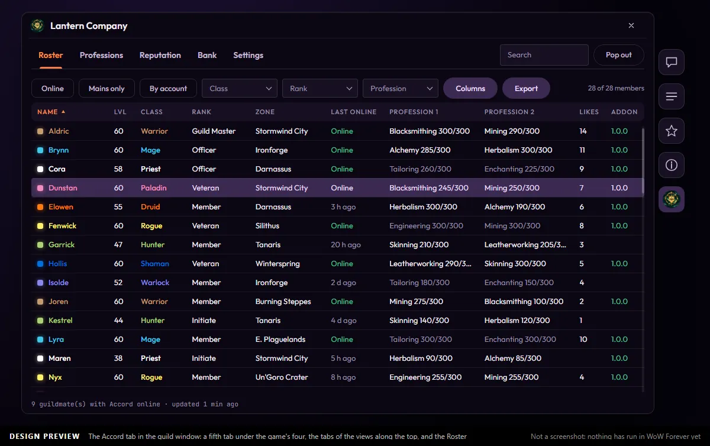
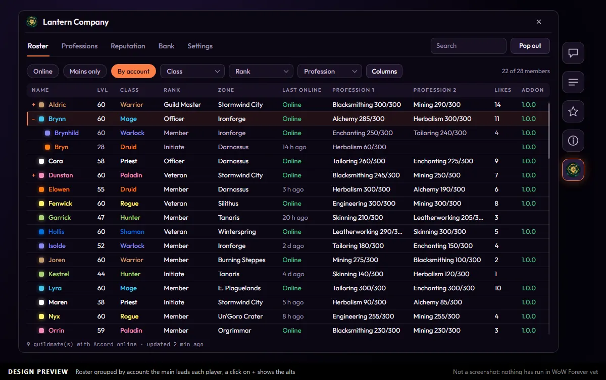
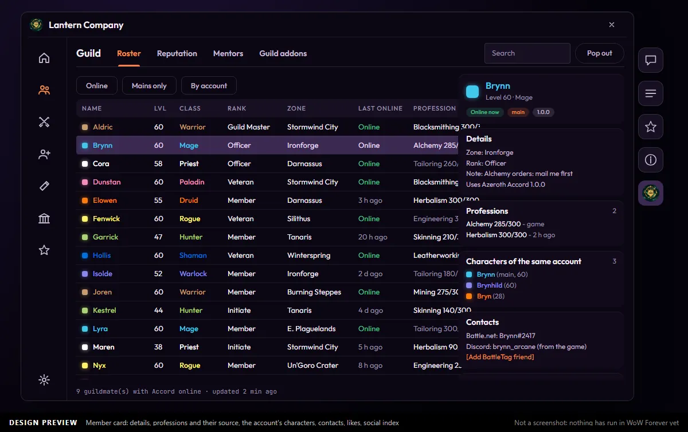
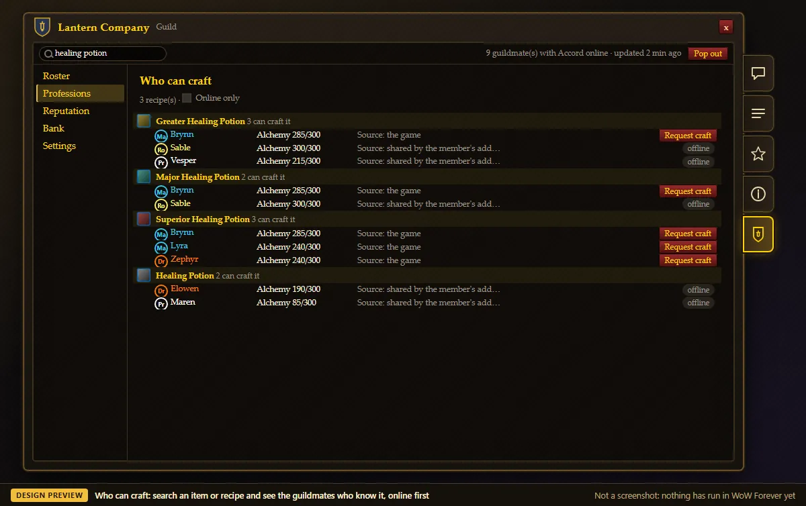
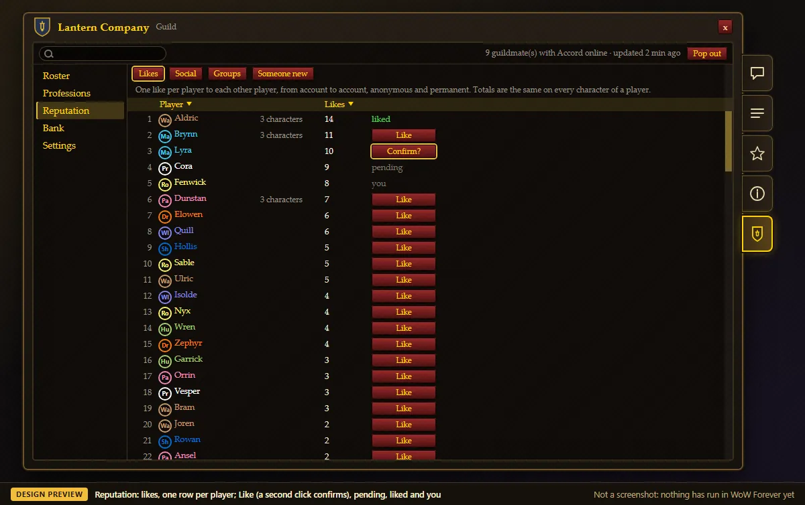
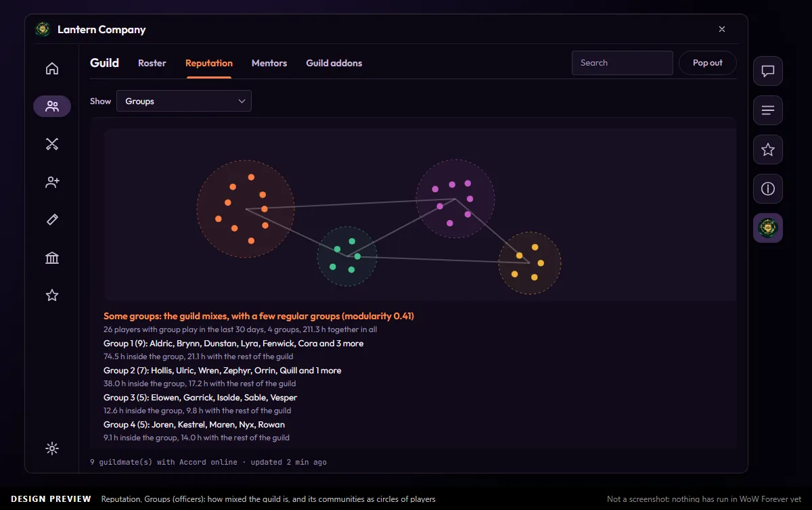
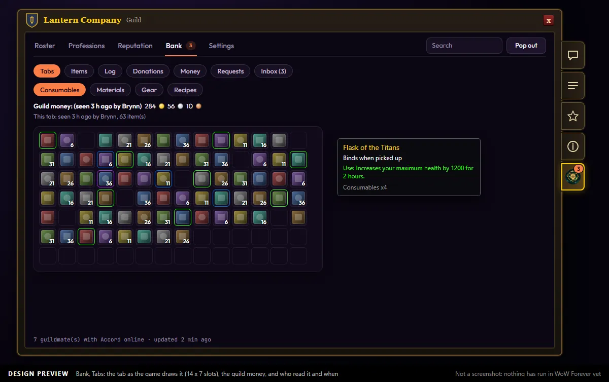
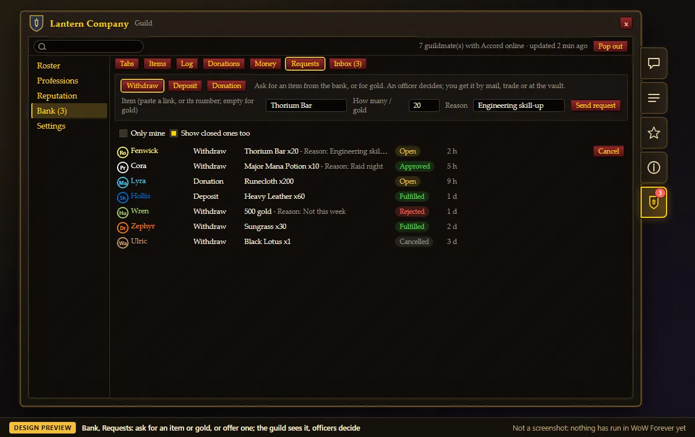
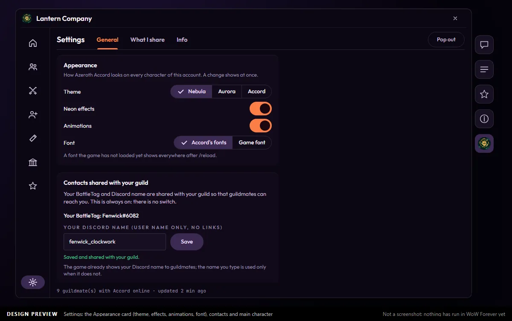

# Azeroth Accord

**A richer guild window for World of Warcraft: Forever.** Azeroth Accord adds an **Accord** tab to the game's guild window with what the default panel lacks: an extended roster with professions and recipes, all the characters of the same account, Battle.net and Discord contacts, likes between guildmates, a social index that shows whether the guild plays together or splits into cliques, and the guild bank with withdrawal, deposit and donation requests.

> **Status: milestones M1 (foundations), M2 (roster), M3 (professions), M4 (reputation), M5 (guild bank) and M6 (settings, Italian, polish, diagnostics, packaging, images) are complete in code and wait for the in-game checks** ([M1](docs/checklists/M1.md), [M2](docs/checklists/M2.md), [M3](docs/checklists/M3.md), [M4](docs/checklists/M4.md), [M5](docs/checklists/M5.md), [release](docs/checklists/release.md)): the Accord tab, the standalone window, the guild sync, the **Roster** view (sortable, filterable, grouped by account), the **member card**, the characters of an account, **contacts** (BattleTag, Discord, friend request), the Settings view, the silent co-play recording, and now the **Professions** view exist: a member's recipe list opened from a profession cell, **who can craft** an item (online members first, grouped by player) and **Request craft**, a whisper with the recipe link that you send yourself. With M4 the **Reputation** view adds **likes** (from the member card or the view: anonymous, one per player, recorded by an online officer's addon), the **social index** (your own; officers see everyone's), the **group map** for officers and **Someone new** to play with; With M5 the **Bank** view shows the guild bank from the last visit of any member with the addon (tab by tab, the money, a searchable list of items; tabs your rank cannot see stay hidden), keeps the **bank log** beyond the game's (without duplicates), ranks the **donations** per player and draws the guild's money over time, and runs the **requests** (withdraw, deposit, donation: a member asks, officers approve, reject or mark as fulfilled; officers see a counter on the tab and an inbox, and everybody is told when their request is decided). The interface is also in **Italian**. Every milestone is published as a test version for the owner's guild once its check passes, `v0.1.0` to `v0.6.0` (fixes raise the last number, as in `v0.6.1`); there is no download yet. The next milestones, M7 to M15, are planned in the [roadmap](ROADMAP.md); `v1.0.0` comes when they are all done. With M6 the **Settings** page (main character, bank notices, Roster columns, saved data and *Clear guild data*) is in the Accord panel and in the game's own settings window; see [Settings](docs/wiki/Settings.md). The manual now has pictures: design previews of every main view (not screenshots).

[Italiano](README.it.md) · [Roadmap](ROADMAP.md) · [Specification (Italian)](docs/specs/README.md) · [Decisions](docs/adr/README.md) · [User manual](docs/wiki/Home.md)

## What it looks like

| | |
|---|---|
|  |  |
|  |  |
|  |  |
|  |  |

> **Design previews, not screenshots.** They are drawn from the addon's own layout and texts, with invented characters and items and original art, because the addon has not been run in the game yet. [All previews](docs/specs/mockups/previews/README.md) · [how they are made](docs/specs/mockups/README.md).

## Planned features

| Area | What you get |
|---|---|
| **Accord tab** | A fifth tab under Chat, Roster, Guild Benefits and Guild Info; the same panel can pop out in its own window (`/accord`) |
| **Extended roster** | Sortable, filterable table: level, class, rank, zone, last online, profession 1 and 2, likes, social index, contacts |
| **Alts** | Click a character to see every character of the same Battle.net account on the realm, without asking |
| **Contacts** | BattleTag and Discord of every member using the addon, one click to copy, native "Add BattleTag friend" |
| **Professions** | Click a member's profession to see their recipes; search "who can craft…"; send a craft request |
| **Likes** | One like from each account to each other account, never to yourself, irreversible, anonymous totals |
| **Social index** | How many different guildmates each player really groups with (effective partners), a map of the guild's groups, and "play with someone new" suggestions |
| **Guild bank** | Bank contents from the last visit of any member, logs, donations, withdrawal and deposit requests approved by officers |

Everything stays **inside your guild**: the addon talks only over the guild's hidden addon channels, with no server, no internet and no telemetry.

## How it is built

- Target: WoW Forever, `## Interface: 16001` ([ADR 0002](docs/adr/0002-wow-forever-target-and-api-dump.md)); Lua 5.1 with embedded Ace3.
- Guild-only peer-to-peer data with simple trust rules: you can only write your own data; likes and bank approvals come from officers ([ADR 0005](docs/adr/0005-trust-first-hand-records-and-officer-relays.md)).
- Native game data first, data shared by members' addons as fallback ([ADR 0010](docs/adr/0010-native-data-first-shared-data-as-fallback.md)).
- Offline tests with a mock client and a network simulator ([ADR 0016](docs/adr/0016-offline-tests-with-lupa-and-a-mock-client.md)).

## Contributing

See [CONTRIBUTING.md](CONTRIBUTING.md). Issues, pull requests and public docs are in English; the specification is in Italian.

## Licence

[GNU GPL v3.0](LICENSE). Fan-made addon, not affiliated with Blizzard Entertainment.
