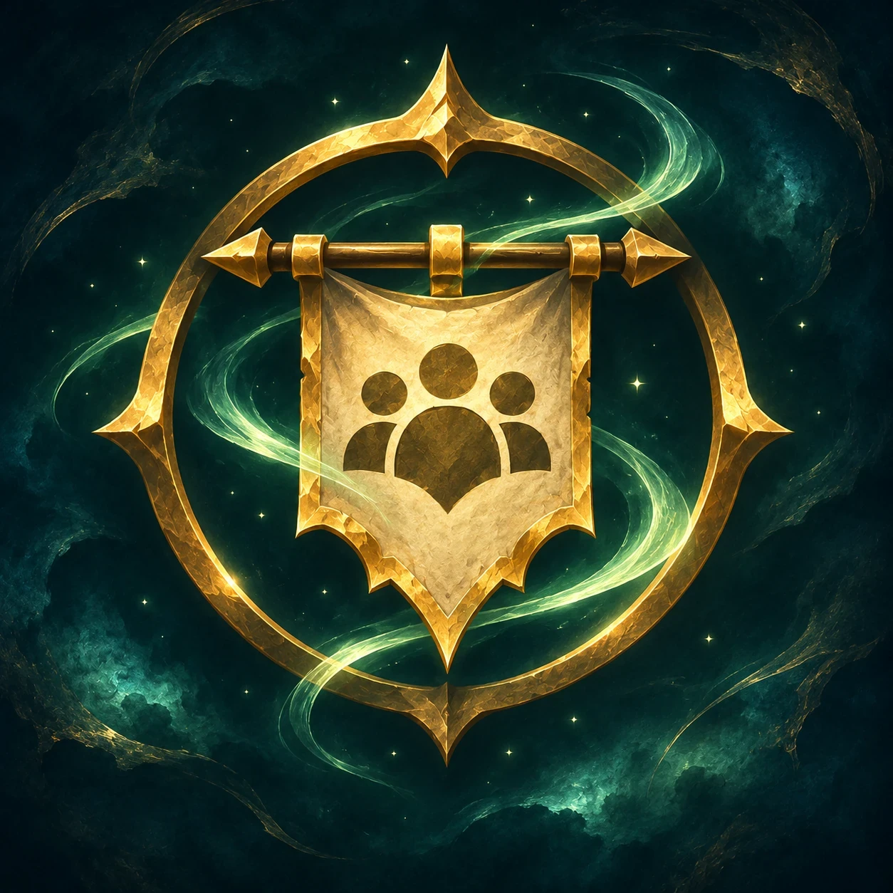

# Azeroth Accord

**A richer guild window for World of Warcraft: Forever.** Azeroth Accord adds an **Accord** tab to the game's guild window with what the default panel lacks: an extended roster with professions and recipes, all the characters of the same account, Battle.net and Discord contacts, likes between guildmates, a social index that shows whether the guild plays together or splits into cliques, and the guild bank with withdrawal, deposit and donation requests.

> **Status: milestones M1 (foundations), M2 (roster), M3 (professions), M4 (reputation), M5 (guild bank), M6 (settings, Italian, polish, diagnostics, packaging, images), M7 (data trust: provenance labels, the guild of alts, demo mode, personal backup, "What I share", hardening) M8 (officer tools: roster timeline, inactive accounts, cleanup queue to do by hand, officer notes, export; bank requests picked from the bank with an optional tip), M9 (Action Center: one inbox, notices, quiet hours, login digest; the guild group finder; guild addons) M10 (calendar, raids, season roster) and M11 (loot and the guild handbook) are complete in code. The latest release is `v0.12.0`** (2026-11-27), after `v0.11.0`, `v0.10.0`, `v0.9.0` and `v0.8.0`: test versions published, by the owner's decision, before the in-game checks, which are still open ([M1](docs/checklists/M1.md), [M2](docs/checklists/M2.md), [M3](docs/checklists/M3.md), [M4](docs/checklists/M4.md), [M5](docs/checklists/M5.md), [M7](docs/checklists/M7.md), [M8](docs/checklists/M8.md), [M9](docs/checklists/M9.md), [M10](docs/checklists/M10.md), [release](docs/checklists/release.md)): the Accord tab, the standalone window, the guild sync, the **Roster** view (sortable, filterable, grouped by account), the **member card**, the characters of an account, **contacts** (BattleTag, Discord, friend request), the Settings view, the silent co-play recording, and now the **Professions** view exist: a member's recipe list opened from a profession cell, **who can craft** an item (online members first, grouped by player) and **Request craft**, a whisper with the recipe link that you send yourself. With M4 the **Reputation** view adds **likes** (from the member card or the view: anonymous, one per player, recorded by an online officer's addon), the **social index** (your own; officers see everyone's), the **group map** for officers and **Someone new** to play with; With M5 the **Bank** view shows the guild bank from the last visit of any member with the addon (tab by tab, the money, a searchable list of items; tabs your rank cannot see stay hidden), keeps the **bank log** beyond the game's (without duplicates), ranks the **donations** per player and draws the guild's money over time, and runs the **requests** (withdraw, deposit, donation: a member asks, officers approve, reject or mark as fulfilled; officers see a counter on the tab and an inbox, and everybody is told when their request is decided). The interface is also in **Italian**. Download it from the repository's *Releases* page and expect problems: nobody has verified it on WoW Forever yet. From M9 on, each completed milestone is released as `v0.<milestone>.0` (fixes raise the last number, as in `v0.8.1`). **M9 came with `v0.9.0`**, not yet checked in the game ([M9 checklist](docs/checklists/M9.md)): the **Action Center** (one list of what waits on you) with its **notification centre** (a history of notices, with chat line, on-screen box or sound), **quiet hours** (notices wait in combat, in instances and in the hours you choose) and a **summary at login** of what changed since your last session ([Action Center](docs/wiki/Action-Center.md)); a **group finder for the guild only** (listings with roles, applications to the leader by whisper, invitations, a **Groups** view, and the same group also listed **privately** in the game's own Group Finder with one click of the leader, if the game allows it: [Groups](docs/wiki/Groups.md)); and the **Guild addons** table (which addons the members use, with a count for each; who uses one is shown to officers only; a switch stops sharing your list: [Guild addons](docs/wiki/Guild-Addons.md)). The next milestones, M12 to M16, are planned in the [roadmap](ROADMAP.md); `v1.0.0` comes when they are all done. **M12 (recruitment, trials and mentors) came with `v0.12.0`**, with the in-game checks pending ([M12 checklist](docs/checklists/M12.md)): a recruitment text for officers built from the season roster's gaps, to copy and post yourself; the trials of new members, seen by officers only; a welcome checklist for new members; and mentors who offer themselves, with suggested pairs for officers. **M13 (guild economy) is in progress**: its craft orders (an order from *Request craft*, delivered only when both sides confirm; the addon never moves gold or items), a personal wishlist the guild can see, a **buy and sell board** (a deal is closed only when both players confirm it), the summed material demand of the open orders and a private **shopping list** (owned/needed from your bags, bank, mail and alts, kept on your computer only; prices from Auctionator if you use it) are in the code but **hidden until M13 is complete**. The interface follows the Material 3 rules ([ADR 0027](docs/adr/0027-material-3-rules-adapted-to-accord.md)): colour roles, components, every view and the pictures are done (M12.6 to M12.8), not yet checked in the game. With M6 the **Settings** page (the **Appearance** card: theme Nebula, Aurora or Accord, neon effects, animations and font; main character, bank notices, Roster columns, saved data and *Clear guild data*) is in the Accord panel and in the game's own settings window; see [Settings](docs/wiki/Settings.md). The manual now has pictures: design previews of every main view (not screenshots). M6 continued with steps M6.8 to M6.18 (M6.8 to M6.18 are done: the new look is complete): Accord takes the look of the owner's other addon, Finland Dragon Credit Points (themes, fonts, title bar and tabs; every view is drawn in it now, and so are the pictures; M6.18 dresses the guild window around the Accord panel in the theme too: its frame, the guild's name, the cross and the side tabs), and gains an About page with the credits and an Italian manual (done in M6.17: every wiki page has its Italian twin). **M10 (calendar, raids, season roster) came with `v0.10.0`**, with the in-game checks pending ([M10 checklist](docs/checklists/M10.md)): the detection of the raid and loot addons and the guild's choice of the source of the season roster; the **Season** view, where each raider declares MS1, MS2 and OS and everybody sees the role counts and gaps ([Season roster](docs/wiki/Season-Roster.md)); the **Events** view to sign up to the guild's events on the game calendar itself, with bench and composition and PvP and world rallies ([Events](docs/wiki/Events.md)); the **Raid-Helper** events of the guild's Discord brought into the game by pasting their export ([Raid-Helper events](docs/wiki/Raid-Helper.md)); and the **availability map** of when the guild usually plays ([Availability](docs/wiki/Availability.md)). **M11 (loot and the guild handbook) came with `v0.11.0`**, with the in-game checks pending ([M11 checklist](docs/checklists/M11.md)): the **guild handbook**, read and written in the game, with its revisions, writers by rank and default pages ([Guild handbook](docs/wiki/Guild-Handbook.md)); its **loot page**, with the guild's loot system and addon and who has it; and the **Raid** view reading FDCP ([Raid and Loot Addons](docs/wiki/Raid-and-Loot-Addons.md)). With M8.2 officers also see a **Timeline** on the member card: the joins, leaves, rank and level changes and public-note changes their addons observed in the roster, kept forever and shared only among officers (never with the guild); Accord only watches the roster and never changes it. With M8.3 officers get the **Officers** tab: the **inactive players** (counted per account, so somebody who only plays an alt is not inactive) in tiers the officers choose (14, 30, 60 and 90 days by default), and the Timeline of the whole guild; a member can **declare an absence** with a return date, seen only by the officers. With M8.4 a **cleanup review** fills a queue of actions the officer does by hand in the game window, and with M8.5 officers write longer **officer notes** on the member card (up to 500 characters, kept forever, shared only among officers and deleted from the computer of an officer who is demoted). With M8.6 officers **export** the roster, the inactive accounts and the timeline as CSV or as text for Discord, from a box to copy (never officer notes or account codes).

[Italiano](README.it.md) · [Roadmap](ROADMAP.md) · [Specification (Italian)](docs/specs/README.md) · [Decisions](docs/adr/README.md) · [User manual](docs/wiki/Home.md) ([Italiano](docs/wiki/Home-it.md))

## What it looks like

| | |
|---|---|
|  |  |
|  |  |
|  |  |
|  |  |
|  |  |

> **Design previews, not screenshots.** They are drawn from the addon's own layout and texts, in the new look (Nebula, the default theme, and a few in Aurora and Accord), with invented characters and items and original art, because the addon has not been run in the game yet. [All previews](docs/specs/mockups/previews/README.md) · [how they are made](docs/specs/mockups/README.md) · [beside Finland Dragon Credit Points](docs/specs/mockups/compare/README.md).

## Planned features

| Area | What you get |
|---|---|
| **Accord tab** | A fifth tab under Chat, Roster, Guild Benefits and Guild Info; the same panel can pop out in its own window (`/accord`) |
| **Extended roster** | Sortable, filterable table: level, class, rank, zone, last online, profession 1 and 2, likes, social index, contacts |
| **Alts** | Click a character to see every character of the same Battle.net account on the realm, without asking |
| **Contacts** | BattleTag and Discord of every member using the addon, one click to copy, native "Add BattleTag friend" |
| **Professions** | Guild recipes: every recipe of a profession, its required level and who in the guild can craft it; click a member's profession to see their recipes, learned and missing; search "who can craft…"; send a craft request |
| **Likes** | One like from each account to each other account, never to yourself, irreversible, anonymous totals |
| **Social index** | How many different guildmates each player really groups with (effective partners), a map of the guild's groups, and "play with someone new" suggestions |
| **Guild bank** | Bank contents from the last visit of any member, logs, donations, withdrawal requests (picked from the bank contents, with an optional tip) and deposit requests approved by officers |
| **Action Center** *(from `v0.9.0`)* | One list of what waits on you (bank and craft requests, officer actions, absences, applicants), a history of notices with chat line, on-screen box or sound, quiet hours, and a short summary at login |
| **Guild group finder** *(from `v0.9.0`)* | Groups for dungeons, raids, quests or help, seen by the guild only: roles, applications to the leader, invitations; optionally listed privately in the game's Group Finder |
| **Guild addons** *(from `v0.9.0`)* | Which addons the members with Accord use, with counts and versions; names for officers only; a switch stops sharing yours |
| **Season roster** *(from `v0.10.0`)* | Each raider declares once per season MS1 with its role, MS2, OS and a note, or "not sure yet"; only their own entry, locked after 30 minutes; officers open the seasons and set a target composition; everybody sees the role counts, the gaps and who has not declared, officers export them as CSV or Discord text; with FDCP as the source, FDCP's pool instead |
| **Events** *(from `v0.10.0`)* | The guild's events of the game calendar, whoever created them; sign up, tentative or decline from Accord and the answer goes into the game calendar itself, so FDCP and the game see it; your role preselected from your season declaration; events kept in Accord only when the client has no calendar, marked so; officers place who signed up in the raid or on the bench against the target composition, MS2 offered for a short role, and every member sees their place (none in Accord with FDCP as the source) |
| **Raid-Helper events** *(from `v0.10.0`)* | An officer pastes the export (JSON or CSV) of a Raid-Helper event; sign-ups are matched to members by their Discord name across alts; officers compare them with the game calendar and the season roster and, after a confirmation, write the event and the answers into the calendar without changing an answer given in the game; export back to Discord. Accord never contacts Discord or Raid-Helper |
| **Availability map** *(from `v0.10.0`)* | When the guild usually plays, by day and hour: each client counts only the time its account is online over the last 8 weeks (no raids, no attendance); counts for everybody, names for officers; a switch stops sharing yours |
| **PvP and world rallies** *(from `v0.10.0`)* | A quick call with a meeting point in words and a start time, answered *coming* or *not coming*; it expires by itself; no coordinates are ever shared |
| **Raid and loot addons** *(detection and season source from `v0.10.0`; the rest from `v0.11.0`)* | Works with the guild's loot addon instead of replacing it: the known addons are detected and the officers can choose Finland Dragon Credit Points as the source; the handbook's loot page names the guild's loot system and addon (any loot addon on CurseForge), where to get it and who has it, with FDCP's loot rules beside it; the **Raid** view shows FDCP's season pool (MS1, MS2, OS) and the night's lineup and bench, and the member card shows a member's credits and place in the loot queue, all read-only; no loot engine and no attendance in Accord |
| **Guild handbook** *(from `v0.11.0`)* | Text pages (guild info, rules, FAQ, raids, roster, loot) that officers and chosen ranks write in the game and every member reads, also offline, with updated pages marked, search, revisions and conflict handling |
| **Recruitment text** *(from `v0.12.0`)* | An officer gets an advert built from the season roster's gaps and the guild's description, as a chat line or a Discord text, to copy and post by hand; the addon never posts it |
| **Trials, welcome and mentors** *(from `v0.12.0`)* | Officers follow members on trial, with private notes and a reminder on the end day; a new member gets a short welcome checklist that ticks itself; members offer to mentor, and officers see suggested pairs |
| **Personal backup** | `/accord backup` exports your own data (characters, main, settings, your own records, the account token) to a text and imports it on another computer, after checking it and showing what changes; other players' data is never in it |
| **Demo mode** | `/accord demo` fills every view with an invented guild, with no guild and no network: nothing is sent or saved, and your real data comes back untouched |
| **Robust sync** | A damaged, oversized or forged message is refused, a guildmate's addon that floods the channel is ignored for 10 minutes, guilds of up to 1000 members with the addon sync with a compact block summary (tried in the network simulator), and Forever full names with a space ("Name Surname") work everywhere |

Everything stays **inside your guild**: the addon talks only over the guild's hidden addon channels, with no server, no internet and no telemetry.

## How it is built

- Target: WoW Forever, `## Interface: 16001` ([ADR 0002](docs/adr/0002-wow-forever-target-and-api-dump.md)); Lua 5.1 with embedded Ace3.
- Guild-only peer-to-peer data with simple trust rules: you can only write your own data; likes and bank approvals come from officers ([ADR 0005](docs/adr/0005-trust-first-hand-records-and-officer-relays.md)).
- Native game data first, data shared by members' addons as fallback ([ADR 0010](docs/adr/0010-native-data-first-shared-data-as-fallback.md)).
- Offline tests with a mock client and a network simulator ([ADR 0016](docs/adr/0016-offline-tests-with-lupa-and-a-mock-client.md)).

## Contributing

See [CONTRIBUTING.md](CONTRIBUTING.md). Issues, pull requests and public docs are in English; the specification is in Italian.

## Credits

- **Created and designed by Finland.**
- **Made with the Italian guild NEBULA** ([the guild's page](https://nebula-community.github.io/giochi/wow-forever/)). The NEBULA logo is used with the guild's permission.
- Support the project on [Ko-fi](https://ko-fi.com/finland6738); report a problem or suggest something in the [issues](https://github.com/Finland6738/azeroth-accord/issues).
- In the game the same credits are on the **Info** page of Settings (`/accord about`); `/accord about chat` prints them in the chat. The manual has them too: [About and credits](docs/wiki/About.md).
- Azeroth Accord is a fan-made addon, not made by and not affiliated with Blizzard Entertainment.

## Font credits

The addon bundles three font families under the [SIL Open Font License 1.1](https://openfontlicense.org/) (the licence texts are next to the files in `AzerothAccord/Media/Fonts/`): **Outfit** (The Outfit Project Authors), **JetBrains Mono** (The JetBrains Mono Project Authors) and **Orbitron** (Matt McInerney, shipped unmodified because it declares a Reserved Font Name). Every font, the icon sheet, the textures, the logos and the libraries are listed with their licences in [docs/third-party.md](docs/third-party.md).

## Licence

[GNU GPL v3.0](LICENSE). Fan-made addon, not affiliated with Blizzard Entertainment.
