# Development roadmap

One file per milestone; each file lists the **development steps** of that milestone. A step is one branch and one pull request, shipped automatically with `tools/ship_step.py` when its checks are green ([ADR 0012](../adr/0012-git-flow-and-automated-shipping.md)). The short overview is in [ROADMAP.md](../../ROADMAP.md); the behaviour every step implements is in the [specification](../specs/README.md).

| Milestone | File | Goal | Steps | Needs the real client |
|---|---|---|---|---|
| **M0** | [M0-spike.md](M0-spike.md) | Answer the open technical questions in the real client | 8 | yes, the whole milestone |
| **M1** | [M1-foundations.md](M1-foundations.md) | Addon skeleton, tests, Compat, data store, transport, sync, the Accord tab | 9 | final check |
| **M2** | [M2-roster.md](M2-roster.md) | Extended roster, alts, member card, contacts, co-play recording | 7 | final check |
| **M3** | [M3-professions.md](M3-professions.md) | Recipes per member, "who can craft", craft requests | 6 | final check |
| **M4** | [M4-reputation.md](M4-reputation.md) | Likes, social index, group map, suggested teammates | 7 | final check |
| **M5** | [M5-guild-bank.md](M5-guild-bank.md) | Bank snapshots, logs, donations, requests | 7 | final check |
| **M6** | [M6-release.md](M6-release.md) | Settings, Italian, polish, diagnostics, packaging, images, the ecosystem look of FDCP, About and credits, Italian wiki, v0.6.0 | 17 | release checklist |
| **M7** | [M7-data-trust.md](M7-data-trust.md) | Provenance, guild of alts outside the guild, demo, backup, "what I share", hardening | 8 | final check |
| **M8** | [M8-officer-tools.md](M8-officer-tools.md) | Roster timeline, inactivity, cleanup wizard, manual-ops queue, notes, export, bank requests from the bank with a tip | 8 | final check |
| **M9** | [M9-action-center.md](M9-action-center.md) | Action Center, notifications, quiet hours, login digest; guild-only group finder; Guild addons table | 10 | final check |
| **M10** | [M10-calendar-raids.md](M10-calendar-raids.md) | Season roster, sign-ups on the game calendar, Raid-Helper events from Discord, composition, availability, rallies; raid and loot addons detected, one source per datum | 10 | final check |
| **M11** | [M11-loot-handbook.md](M11-loot-handbook.md) | Guild handbook pages; loot system and addon documented, detected in the guild, FDCP read through its API | 8 | final check |
| **M12** | [M12-recruitment.md](M12-recruitment.md) | Recruitment, trials, onboarding, mentors; the Material 3 rules applied to the interface (ADR 0027) | 9 | final check |
| **M13** | [M13-economy.md](M13-economy.md) | Craft orders, materials, shopping list, wishlist, buy and sell board, goals | 8 | final check |
| **M14** | [M14-board-polls.md](M14-board-polls.md) | Board, MOTD history, polls, kudos | 6 | final check |
| **M15** | [M15-community.md](M15-community.md) | Opt-in community features | 6 | final check |
| **M16** | [M16-quests.md](M16-quests.md) | Guild quests: the quests in every guild character's log, who has each one | 6 | final check |
| **M17** | [M17-professions.md](M17-professions.md) | Professions assistant: a 1–300 route computed by Accord, owned/needed materials, a tracker with Create; gathering and Forever skills | 7 | final check |
| **M18** | [M18-group-finder.md](M18-group-finder.md) | Guild group finder like the game's: groups list and detail, role slots with level ranges and recommended classes, three-step create; v1.0.0 | 7 | final check and full release check |
| — | [V2-backlog.md](V2-backlog.md) | Where the first ideas went, what is not planned, what stays out | — | — |

**Releases.** The first is `v0.8.0` (2026-11-25), covering M1 to M8, tagged before the in-game checks by the owner's decision; `v0.1.0` to `v0.7.0` are not tagged. From M9 on, `v0.<N>.0` follows each completed milestone, with the unfinished pieces of later ones hidden ([RELEASING](../RELEASING.md)). M10 is complete in code (its switch is on since M10.10, in-game check pending); M11 is complete in code (its switch `raid` is on since M11.8, in-game check pending).

## Order and dependencies

```mermaid
flowchart LR
  M0[M0 Spike] --> M1[M1 Foundations] --> M2[M2 Roster] --> M3[M3 Professions] --> M4[M4 Reputation] --> M5[M5 Guild bank] --> M6[M6 Release]
  M6 --> M7[M7 Data trust] --> M8[M8 Officer tools] --> M9[M9 Action Center] --> M10[M10 Calendar and raids] --> M11[M11 Loot and handbook]
  M11 --> M12[M12 Recruitment] --> M13[M13 Economy] --> M14[M14 Board and polls] --> M15[M15 Community] --> M16[M16 Quests] --> M17[M17 Professions] --> M18[M18 Group finder] --> V1[v1.0.0]
```



Every milestone ends with its in-game check and its version, `v0.N.0`; fixes raise the last number; `v1.0.0` follows M18 ([ADR 0020](../adr/0020-one-version-per-milestone.md)). Each milestone from M7 on opens with a step that writes its specification in `docs/specs/` (SPEC-11 to SPEC-22), in Italian, before any code.

M0 can change the plan: each check names the specs and ADRs it may revise. M1 may start on the specification's assumptions while the owner runs the probe; M0.8 then revises what the results contradict.

## How a step is written

```
### M<N>.<k> — Title
- Branch:      step/m<N>-<k>-<short-name>
- Depends on:  previous steps
- Spec:        the sections it implements
- Scope:       what it creates or changes
- Done when:   acceptance criteria (checkboxes)
- Tests:       offline tests that must exist and pass
- Docs:        what to update in the same pull request
- Real client: what only the game can confirm (listed in the PR as "not verified")
```

## Definition of done (every step)

- [ ] The acceptance criteria of the step are met.
- [ ] `python -I -X utf8 tools/check_docs.py` and, from M1.2 on, `python -X utf8 Tests/run_tests.py` pass locally and in CI.
- [ ] `CHANGELOG.md` ("Unreleased"), the affected specs and ADRs, both READMEs when features or status change, and `docs/wiki/` for anything a user can see are updated in the same pull request.
- [ ] The pull request lists what was **not** verified in the real client.
- [ ] No personal data; every new API is checked against the Forever dump and guarded by Compat.
- [ ] The step's checkboxes in its milestone file are ticked in the same pull request.
