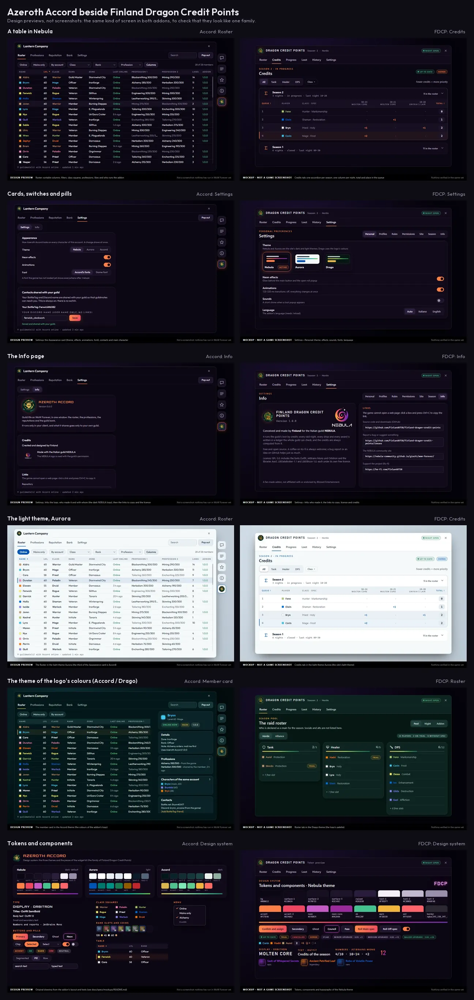

# Azeroth Accord beside Finland Dragon Credit Points

The interface of Azeroth Accord follows the look of Finland Dragon Credit Points (FDCP), the owner's other addon ([ADR 0021](../../../adr/0021-interface-follows-the-ecosystem-style-of-fdcp.md), [`ui-style.md`](../../ui-style.md)): the same tokens, shapes, type and widgets, with Accord's own third theme. This sheet is the check that the two still look like one family: in each row the left picture is a design preview of Accord (`../previews/`, `../img/clean/`) and the right one a design preview of FDCP showing the same kind of screen.

| Row | What to look at |
|---|---|
| A table in Nebula | the header in capitals on a rounded bar, the sorted column in the accent colour with an arrow, 28-point rows with a thin line, the selected row tinted, class squares before the names |
| Cards, switches and pills | cards with rounded corners and a soft top light, switches and segmented pills, the primary button with its glow, copy boxes |
| The Info page | the logo, the title in the display face, the credits, the links in boxes, the NEBULA logo |
| The light theme, Aurora | white cards on a light grey page, dark text, blue accent, no glow, class names in the text colour |
| The theme of the logo's colours | Accord (green and gold) beside FDCP's Drago, the two themes that come from a logo |
| Tokens and components | the colour tokens of the themes and the pieces of the kit, side by side |

The two sets are **drawings made in a browser**: font smoothing, exact spacing and the frame of the game's guild window (an original imitation in Accord's previews) differ from the real client, and neither addon has been looked at in the real client yet ([the release check](../../../checklists/release.md), step 7, does that).

Made by `python tools/make_compare.py` (Pillow; it reads, and never changes, `../finland-dragon-credit-points/docs/specs/mockups/` next to this repository). The sheet is a committed picture: rerun the tool after the previews of either addon change. The labels are set in Outfit (SIL OFL 1.1).
