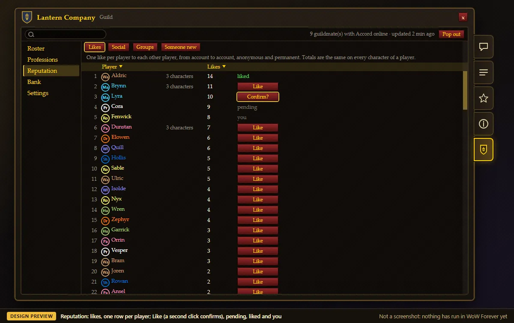
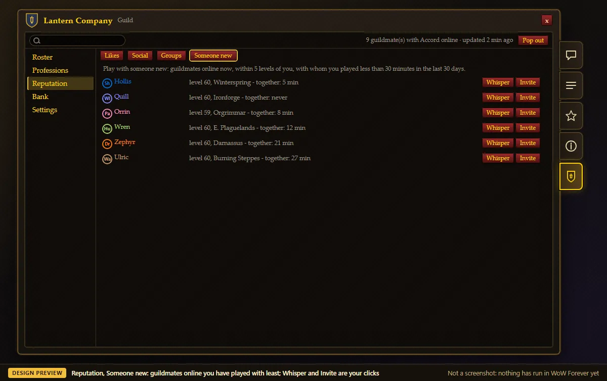
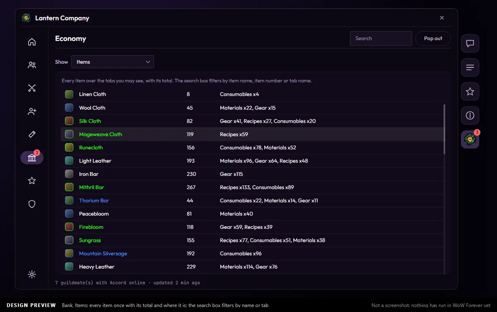
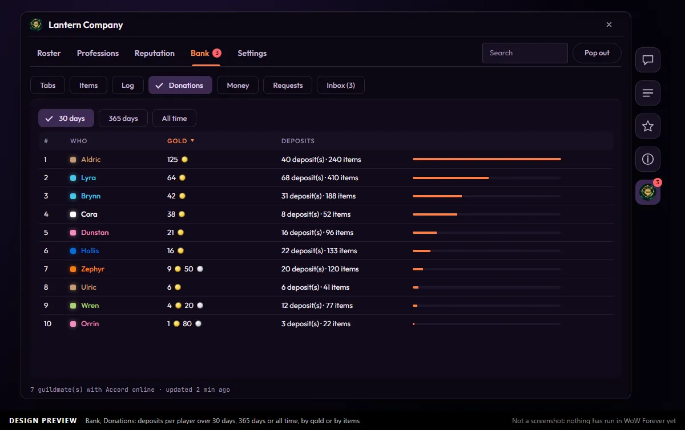
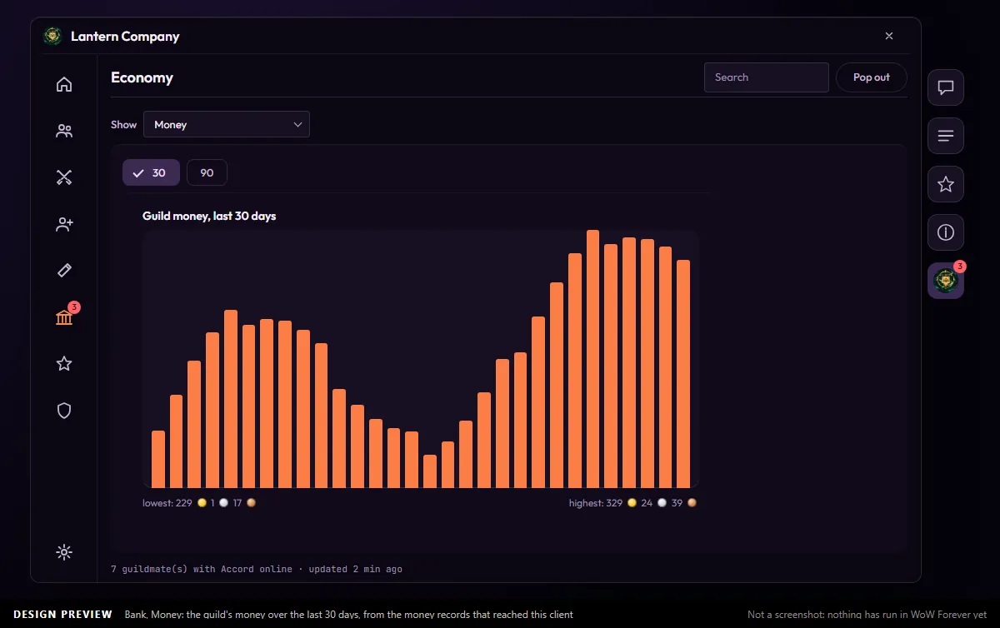
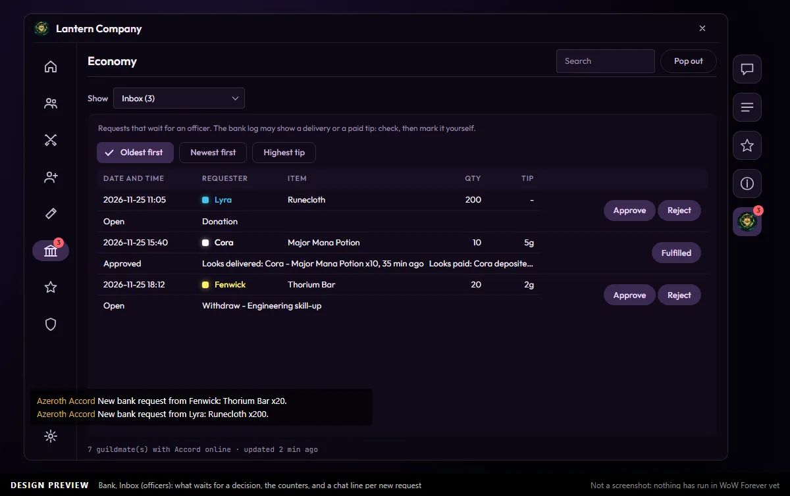
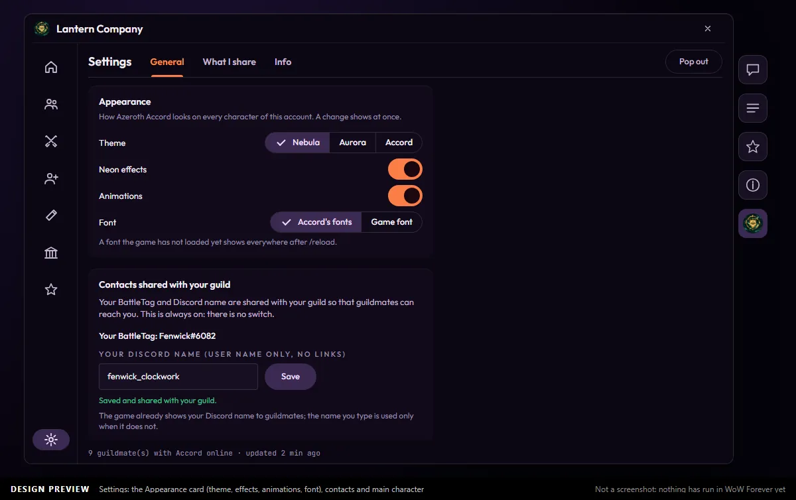

# Interface previews

One image for each main view of the Azeroth Accord interface, so you can see what the addon looks like before you install it.

> **Design previews, not screenshots.** They are drawn from the addon's own layout and texts (`UI/*.lua`, `Locale/enUS.lua`, `Locale/itIT.lua`) in the look of the game's guild window, with original art (CSS shapes: no game screenshot, icon or texture is used) and invented characters, guild and items. Nothing has been run in the WoW Forever client yet, so the real window may differ in small details (the game's own fonts and textures, icons, exact spacing). Every image says so in its bottom strip.

The images are generated by `tools/make_mockups.py` (`python -X utf8 tools/make_mockups.py`): rerun it after a change of the interface. The scenes are in `tools/mockup_scenes.py` and `tools/mockup_scenes2.py`; the design system and the annotated screens are in [`../html/`](../html/) and [`../img/`](../img/).

## The Accord tab

| Preview | What it shows |
|---|---|
|  | **accord-tab-roster** The Accord tab in the guild window: a fifth tab under the game's four, and the Roster in its panel |
|  | **window-standalone** The standalone window (/accord, Pop out): the same panel in a window you can move and resize |

## Roster and member card

| Preview | What it shows |
|---|---|
|  | **roster-table** Roster: sortable columns, filters, class-coloured names, professions, likes and who runs the addon |
|  | **roster-grouped** Roster grouped by account: the main leads each player, a click on + shows the alts |
|  | **member-card** Member card: details, professions and their source, the account's characters, contacts, likes, social index |

## Professions

| Preview | What it shows |
|---|---|
|  | **professions-recipes** Professions: a guildmate's recipe list with its source and age, search, categories and Request craft |
|  | **professions-who-can-craft** Who can craft: search an item or recipe and see the guildmates who know it, online first |

## Reputation

| Preview | What it shows |
|---|---|
|  | **reputation-likes** Reputation: likes, one row per player; Like (a second click confirms), pending, liked and you |
|  | **reputation-social-index** Reputation, Social: your own index, what it measures, and (officers) every player's index |
|  | **reputation-group-map** Reputation, Groups (officers): how mixed the guild is, and its communities as circles of players |
|  | **reputation-someone-new** Reputation, Someone new: guildmates online you have played with least; Whisper and Invite are your clicks |

## Guild bank

| Preview | What it shows |
|---|---|
|  | **bank-tabs** Bank, Tabs: the tab as the game draws it (14 x 7 slots), the guild money, and who read it and when |
|  | **bank-items** Bank, Items: every item once with its total and where it is; the search box filters by name or tab |
|  | **bank-log** Bank, Log: the game's short log merged over every visit of guildmates with the addon, without duplicates |
|  | **bank-donations** Bank, Donations: deposits per player over 30 days, 365 days or all time, by gold or by items |
|  | **bank-money** Bank, Money: the guild's money over the last 30 days, from the money records that reached this client |
|  | **bank-requests** Bank, Requests: ask for an item or gold, or offer one; the guild sees it, officers decide |
|  | **bank-inbox** Bank, Inbox (officers): what waits for a decision, the counters, and a chat line per new request |

## Settings and diagnostics

| Preview | What it shows |
|---|---|
|  | **settings** Settings: contacts, main character, notices and Roster columns (also in the game's settings window) |
|  | **settings-saved-data** Settings, saved data: what the addon keeps on this computer, and Clear guild data (two clicks) |
|  | **diagnostics-box** /accord debug: the report in a box, already selected, to paste into a bug report (no names) |

## Italian interface

| Preview | What it shows |
|---|---|
|  | **it-roster** Interfaccia italiana: il Roster nella scheda Accord della finestra di gilda |
|  | **it-bank-requests** Interfaccia italiana: le richieste alla banca, con i pulsanti degli ufficiali |
|  | **it-settings** Interfaccia italiana: la pagina Impostazioni |
