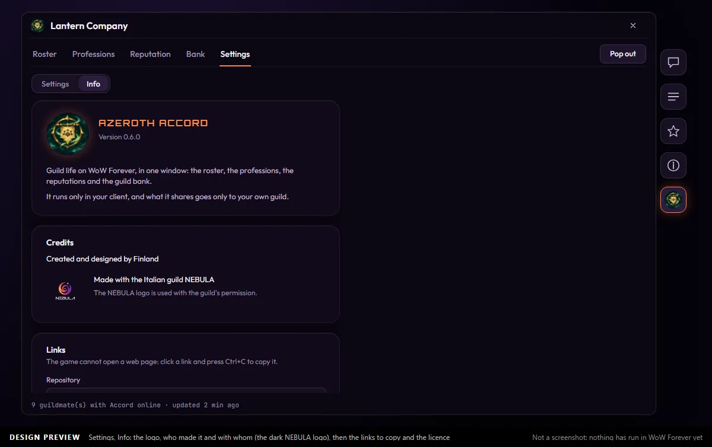
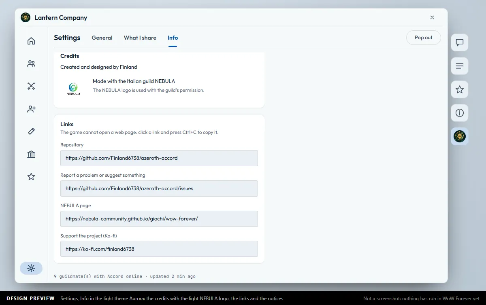

# Informazioni e crediti

*English: [[About and credits|About]]*

**Azeroth Accord** è un addon di gilda per World of Warcraft: Forever: una sola finestra con il roster, le professioni, le reputazioni e la banca di gilda. Funziona solo nel tuo client, e quello che condivide va solo alla tua gilda ([[Privacy e dati|Privacy-and-Data-it]]).

## Crediti

- **Creato e progettato da Finland.**
- **Realizzato con la gilda italiana NEBULA.** Il logo di NEBULA è usato con il permesso della gilda.
- **Icone:** [Material Symbols Rounded](https://github.com/google/material-design-icons) di Google, con licenza **Apache License 2.0**. Sono le icone dell'interfaccia di Accord; classi, oggetti e ricette tengono le icone del gioco.

## Nel gioco

Gli stessi crediti sono nella pagina **Info** delle Impostazioni: aprila con `/accord about`, oppure con il pulsante **Info** in alto nella vista Impostazioni (anche nella finestra delle impostazioni del gioco, sotto *Opzioni → AddOn → Azeroth Accord*). La pagina mostra il logo e la versione dell'addon, i crediti con il logo di NEBULA (quello scuro nei temi Nebula e Accord, quello chiaro in Aurora), i link, la licenza e le note.

*Anteprime di progetto, non screenshot: sono disegnate dal layout e dai testi dell'addon (qui in inglese), con personaggi e oggetti inventati, perché l'addon non è ancora stato provato nel gioco ([tutte le anteprime](https://github.com/Finland6738/azeroth-accord/blob/main/docs/specs/mockups/previews/README.md), anche in italiano).*

`/accord about chat` scrive invece i crediti e i link in chat.

Il gioco non può aprire una pagina web, quindi ogni link è una casella: fai clic, il testo si seleziona, premi **Ctrl+C** e incollalo nel browser. Le caselle non si possono modificare.

## Link

| Cosa | Indirizzo |
|---|---|
| Repository | https://github.com/Finland6738/azeroth-accord |
| Segnala un problema o suggerisci qualcosa | https://github.com/Finland6738/azeroth-accord/issues |
| Pagina di NEBULA | https://nebula-community.github.io/giochi/wow-forever/ |
| Sostieni il progetto (Ko-fi) | https://ko-fi.com/finland6738 |

## Licenza e note

Azeroth Accord è software libero con licenza **GNU GPL v3.0**. I font, le immagini e le librerie incluse, con la licenza di ciascuna, sono elencati in [docs/third-party.md](https://github.com/Finland6738/azeroth-accord/blob/main/docs/third-party.md) (in inglese).

Azeroth Accord è un addon creato dai fan. Non è realizzato da Blizzard Entertainment e non è affiliato a Blizzard Entertainment.
