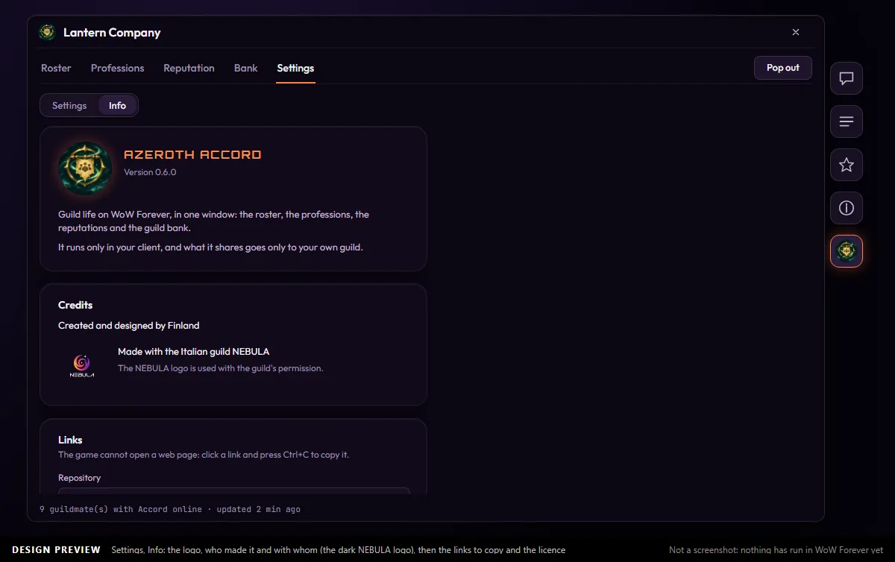
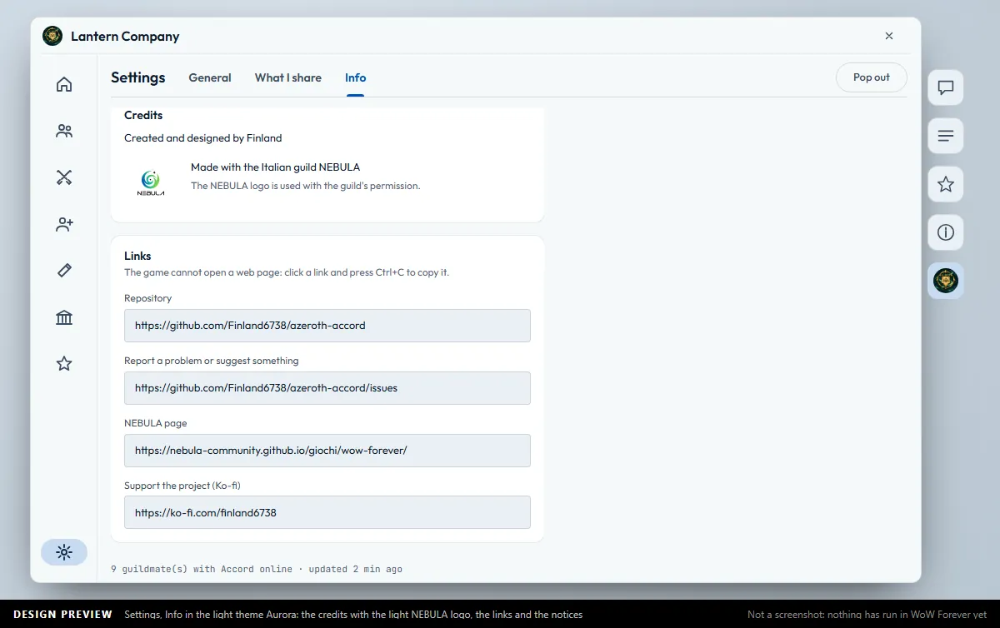

# About and credits

*Italiano: [[Informazioni e crediti|About-it]]*

**Azeroth Accord** is a guild addon for World of Warcraft: Forever: one window with the roster, the professions, the reputations and the guild bank. It runs only in your client, and what it shares goes only to your own guild ([[Privacy and Data|Privacy-and-Data]]).

## Credits

- **Created and designed by Finland.**
- **Made with the Italian guild NEBULA.** The NEBULA logo is used with the guild's permission.
- **Icons:** [Material Symbols Rounded](https://github.com/google/material-design-icons) by Google, under the **Apache License 2.0**. They are the icons of Accord's own interface; classes, items and recipes keep the icons of the game.

## In the game

The same credits are on the **Info** page of Settings: open it with `/accord about`, or with the **Info** button at the top of the Settings view (also in the game's own settings window, under *Options → AddOns → Azeroth Accord*). The page shows the addon's logo and version, the credits with the NEBULA logo (the dark one on the Nebula and Accord themes, the light one on Aurora), the links, the licence and the notices.

*Design previews, not screenshots: drawn from the addon's own layout and texts with invented characters and items, because the addon has not been run in the game yet ([all previews](https://github.com/Finland6738/azeroth-accord/blob/main/docs/specs/mockups/previews/README.md)).*

`/accord about chat` prints the credits and the links in the chat instead.

The game cannot open a web page, so every link is a box: click it, the text is selected, press **Ctrl+C** and paste it into your browser. The boxes cannot be edited.

## Links

| What | Address |
|---|---|
| Repository | https://github.com/Finland6738/azeroth-accord |
| Report a problem or suggest something | https://github.com/Finland6738/azeroth-accord/issues |
| NEBULA page | https://nebula-community.github.io/giochi/wow-forever/ |
| Support the project (Ko-fi) | https://ko-fi.com/finland6738 |

## Licence and notices

Azeroth Accord is free software under the **GNU GPL v3.0**. The fonts, the pictures and the libraries that come with it, and the licence of each, are listed in [docs/third-party.md](https://github.com/Finland6738/azeroth-accord/blob/main/docs/third-party.md).

Azeroth Accord is a fan-made addon. It is not made by, and not affiliated with, Blizzard Entertainment.
