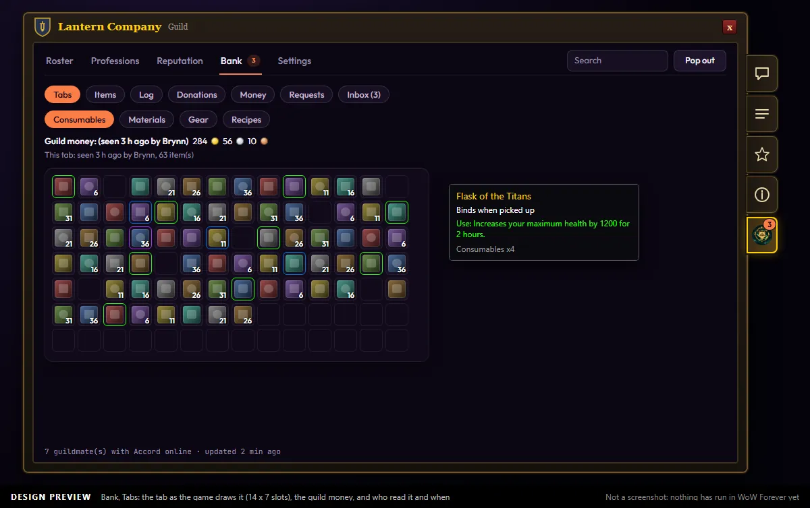
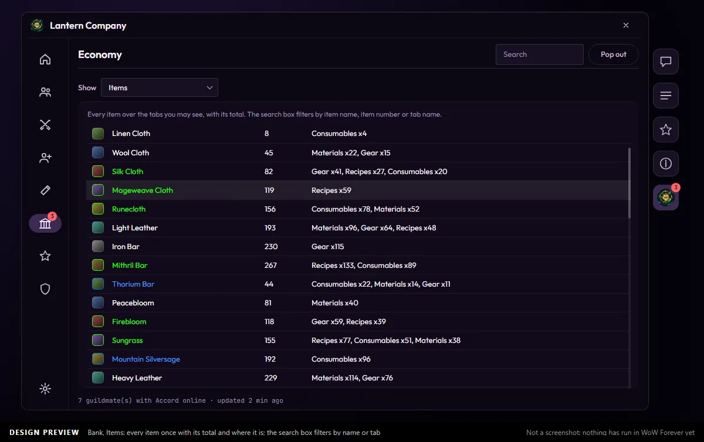
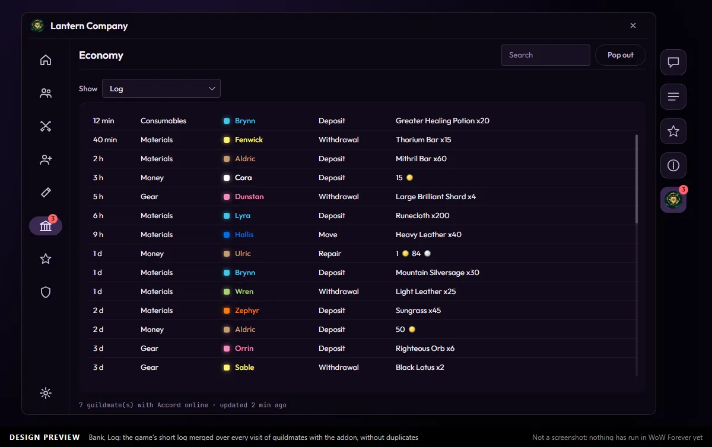
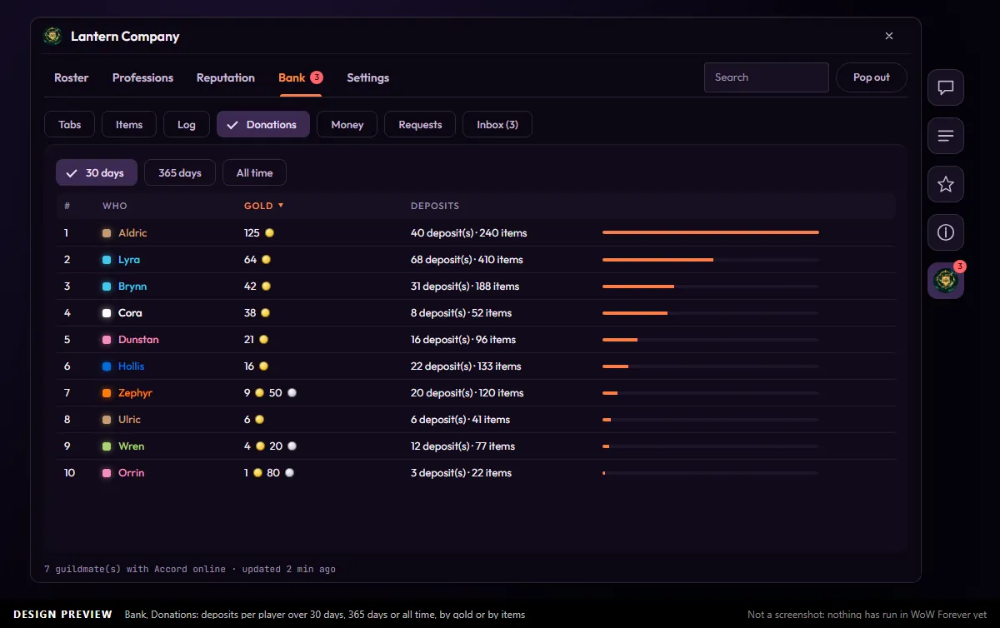
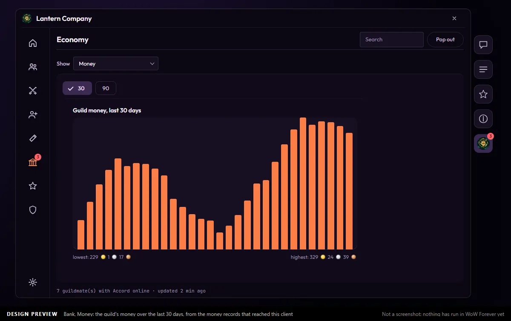
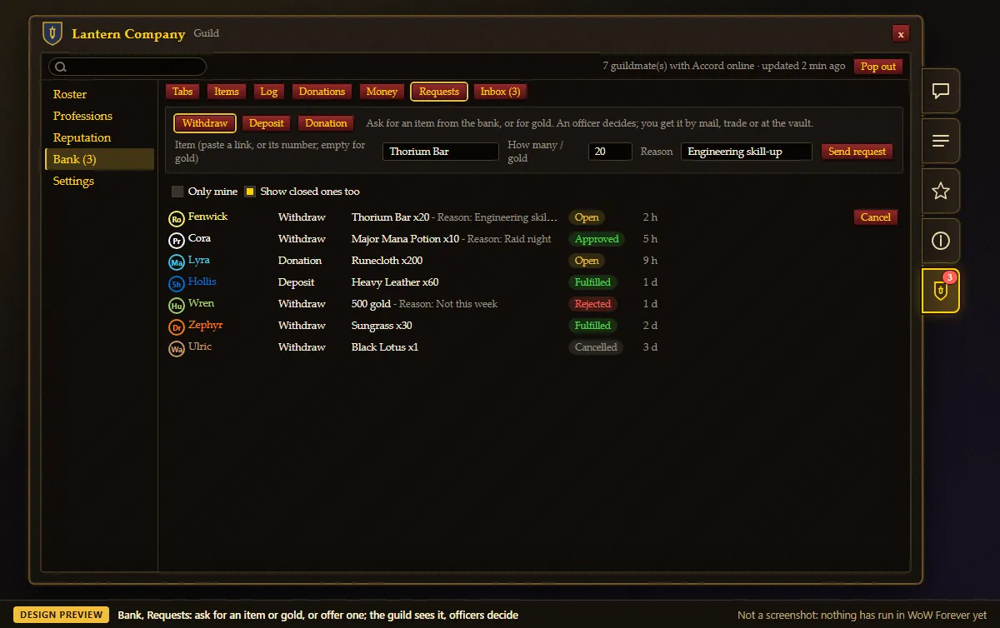
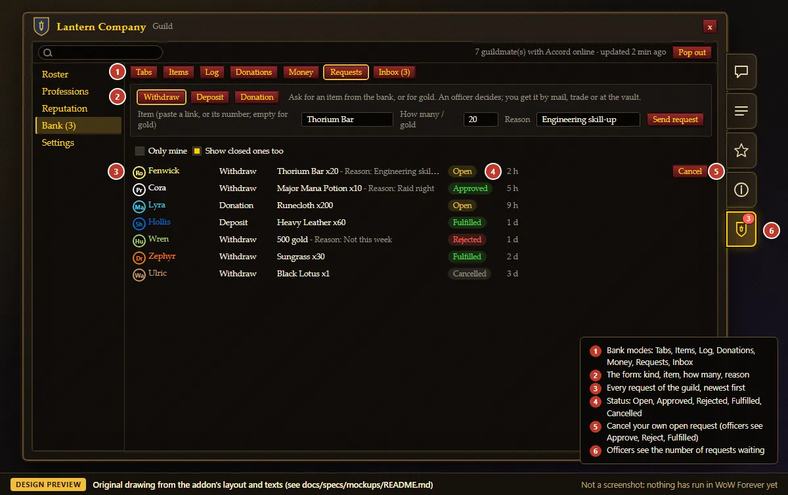
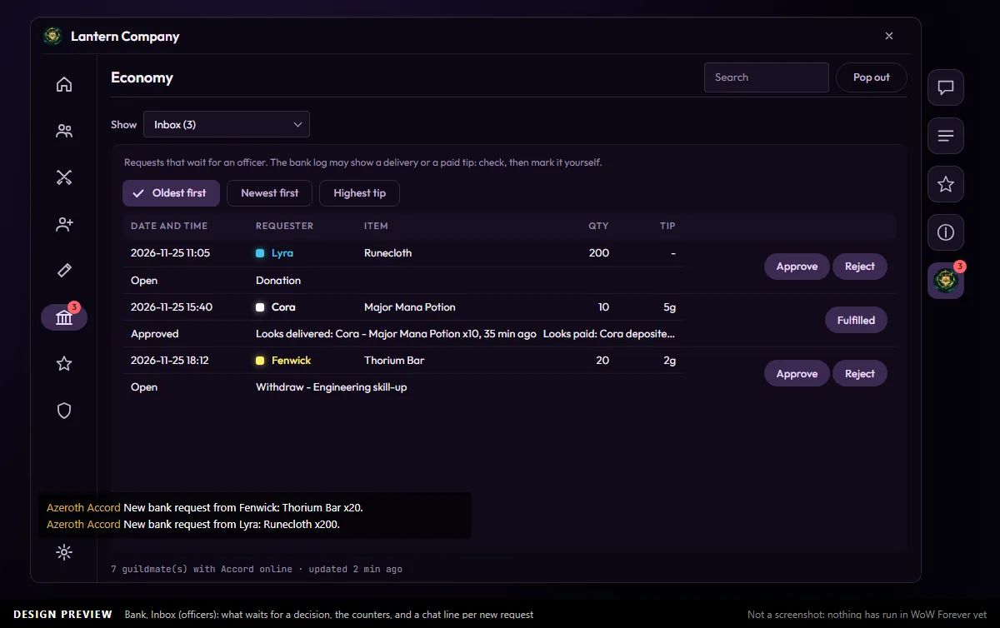

# Banca di gilda

*English: [[Guild Bank|Guild-Bank]]*

> Disponibile dal primo rilascio (`v0.8.0`). L'addon non è ancora stato provato nel gioco vero: le prime prove sono con la gilda del proprietario (la prova nel gioco è [docs/checklists/M5.md](https://github.com/Finland6738/azeroth-accord/blob/main/docs/checklists/M5.md), in inglese).

- Il gioco mostra la banca solo alla cassaforte. Ogni volta che un compagno con l'addon la apre, l'addon salva cosa contiene ogni scheda e lo condivide, quindi la vista **Banca** funziona ovunque. Ogni scheda mostra quanto è vecchio il suo contenuto.
- Le schede che il tuo grado non può vedere nel gioco restano nascoste anche nell'addon.
- **Registri e donazioni**: depositi e prelievi si raccolgono nel tempo; l'elenco delle donazioni mostra chi ha aiutato la gilda negli ultimi 30 giorni, nell'ultimo anno e in totale.
- **Richieste**: scegli un oggetto dal contenuto della banca e di' quanti, con una mancia facoltativa in oro, chiedi dell'oro (*Prelievo*), offri un oggetto (*Deposito*) o prometti una *Donazione*. Gli ufficiali approvano o rifiutano e la segnano come consegnata; la consegna avviene nel gioco (posta, scambio o cassaforte).

## Chi vede cosa

- Ciò che vedi alla cassaforte è condiviso con la gilda, così un compagno che non va mai alla cassaforte lo vede lo stesso, vecchio quanto la tua visita.
- Il gioco non dice all'addon quali gradi possono vedere una scheda, solo se *il tuo* grado può. Quindi una scheda che leggi è mostrata ai membri del tuo grado e superiori. Una scheda letta da un **ufficiale** è condivisa solo con gli ufficiali (sul canale degli ufficiali) e non arriva mai ai computer dei membri. Se tutti i gradi possono vedere una scheda ma solo gli ufficiali hanno aperto la cassaforte, i membri vedono quella scheda quando l'ha aperta anche un membro.

## La vista Banca

Aprila con la scheda **Banca** del pannello o con `/accord bank`. Le modalità (Schede, Oggetti, In arrivo per gli ufficiali, Richieste, Registro, Donazioni, Denaro) sono nel menu **Mostra** in alto nella vista *(dalla `v0.13.0`; prima, una fila di pulsanti)*. La Banca è una pagina dell'icona **Economia** della barra di navigazione.

- **Schede**: un pulsante per ogni scheda che puoi vedere, il denaro della gilda e quanto è vecchio, e la scheda disposta come nel gioco (14 colonne di 7 slot). Sotto i pulsanti delle schede leggi *vista 2 h fa da Bob*: l'età del contenuto e il compagno il cui addon l'ha letto. Passa il mouse su un oggetto per il suo suggerimento.
- **Oggetti**: una riga per oggetto su tutte le schede che puoi vedere, con il totale e dove si trova. La casella di ricerca del pannello filtra per nome dell'oggetto, numero dell'oggetto o nome della scheda.
- Quando non c'è ancora nulla da mostrare, la vista lo dice: qualcuno deve aprire la cassaforte una volta.

## Registri, donazioni e denaro

- **Registro**: chi ha depositato o prelevato cosa, dal più recente. Il gioco tiene solo una breve storia e la mostra solo alla cassaforte; l'addon aggiunge alla storia ogni visita di un compagno con l'addon, senza elencare due volte lo stesso evento, così cresce oltre quella del gioco. Cerca per nome o oggetto. Clicca il titolo di una colonna per ordinare (un secondo clic inverte).
- **Donazioni**: cosa ha depositato ogni giocatore (oro e oggetti) negli ultimi 30 giorni, negli ultimi 365 giorni o da sempre (i pulsanti in alto scelgono il periodo; clicca il titolo di una colonna, *Oro*, *Oggetti* o *Depositi*, per cambiare l'ordine), tutti i personaggi di un giocatore insieme. Prelievi e riparazioni non contano. L'elenco è visibile a ogni membro (il proprietario può limitarlo agli ufficiali).
- **Denaro**: come è cambiato il denaro della gilda negli ultimi 30 giorni, da ciò che gli addon hanno visto, e sotto il grafico il registro dell'oro (quando, chi, cosa, somma), ordinabile dai titoli.

## Richieste

Nella modalità **Richieste** della vista Banca puoi:

- **Prelievo**: chiedere un oggetto dalla banca, o dell'oro; **Deposito**: offrire un oggetto; **Donazione**: promettere oggetti o oro. Aggiungi quanti (o quante monete d'oro) e un motivo, poi premi *Invia richiesta*. Puoi avere cinque richieste aperte alla volta. I chip *Solo le mie* e *Mostra anche le chiuse* sotto il modulo filtrano l'elenco.
- Ogni compagno vede ogni richiesta. Puoi **annullare** la tua finché è ancora aperta.
- Gli **ufficiali** rispondono con *Approva*, *Rifiuta* (la casella del motivo diventa il motivo del rifiuto) e *Consegnata*. Passa il mouse su una riga per leggere la sua storia. Solo gli ufficiali possono cambiare lo stato di una richiesta: gli altri addon ignorano qualsiasi altra cosa.
- L'addon non sposta mai oggetti o oro: dopo un'approvazione l'oggetto ti arriva per posta, scambio o alla cassaforte, come decidono gli ufficiali.

### Scegliere un oggetto dalla banca

- In un **Prelievo**, clicca la casella dell'oggetto: un elenco mostra gli oggetti delle schede della banca che puoi vedere, ognuno con la quantità disponibile. Scrivi parte del nome (o il numero dell'oggetto) per restringerlo, e clicca una riga.
- La riga sotto la casella dice quanti ce ne sono in banca e quanto è vecchia quella foto (l'etichetta dell'età: passaci sopra per vedere chi ha letto la banca; dopo sette giorni si attenua). La quantità si ferma al disponibile, e non supera mai 9999.
- Un oggetto che nell'elenco non c'è (foto vecchia, scheda che non vedi, nessuna foto ancora): incolla il suo link o scrivi il numero. Allora vale solo il limite 1–9999. Lascia la casella vuota per chiedere oro.
- *Deposito* e *Donazione* offrono qualcosa che hai: incolla un link o scrivi il numero.

### La mancia

- Quando chiedi un oggetto puoi promettere una **mancia** in monete d'oro intere, fino a 10000 (vuota o 0 per nessuna). È una semplice donazione alla banca di gilda, non una scommessa né un prezzo: gli ufficiali decidono la tua richiesta come ritengono.
- La mancia è una **promessa**. L'addon non sposta mai oro: la paghi tu depositando l'oro nella banca di gilda.
- Chi la vede: tutta la gilda, come il resto della richiesta. In `v0.8.0` l'addon la mostra solo a te (e ai tuoi altri personaggi), agli ufficiali e al Guild Master.
- Una volta inviata la mancia non si cambia: annulla la richiesta e mandane una nuova.
- Un compagno con una versione più vecchia dell'addon vede la richiesta senza la mancia.

## Per gli ufficiali: la casella e gli avvisi

*Anteprime di progetto, non screenshot: sono disegnate dal layout e dai testi dell'addon (qui in inglese), con personaggi e oggetti inventati, perché l'addon non è ancora stato provato nel gioco ([tutte le anteprime](https://github.com/Finland6738/azeroth-accord/blob/main/docs/specs/mockups/previews/README.md), anche in italiano).*

- Un distintivo rosso con un numero compare sulla scheda Accord della finestra della gilda (e sulla scheda Banca del pannello e sull'icona Economia della barra) quando ci sono richieste che aspettano te. I membri non lo vedono mai.
- La modalità **In arrivo** elenca ciò che aspetta un ufficiale: le richieste aperte da approvare o rifiutare, quelle approvate da segnare come *Consegnata*. Ogni riga mostra **data e ora**, chi ha chiesto, l'oggetto, la quantità e la mancia. Parte dalla più vecchia; clicca il titolo di una colonna per ordinarla, per esempio *Data e ora* per avere prima le più recenti o *Mancia* per la mancia più alta. L'ultima colonna dice il motivo della richiesta, o che sembra consegnata o pagata.
- Quando il registro della banca mostra il movimento corrispondente (chi ha chiesto ha tolto l'oggetto, o l'ha depositato, o l'oro), la riga dice *Sembra consegnata*; la segni comunque tu, perché la consegna resta manuale.
- Quando il registro del denaro mostra un deposito d'oro di chi ha chiesto (un suo personaggio qualsiasi), dopo la richiesta, di almeno la mancia, la riga dice *Sembra pagata*. Un deposito vale per una sola mancia, dalla richiesta più vecchia; più depositi piccoli non si sommano. È solo un indizio: controlla tu. L'addon non registra nulla sul pagamento; dopo che segni la richiesta come consegnata, l'indizio è nel suo suggerimento in *Richieste* (*Mostra anche le chiuse*). Il registro della banca dà orari arrotondati, quindi un deposito vecchio letto tardi può non essere riconosciuto.
- Ricevi una riga in chat quando arriva una nuova richiesta; chi ha chiesto ne riceve una quando approvi, rifiuti o consegni. Gli avvisi non si ripetono mai dopo un ricaricamento, e la prima volta che l'addon gira non annuncia le richieste che esistono già. Dalla `v0.9.0` questi avvisi fanno parte degli avvisi del [[Centro azioni|Action-Center-it]].
