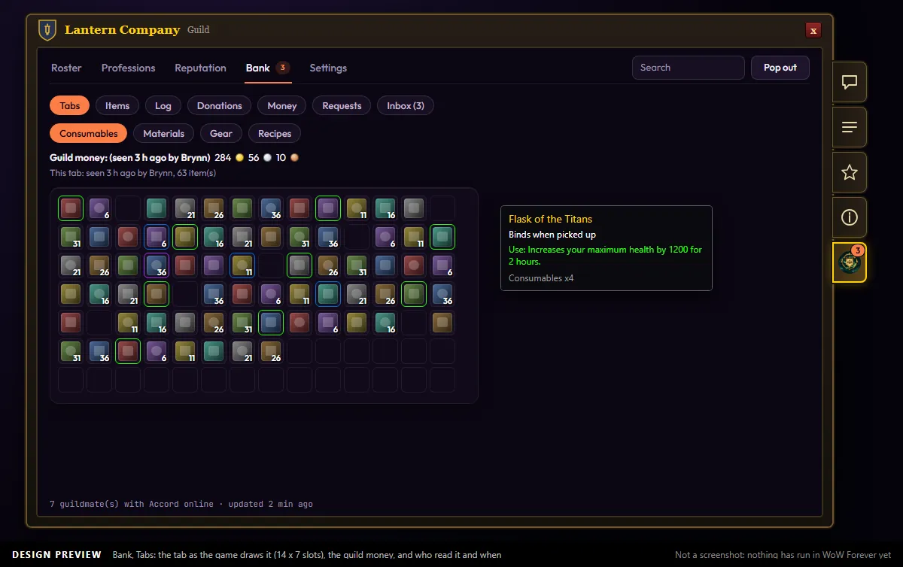
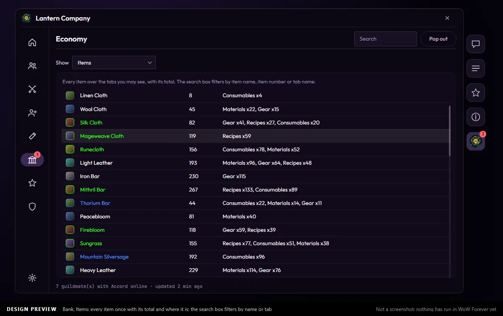
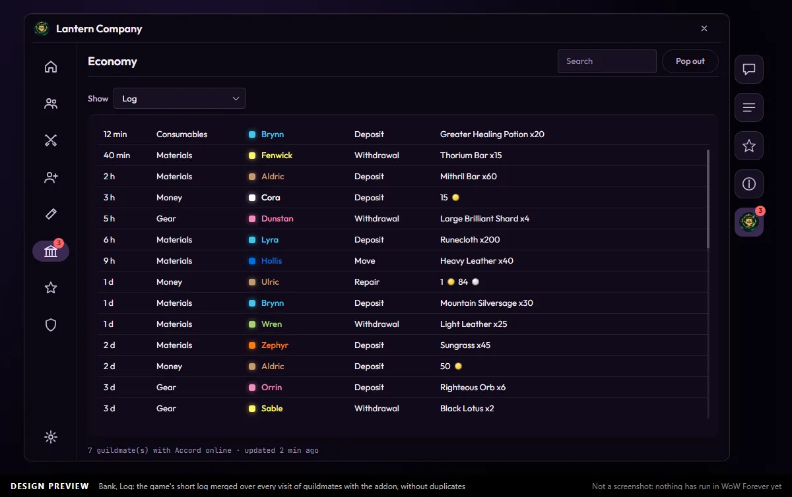
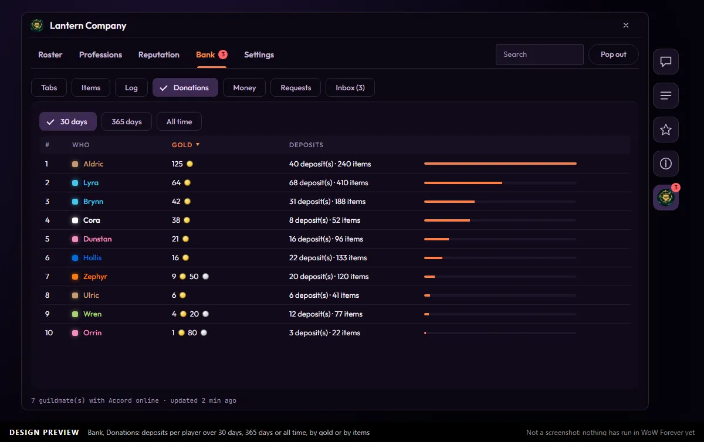
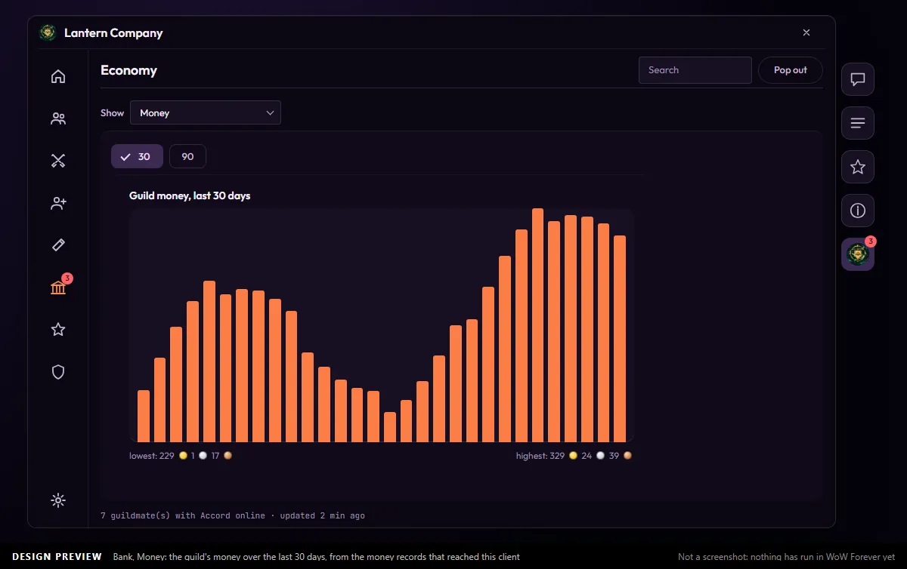
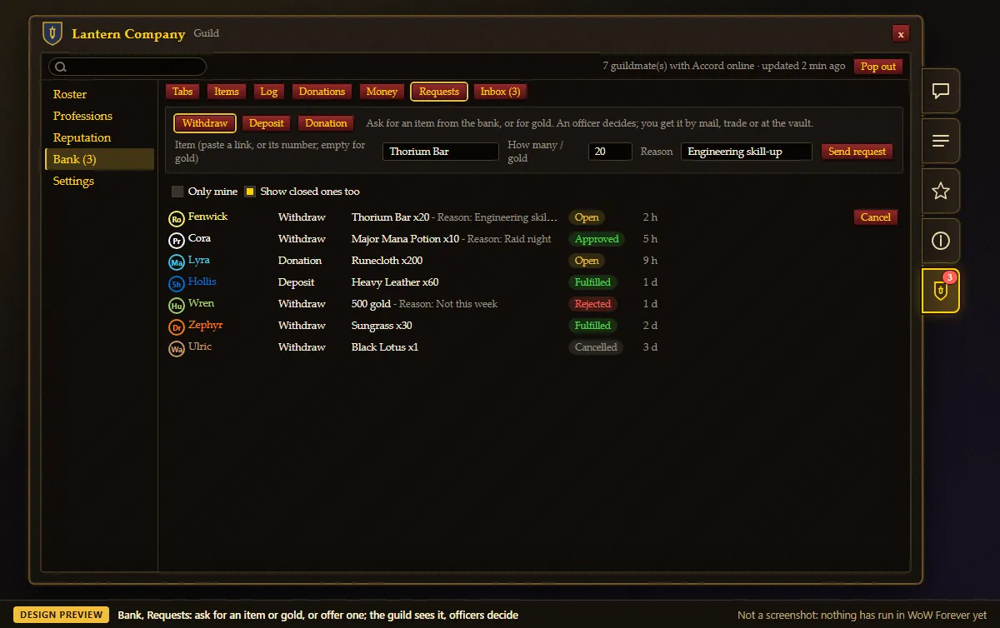
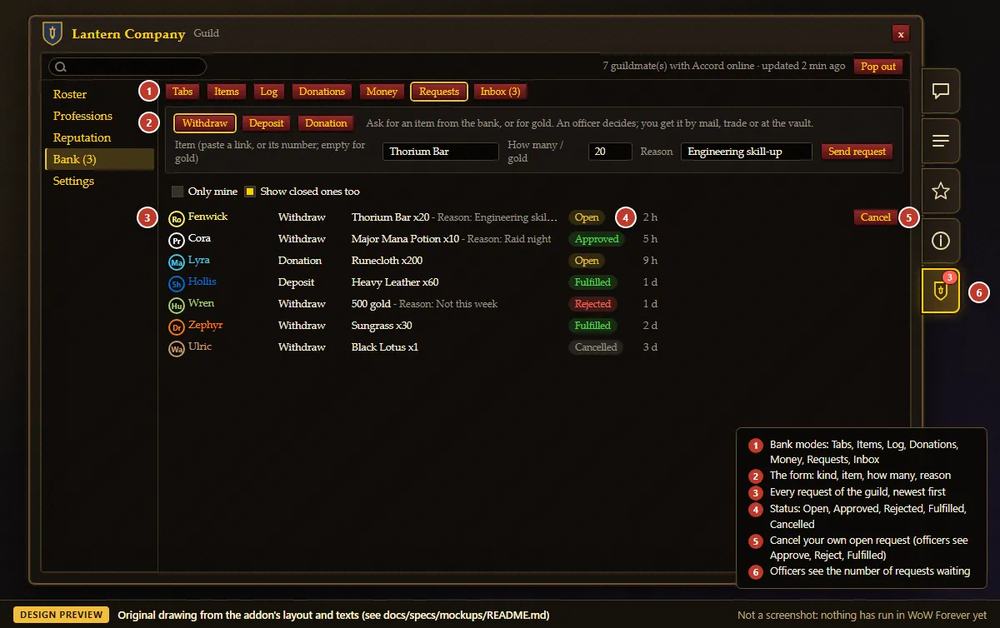
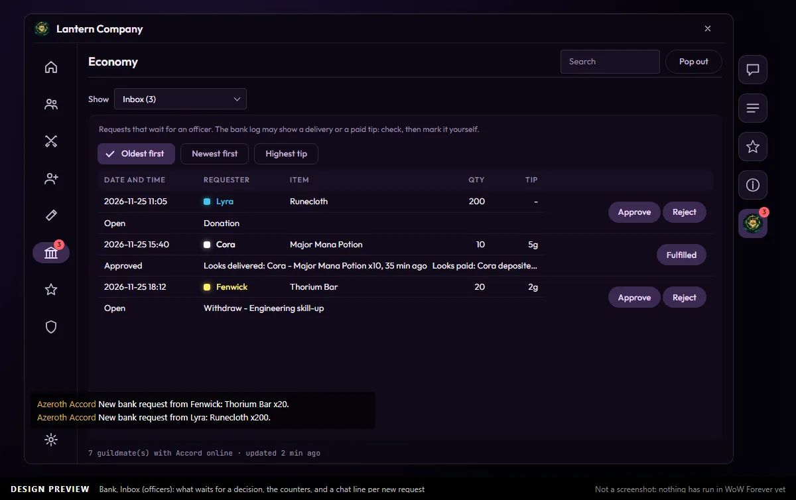

# Guild bank

*Italiano: [[Banca di gilda|Guild-Bank-it]]*

> Available from the first release (`v0.8.0`). The addon has not been checked in the real game yet: the first tests are with the owner's guild (the in-game check is [docs/checklists/M5.md](https://github.com/Finland6738/azeroth-accord/blob/main/docs/checklists/M5.md)).

- The game shows the bank only at the vault. Whenever a guildmate with the addon opens it, the addon saves what each tab holds and shares it, so the **Bank** view works anywhere. Each tab shows how old its contents are.
- Tabs that your rank cannot see in the game stay hidden in the addon too.
- **Logs and donations**: deposits and withdrawals are collected over time; the donations list shows who helped the guild in the last 30 days, the last year and in total.
- **Requests**: pick an item from the bank contents and say how many, with an optional tip in gold, ask for gold (*Withdraw*), offer an item (*Deposit*) or pledge a *Donation*. Officers approve or reject it and mark it as fulfilled; handing the item over happens in the game (mail, trade or the vault).

## Who sees what

- What you see in the vault is shared with the guild so that a guildmate who never visits the vault sees it too, as old as your visit.
- The game does not tell the addon which ranks may see a tab, only whether *your* rank can. So a tab you read is shown to members of your rank and above. A tab read by an **officer** is shared with officers only (on the officer channel) and never reaches the members' computers. If every rank may see a tab but only officers have opened the vault, members see that tab once a member has opened it too.

## The Bank view

Open it with the **Bank** tab of the panel or `/accord bank`. The modes (Tabs, Items, Inbox for officers, Requests, Log, Donations, Money) are the pills at the top of the view.

- **Tabs**: one pill per tab you may see, the guild's money and how old it is, and the tab laid out like in the game (14 columns of 7 slots). Under the tab pills you read *seen 2 h ago by Bob*: the age of the contents and the guildmate whose addon read them. Hover an item for its tooltip.
- **Items**: one row per item over all the tabs you may see, with the total and where it is. The search box of the panel filters by item name, item number or tab name.
- With nothing to show yet, the view says so: somebody must open the vault once.

## Logs, donations and money

- **Log**: who deposited or withdrew what, newest first. The game keeps only a short history and shows it only at the vault; the addon adds every visit of a guildmate with the addon to the history, without listing the same event twice, so it grows beyond the game's. Search by name or item.
- **Donations**: what each player deposited (gold and items) in the last 30 days, the last 365 days or ever (pills at the top choose the period and the order, gold or items), all the characters of a player together. Withdrawals and repairs do not count. The list is visible to every member (the owner may restrict it to officers).
- **Money**: how the guild's money changed over the last 30 days, from what the addons have seen.

## Requests

In the **Requests** mode of the Bank view you can:

- **Withdraw**: ask for an item from the bank, or for gold; **Deposit**: offer an item; **Donation**: promise items or gold. Add how many (or how many gold pieces) and a reason, then press *Send request*. You can have five open requests at once. The chips *Only mine* and *Show closed ones too* under the form filter the list.
- Every guildmate sees every request. You can **cancel** your own while it is still open.
- **Officers** answer with *Approve*, *Reject* (the reason box becomes the reason of the rejection) and *Fulfilled*. Hover over a row to read its history. Only officers can change a request's status: the other addons ignore anything else.
- The addon never moves items or gold: after an approval the item reaches you by mail, trade or at the vault, as the officers decide.

### Picking an item from the bank

- In a **Withdraw**, click the item box: a list shows the items of the bank tabs you can see, each with the quantity available. Type part of a name (or an item number) to narrow it, and click a row.
- The line under the box says how many the bank holds and how old that picture is (the age label: hover it to see who read the bank; it dims after seven days). The quantity stops at what is available, and is never more than 9999.
- An item that is not in the list (an old picture, a tab you cannot see, no picture yet): paste its link or write its number. Then only the 1–9999 limit applies. Leave the box empty to ask for gold.
- *Deposit* and *Donation* offer something you have: paste a link or write the number.

### The tip

- When you ask for an item, you may promise a **tip** in whole gold, up to 10000 (leave it empty or 0 for none). It is a plain donation to the guild bank, not a bet or a price: the officers decide your request as they see fit.
- The tip is a **promise**. The addon never moves gold: you pay it by depositing the gold in the guild bank yourself.
- Who sees it: you (and your other characters), the officers and the Guild Master. The other members do not see it in the addon. It travels with the request, which the whole guild receives, so treat it as hidden from view, not as a secret.
- Once sent, the tip cannot be changed: cancel the request and send a new one.
- A guildmate with an older version of the addon sees the request without the tip.

## For officers: the inbox and the notices

*Design previews, not screenshots: drawn from the addon's own layout and texts with invented characters and items, because the addon has not been run in the game yet ([all previews](https://github.com/Finland6738/azeroth-accord/blob/main/docs/specs/mockups/previews/README.md)).*

- A round mark with a number, in the theme's accent colour, appears on the Accord tab of the guild window (and as a badge on the panel's Bank tab) when requests are waiting for you. Members never see it.
- The **Inbox** mode lists what waits for an officer: open requests to approve or reject, approved ones to mark as *Fulfilled*. Each row shows the **date and time**, who asked, the item, the quantity and the tip. The chips sort it by *Oldest first* (the default), *Newest first* or *Highest tip*.
- When the bank log shows the matching movement (the requester took the item out, or deposited it, or the gold), the row says *Looks delivered*; you still mark it yourself, because handing over stays manual.
- When the money log shows a gold deposit by the requester (any of their characters) after the request, of at least the tip, the row says *Looks paid*. One deposit counts for one tip, the oldest request first; several small deposits are not added up. It is only a hint: check it yourself. The addon records nothing about the payment; after you mark the request as fulfilled, the hint is in its tooltip in *Requests* (*Show closed ones too*). The bank log gives rounded times, so an old deposit read late may not be recognised.
- You get one chat line when a new request arrives; the requester gets one when you approve, reject or fulfil it. Notices are never repeated after a reload, and the first time the addon runs it does not announce the requests that already exist.
