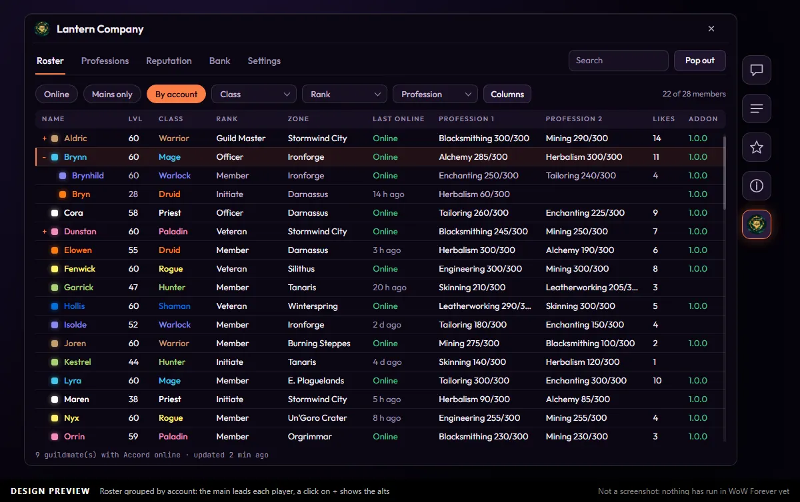
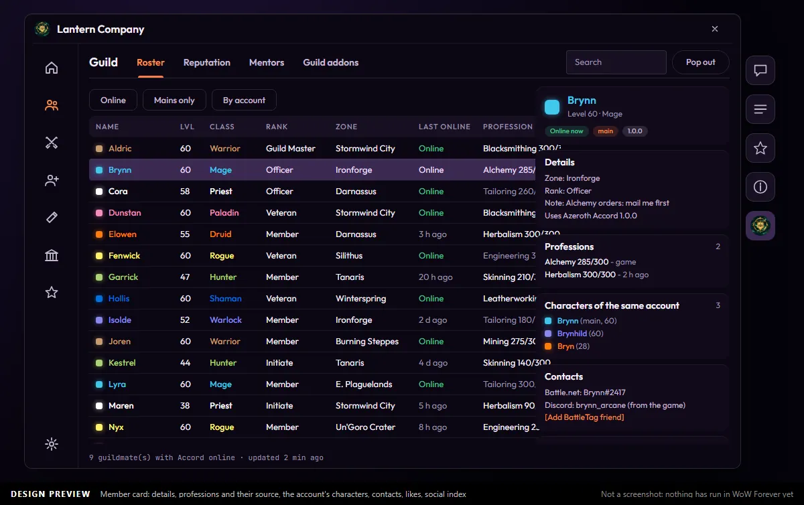
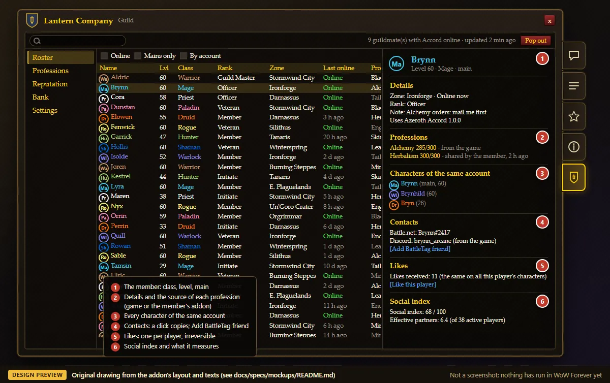

# Roster di gilda

*English: [[Guild Roster|Guild-Roster]]*

> Disponibile dalla versione del roster (milestone M2). Le colonne Like e Sociale arrivano con la milestone M4 (Like: il totale del giocatore, verde quando gli hai dato un like, grigio finché il tuo like è in attesa; Sociale: l'indice sociale, un trattino sotto le 5 ore di gioco di gruppo, mostrato solo agli ufficiali e al Maestro di gilda). Le celle delle professioni aprono le ricette del membro dalla versione delle professioni (milestone M3): vedi [[Professioni e ricette|Professions-and-Recipes-it]].

La vista **Roster** è una tabella di tutti i membri: nome, livello, classe, grado, zona, ultimo accesso, **professione 1** e **professione 2**, like, indice sociale, Battle.net e Discord. Clicca l'intestazione di una colonna per ordinare (un secondo clic inverte; il titolo della colonna ordinata è nel colore d'accento con una freccia, e i membri senza nulla in quella colonna vanno sempre in fondo); usa la casella di ricerca in alto a destra delle schede (nome o professione) e i filtri: i pulsanti *Online*, *Solo main* e *Per account* (accesi finché sono attivi) e gli elenchi *Classe*, *Grado* e *Professione* (la prima voce di ognuno mostra di nuovo tutto); *Colonne* apre un elenco di caselle per scegliere quali colonne mostrare, e le tue scelte sono ricordate per ogni personaggio. Quando il pannello è stretto i filtri continuano su una seconda riga. La tabella resta veloce con una gilda di 1000 membri.

## La tabella

Clicca un titolo per ordinare, cliccalo di nuovo per invertire. Ogni nome ha un quadratino del colore della classe, e il nome è scritto in quel colore (nel tema chiaro il nome resta scuro e solo il quadratino porta il colore). **Per account** raggruppa la tabella per giocatore: il main in testa, un clic su + mostra gli alt.

## La scheda del membro

Clicca una riga per aprire la **scheda del membro**: accanto alla tabella in un pannello largo, sopra di essa (con un pulsante *Indietro*) in uno stretto; la croce la chiude. La scheda ha il nome del membro nel colore della classe, qualche **distintivo** sotto (*online* o *fuori gilda*, *main* o *alt* quando il giocatore ha altri personaggi, e la versione dell'addon) e un riquadro per ogni sezione. Mostra zona, ultimo accesso, grado, la nota pubblica (e la nota degli ufficiali solo se il gioco ti lascia leggerla), la versione dell'addon e le professioni con la provenienza di ogni informazione (il gioco, condivisa dal membro e quanto è vecchia, o letta dal tuo personaggio); i riquadri delle professioni e degli altri personaggi riportano il loro numero. Le righe che fanno qualcosa (un link a un altro personaggio, **[Rendi questo il mio main]**, **[Dai un like]**) sono nel colore d'accento: clicca un altro personaggio nella scheda per aprire la sua scheda, o una riga di professione per vedere le ricette di quel membro. Se la scheda è più lunga della finestra, scorrila con la rotella del mouse.

*Anteprime di progetto, non screenshot: sono disegnate dal layout e dai testi dell'addon (qui in inglese), con personaggi e oggetti inventati, perché l'addon non è ancora stato provato nel gioco ([tutte le anteprime](https://github.com/Finland6738/azeroth-accord/blob/main/docs/specs/mockups/previews/README.md), anche in italiano).*

## Personaggi dello stesso account

Sui tuoi personaggi la scheda offre **[Rendi questo il mio main]**. La scheda elenca **tutti i personaggi dello stesso account Battle.net nel reame**, anche quelli fuori dalla gilda, per ogni membro che usa l'addon. Attiva *Per account* nella tabella per vedere una riga per giocatore con gli alt sotto (clicca **+** per mostrarli).

Un personaggio che non è in gilda compare lo stesso, segnato *fuori gilda*. Il main è quello scelto dal giocatore, altrimenti il personaggio di livello più alto.

Per i membri senza l'addon, una nota pubblica di gilda scritta come `main: <nome>` (il mio main è quel personaggio) o `alt: <nome>` (quel personaggio è un mio alt) è mostrata come indizio, con l'etichetta *dichiarato nella nota*. Un membro che ha l'addon non viene mai spostato da una nota.

Il raggruppamento non si può falsificare: due personaggi contano come un solo giocatore solo se **entrambi** si elencano a vicenda, quindi elencare il personaggio di qualcun altro non cambia nulla.

## Contatti

La scheda mostra il **BattleTag** e il nome **Discord** dei membri che usano l'addon (il nome Discord anche per tutti quando il gioco lo fornisce, segnato *dal gioco*). **Clicca un contatto** per aprire una piccola finestra con il testo già selezionato: premi Ctrl+C per copiarlo, poi Esc (o *Chiudi*). **[Aggiungi amico BattleTag]** invia la richiesta di amicizia del gioco; funziona anche se l'altro giocatore non usa l'addon. La tabella ha una colonna *Contatti* (BT e DC) che puoi mostrare o nascondere.

Il tuo BattleTag è letto dal gioco. Scrivi il tuo **nome Discord** (solo il nome utente, fino a 32 caratteri, senza link) in [[Impostazioni|Settings-it]] (`/accord settings`); si usa quando il gioco non lo mostra già. Entrambi sono sempre condivisi con la tua gilda.
