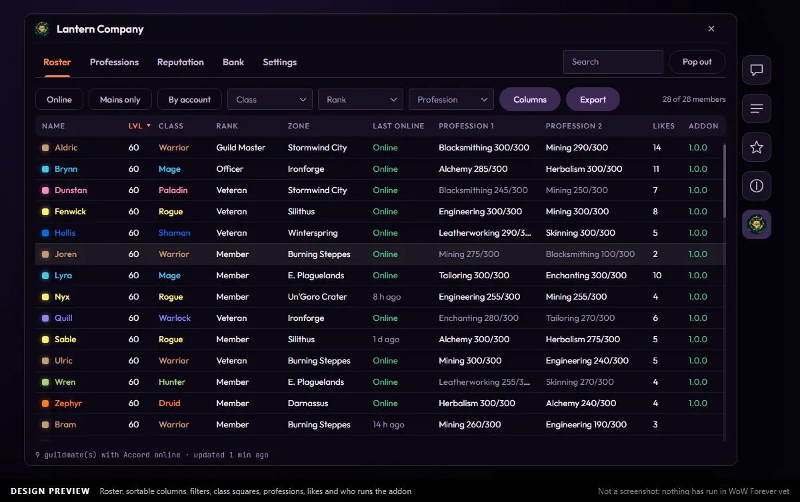

# Roster di gilda

*English: [[Guild Roster|Guild-Roster]]*

> Disponibile dalla versione del roster (milestone M2). Le colonne Like e Sociale arrivano con la milestone M4 (Like: il totale del giocatore, verde quando gli hai dato un like, grigio finché il tuo like è in attesa; Sociale: l'indice sociale, un trattino sotto le 5 ore di gioco di gruppo, mostrato solo agli ufficiali e al Maestro di gilda). Le celle delle professioni aprono le ricette del membro dalla versione delle professioni (milestone M3): vedi [[Professioni e ricette|Professions-and-Recipes-it]].

La vista **Roster** è una tabella di tutti i membri: nome, livello, classe, grado, zona, ultimo accesso, **professione 1** e **professione 2**, like, il **BattleTag** (condiviso dall'Accord del membro; vuoto per chi non ce l'ha) e se il membro usa Accord; l'indice sociale è nella vista [[Reputazione|Likes-and-Social-Index-it]] e nella scheda del membro. Clicca l'intestazione di una colonna per ordinare (un secondo clic inverte; il titolo della colonna ordinata è nel colore d'accento con una freccia, e i membri senza nulla in quella colonna vanno sempre in fondo); usa la casella di ricerca in alto a destra delle schede (nome o professione) e i filtri: i pulsanti *Online*, *Solo main* e *Per account* (accesi finché sono attivi) e gli elenchi *Classe*, *Grado* e *Professione* (la prima voce di ognuno mostra di nuovo tutto); *Colonne* apre un elenco di caselle per scegliere quali colonne mostrare, e le tue scelte sono ricordate per ogni personaggio. Quando il pannello è stretto i filtri continuano su una seconda riga. La tabella resta veloce con una gilda di 1000 membri.

## La tabella

Clicca un titolo per ordinare, cliccalo di nuovo per invertire. Ogni nome ha un quadratino del colore della classe, e il nome è scritto in quel colore (nel tema chiaro il nome resta scuro e solo il quadratino porta il colore). **Per account** raggruppa la tabella per giocatore: il main in testa, un clic su + mostra gli alt.

## Da dove viene un valore

Accanto a un valore che non arriva direttamente dal gioco, Accord mostra una piccola **etichetta** grigia con la sua fonte: `gioco` (letto adesso dal gioco), un'età come `3 g fa` (condiviso dall'addon di un altro giocatore, cambiato l'ultima volta 3 giorni fa), `tu` (letto dal tuo personaggio) oppure `nota` (dichiarato nella nota pubblica del membro: Accord non può verificarlo). Passa il mouse sopra per vedere chi ha riportato il valore. L'etichetta compare nella scheda del membro (professioni, contatti, personaggi dell'account, versione dell'addon), nelle celle delle professioni della tabella (nel tooltip), sopra l'elenco delle ricette, nel totale dei like e su ogni scheda della banca di gilda. Un valore condiviso che non cambia da molto tempo è **attenuato** e il tooltip lo dice: 7 giorni per una scheda della banca, 60 per professioni e ricette, 30 per la versione dell'addon, 180 per BattleTag e Discord. L'età è "da quanto il valore non cambia", non "da quanto qualcuno l'ha controllato".

## La scheda del membro

Clicca una riga per aprire la **scheda del membro**. Nella finestra di Accord si apre come **finestra di dettaglio a sé** accanto alla finestra, a destra, o a sinistra se sullo schermo non c'è spazio, così la tabella resta larga. Nel pannello dentro la finestra della gilda sta accanto alla tabella in un pannello largo, o sopra di essa (con un pulsante *Indietro*) in uno stretto. La croce la chiude. La scheda ha il nome del membro nel colore della classe, qualche **distintivo** sotto (*online* o *fuori gilda*, *main* o *alt* quando il giocatore ha altri personaggi, e la versione dell'addon) e un riquadro per ogni sezione. Mostra zona, ultimo accesso, grado, la nota pubblica (e la nota degli ufficiali solo se il gioco ti lascia leggerla), la versione dell'addon e le professioni con la provenienza di ogni informazione (il gioco, condivisa dal membro e quanto è vecchia, o letta dal tuo personaggio); i riquadri delle professioni e degli altri personaggi riportano il loro numero. Le righe che fanno qualcosa (un link a un altro personaggio, **[Rendi questo il mio main]**, **[Dai un like]**) sono nel colore d'accento: clicca un altro personaggio nella scheda per aprire la sua scheda, o una riga di professione per vedere le ricette di quel membro. Se la scheda è più lunga della finestra, scorrila con la rotella del mouse.

*Anteprime di progetto, non screenshot: sono disegnate dal layout e dai testi dell'addon (qui in inglese), con personaggi e oggetti inventati, perché l'addon non è ancora stato provato nel gioco ([tutte le anteprime](https://github.com/Finland6738/azeroth-accord/blob/main/docs/specs/mockups/previews/README.md), anche in italiano).*

## Personaggi dello stesso account

Sui tuoi personaggi la scheda offre **[Rendi questo il mio main]**. La scheda elenca **tutti i personaggi dello stesso account Battle.net nel reame**, anche quelli fuori dalla gilda, per ogni membro che usa l'addon. Attiva *Per account* nella tabella per vedere una riga per giocatore con gli alt sotto (clicca **+** per mostrarli).

Un personaggio che non è in gilda compare lo stesso. Il main è quello scelto dal giocatore, altrimenti il personaggio di livello più alto.

**Alt in un'altra gilda.** Per un personaggio fuori dalla gilda la scheda e le righe raggruppate dicono dov'è: *Altra gilda: <nome> · visto 3 g fa*, oppure *Nessuna gilda · visto oggi* se il personaggio non ha gilda. La riga è letta dai personaggi di quel giocatore che sono nella tua gilda, quindi:

- è **vecchia quanto l'ultimo accesso di quell'alt** con l'addon (si mostra a giorni: *oggi*, *3 g fa*); se l'alt entra in una gilda o ne esce, lo vedi solo dopo che quell'alt ha fatto l'accesso e il giocatore ha fatto l'accesso con un personaggio della tua gilda. Una riga più vecchia di un mese è attenuata, e la sua etichetta dice chi l'ha condivisa;
- un personaggio noto solo da una nota pubblica non mostra nessuna gilda, e nemmeno uno che l'addon non ha più visto da prima di questa funzione: mostra *fuori gilda* come prima;
- **l'altra gilda non vede nulla dei dati di Accord della tua gilda.** Nell'elenco dei personaggi che la tua gilda già riceve viaggiano solo il nome della gilda e il giorno dell'ultimo accesso di quell'alt.

Per i membri senza l'addon, una nota pubblica di gilda scritta come `main: <nome>` (il mio main è quel personaggio) o `alt: <nome>` (quel personaggio è un mio alt) è mostrata come indizio, con l'etichetta *dichiarato nella nota*. Un membro che ha l'addon non viene mai spostato da una nota.

Il raggruppamento non si può falsificare: due personaggi contano come un solo giocatore solo se **entrambi** si elencano a vicenda, quindi elencare il personaggio di qualcun altro non cambia nulla.

## Contatti

La scheda mostra il **BattleTag** e il nome **Discord** dei membri che usano l'addon (il nome Discord anche per tutti quando il gioco lo fornisce, segnato *dal gioco*). **Clicca un contatto** per aprire una piccola finestra con il testo già selezionato: premi Ctrl+C per copiarlo, poi Esc (o *Chiudi*). **[Aggiungi amico BattleTag]** invia la richiesta di amicizia del gioco; funziona anche se l'altro giocatore non usa l'addon. La tabella ha una colonna *Contatti* (BT e DC) che puoi mostrare o nascondere.

Il tuo BattleTag è letto dal gioco. Scrivi il tuo **nome Discord** (solo il nome utente, fino a 32 caratteri, senza link) in [[Impostazioni|Settings-it]] (`/accord settings`); si usa quando il gioco non lo mostra già. Entrambi sono sempre condivisi con la tua gilda.

## Cronologia (solo ufficiali)

Gli ufficiali e il Guild Master vedono nella scheda del membro un riquadro **Cronologia**: ciò che gli addon degli ufficiali hanno osservato cambiare nel roster per i personaggi di quel giocatore, dal più recente. Elenca le **ultime dieci** variazioni di **ogni personaggio del giocatore in gilda**, con un link **Mostra tutto (n)** che apre la pagina **Cronologia** della scheda **Ufficiali** su quel giocatore, e la riga *Membro dal <data>* dall'ingresso più vecchio che Accord ha visto (*Membro dal: sconosciuto* se non ne ha visto nessuno: la prima volta che l'addon di un ufficiale legge il roster fa solo una fotografia, quindi chi è già in gilda non "entra").

Una riga è l'ora e ciò che è successo: *è entrato nella gilda*, *è uscito dalla gilda* (il gioco non dice se il membro se n'è andato o è stato espulso), *grado Membro → Veterano*, *livello 20 → 27* e *nota pubblica: "vecchia" → "nuova"*. Le ore sono **UTC**. Passa il mouse su una riga per vedere chi l'ha osservata (tu, il nome di un compagno, o *un ex ufficiale*; mai un codice tecnico) e l'intervallo esatto: un addon vede un cambiamento solo quando legge il roster, quindi la riga dice *tra il <data> e il <data>* quando dall'ultima lettura è passato più di un giorno. I livelli guadagnati da un personaggio in un giorno sono una riga sola.

- **Due ufficiali che vedono lo stesso cambiamento fanno una riga sola.** Lo stesso cambiamento visto da due ufficiali, anche in momenti diversi, si mostra una volta, con l'intervallo più stretto e tutti gli osservatori nel tooltip.
- **Per sempre.** Nulla si cancella perché è vecchio: la cronologia, con il testo vecchio e nuovo delle note pubbliche, resta finché gli addon degli ufficiali la tengono. Se smetti di essere ufficiale, il tuo addon la cancella dal tuo computer (vedi sotto).
- **Solo ufficiali.** I membri non vedono mai il riquadro, non ricevono mai questi record e il loro addon non osserva nulla. È la decisione del proprietario ([SPEC-10 Q13](https://github.com/Finland6738/azeroth-accord/blob/main/docs/specs/SPEC-10-risks-open-questions.md)).
- **Dove sta.** Sul computer dell'ufficiale che l'ha osservato. Si condivide con gli altri ufficiali **solo sul canale degli ufficiali** (mai con la gilda, mai in whisper a un membro) e **solo dopo che l'addon ha visto quel canale portare un messaggio addon nella sessione**; fino ad allora il riquadro dice *Solo su questo computer finché il canale degli ufficiali non funziona* e mostra *Canale ufficiali: funzionante* oppure *non ancora provato*. Se smetti di essere ufficiale, con tutti i tuoi personaggi, Accord toglie questi dati dal tuo computer.
- Accord non cambia mai il roster: lo guarda soltanto. Nulla viene promosso, retrocesso o espulso dall'addon.

## Note degli ufficiali (solo ufficiali)

Gli ufficiali e il Maestro di gilda vedono nella scheda del membro un riquadro **Note degli ufficiali**: una nota più lunga su quel personaggio, solo per gli ufficiali. Non è la nota ufficiale del gioco (31 caratteri), che Accord mostra a parte, come prima, e non cambia mai.

- **Scrivi una nota…** (o **Modifica la nota…**) apre una casella di al massimo **500 caratteri** e **20 righe** (e 1000 byte: le lettere accentate ne occupano due). Il conteggio sotto la casella dice quanto resta; una nota oltre il limite non si salva e la casella dice perché. **Cancella la nota** la toglie per tutti gli ufficiali.
- Il riquadro mostra chi ha scritto l'ultima versione e quando (*Scritta da te, 3 g fa*) e sotto, in sola lettura, le note degli altri personaggi del giocatore, ognuna con il suo nome. Due ufficiali che modificano la stessa nota insieme: vince il salvataggio più recente.
- La pagina **Inattivi** segna con l'icona di un libro i giocatori che hanno una nota su uno dei loro personaggi, e il secondo passo della revisione guidata mostra la nota del giocatore su una riga.
- **Per sempre.** La nota di chi è uscito dalla gilda resta (il riquadro dice *Uscito dalla gilda il <data>*), così c'è ancora se rientra. Solo **Cancella la nota** la toglie.
- **Solo ufficiali.** I membri non vedono mai il riquadro e non ricevono mai le note. Viaggiano come la cronologia: **solo sul canale degli ufficiali**, mai con la gilda, mai in whisper a un membro, e solo dopo che l'addon ha visto quel canale funzionare nella sessione; fino ad allora una nota resta sul computer dove è stata scritta (*Solo su questo computer finché il canale degli ufficiali non funziona*). Non sono mai in un'esportazione né nel tuo backup personale; *Cosa condivido* conta solo le note che hai scritto.
- Se smetti di essere ufficiale, con tutti i tuoi personaggi, Accord cancella le note dal tuo computer; se torni ufficiale, le ricevi di nuovo dagli altri ufficiali.

## Prove (solo ufficiali)

> **Novità della `v0.12.0`**. Nulla è stato verificato nel gioco vero.

Gli ufficiali e il Guild Master possono seguire un nuovo membro **in prova**. Il membro non vede nulla della prova in Accord; se la gilda ha un grado per le prove, lo mostra già il gioco.

- **Inizia una prova**: dalla pagina **Prove** della scheda Ufficiali (una quarta pagina, dopo *Cronologia*) o dalla scheda del membro. Scegli il membro, la durata (**14 giorni** di base, da 1 a 60) e il primo giorno (oggi di base; al massimo 30 giorni fa o 14 avanti).
- **La pagina** elenca le prove aperte (nome, grado, inizio, fine, giorni che mancano, numero di note; *2 prove aperte* quando due ufficiali ne hanno iniziata una ciascuno) e, con **Chiuse (90 giorni)**, quelle chiuse da poco. Le più vecchie restano nella scheda del membro.
- **Clicca una prova** per vederla: **Proroga** di qualche giorno (la fine si sposta al massimo a 120 giorni dall'inizio), oppure chiudila con **Superata**, **Non superata** o **Annulla la prova**. Ogni chiusura chiede un secondo clic (**Conferma**). Una prova chiusa non si riapre: iniziane una nuova da un altro giorno.
- **Superata** può aggiungere una **promozione alla tua coda** (l'interruttore sotto i pulsanti, spento all'inizio): il grado subito sopra il suo che tu puoi dare. Accord non promuove nessuno: lo fai tu nel gioco, e la coda lo spunta.
- **Note**: ogni ufficiale scrive **una nota** per prova (*Scrivi la mia nota*), nella stessa casella e con gli stessi limiti delle [note degli ufficiali](#note-degli-ufficiali-solo-ufficiali); quelle degli altri si leggono soltanto, con autore ed età.
- **Il giorno della fine**: il [[Centro azioni|Action-Center-it]] mostra *La prova di … è finita il …: decidi* finché un ufficiale non la chiude o la proroga, e arriva un avviso **una volta**, il giorno della fine (anche dopo un `/reload` o un altro accesso); una proroga ne dà uno nuovo alla nuova fine. Chi esce dalla gilda durante la prova compare come *… è uscito dalla gilda durante la prova* finché un ufficiale non la annulla.
- **Mentori suggeriti**: un terzo selettore della pagina elenca i nuovi membri (in prova, o entrati negli ultimi 30 giorni), prima il più vecchio, ognuno con fino a tre [[mentori|Likes-and-Social-Index-it]] che si sono offerti, il motivo (*2.0 h insieme*, *gioca con le stesse persone*, *stesso gruppo*, *di solito in linea alle stesse ore* o *Ancora nessun gioco insieme*) e **Sussurra** per entrambi. Un mentore è la prima scelta di al massimo tre nuovi membri. La scheda del nuovo membro mostra lo stesso, solo agli ufficiali.
- **Per sempre**, come le note e la cronologia. Viaggiano come loro: **solo sul canale degli ufficiali**, mai con la gilda, mai in whisper a un membro, e solo quando il canale funziona (fino ad allora *Solo su questo computer finché il canale degli ufficiali non funziona*). Non sono nel tuo backup personale; *Cosa condivido* le conta soltanto. Se smetti di essere ufficiale, Accord le cancella dal tuo computer.

## Le pagine degli Ufficiali (solo ufficiali)

Gli ufficiali e il Guild Master hanno un'icona in più nella barra di navigazione, **Ufficiali**, con le pagine **Inattivi**, **Coda** e **Cronologia** (e **Prove**). I membri non vedono l'icona. La riga in alto a destra dice se il **canale degli ufficiali** funziona; la casella di ricerca del pannello filtra per nome.

### Account inattivi

La pagina **Inattivi** elenca i **giocatori**, non i personaggi, che non si vedono da un po': chi gioca solo un alt **non** è inattivo.

- **L'ultimo accesso** è il più recente tra tutti i personaggi del giocatore: in linea adesso o l'*ultimo accesso* del gioco per i personaggi in gilda, il giorno dell'ultimo accesso con l'addon per un alt fuori dalla gilda (condiviso dall'addon di quel giocatore) e i tuoi accessi per i tuoi personaggi. I personaggi si uniscono come nella scheda del membro; se a unirli è una nota pubblica (`main:` / `alt:`), la riga dice *unito da una nota*, perché nessuno la verifica.
- **Fasce**: di base 14, 30, 60 e 90 giorni. **Fasce…** le cambia: quattro numeri crescenti da 1 a 365, **uguali per tutti gli ufficiali** (le può cambiare qualunque ufficiale), con *Valori predefiniti*.
- **Colonne**: il principale, quanti personaggi sono in gilda, il grado più alto, i giorni, la fascia, quando e con quale personaggio il giocatore si è visto l'ultima volta, e l'assenza. Passa il mouse su una riga per la fonte della data. Le righe sono ordinate per giorni, prima i più lunghi; chi ha un personaggio ufficiale è segnato *ufficiale*, chi ha una [nota degli ufficiali](#note-degli-ufficiali-solo-ufficiali) l'icona di un libro.
- **Filtri**: la fascia minima mostrata, **Mostra assenti** (chi ha un'assenza dichiarata, altrimenti nascosto) e **Mostra sconosciuti** (chi non ha nessuna data nota, in fondo; il gioco potrebbe non dire l'*ultimo accesso* di tutti i membri).
- **Clicca una riga** per impostare o togliere un'assenza, o per aprire la scheda del membro.

L'addon li elenca soltanto. Non espelle, non retrocede e non scrive a nessuno.

### Revisione guidata e coda

**Revisiona…**, nella pagina Inattivi, ti aiuta a decidere cosa fare con chi manca da tempo. **Accord non modifica mai il roster**: non promuove, non retrocede, non rimuove e non scrive note. Prepara solo una lista di cose che farai tu a mano.

1. **Quali account.** Scegli la fascia minima (all'inizio 90 giorni o più). Due interruttori aggiungono gli account che hai rivisto negli ultimi 30 giorni e quelli di cui non si conosce nessuna data. Gli account con un'assenza dichiarata o con un personaggio ufficiale non vengono mai proposti.
2. **Una scelta per account**, divisi per fascia. Clicca un account per vedere i suoi personaggi in gilda (grado, livello, ultimo accesso) la sua nota degli ufficiali, se c'è, e le ultime tre variazioni della cronologia, poi scegli **Tieni** (predefinita), **Rimuovi**, **Retrocedi**, **Promuovi** o **Cambia nota**. La scelta vale per tutti i personaggi dell'account; clicca un personaggio per dargliene una diversa. Per un cambio di grado Accord propone il grado accanto e ti lascia scegliere un grado sotto il tuo. Per una nota scegli quella pubblica o quella ufficiale e scrivi il testo nuovo (al massimo 31 caratteri). Le azioni che il tuo grado non può fare restano fuori.
3. **Riepilogo.** **Aggiungi N azioni alla coda** riempie la coda e non fa altro. Gli account lasciati su *Tieni* non vengono riproposti per 30 giorni. Le scelte non aggiunte sono elencate con il motivo.

La pagina **Coda** elenca ciò che resta da fare, dalla voce più vecchia; la scheda mostra quante sono. Clicca una voce per vedere il nome (già selezionato, copialo con Ctrl+C) e il comando del gioco da scrivere nella chat (`/gremove`, `/gpromote`, `/gdemote`) oppure il testo da incollare nella nota, con un pulsante che apre la finestra della gilda. Scrivi o clicchi tu.

- **La spunta viene dal roster.** Quando Accord legge il roster e vede il grado cambiato, il personaggio non più presente o la nota cambiata, la voce diventa **fatta**, anche se l'ha fatta un altro ufficiale. Se il personaggio esce mentre aspetta un cambio di grado o di nota, la voce diventa **uscito**.
- Se il tuo grado non può leggere le note ufficiali, la voce di una nota ufficiale ha il pulsante **Segna fatta**.
- Una voce ancora aperta dopo **14 giorni** è **scaduta**. Le voci chiuse restano, attenuate, per 7 giorni. **Annulla voce** ne chiude una a mano. Una voce nuova per lo stesso personaggio e la stessa azione sostituisce quella aperta; al massimo 200 sono aperte.
- La coda è **tua**: resta sul tuo computer e non è condivisa con gli altri ufficiali. Si cancella se smetti di essere ufficiale.

I comandi, i permessi e il limite di 31 caratteri non sono ancora stati verificati nel gioco.

### Cronologia

Tutti i cambiamenti osservati della gilda, con filtri per tipo (entrati, usciti, grado, livello, nota pubblica) e per periodo (7, 30, 90 o 365 giorni; all'inizio 30). Aperta con **Mostra tutto** da una scheda mostra solo quel giocatore; clicca **Solo <nome>** per rivedere tutti.

## Esportazione (solo ufficiali)

Gli ufficiali e il Guild Master possono copiare fuori dal gioco ciò che una pagina mostra, in un foglio di calcolo o su Discord. Il pulsante **Esporta** è nella vista **Roster** e nelle pagine **Inattivi** e **Cronologia** della scheda *Ufficiali*. I membri non ce l'hanno.

- L'esportazione contiene **ciò che la pagina mostra**, con i suoi filtri e la ricerca. Nel Roster raggruppato *Per account*, gli alt di un account chiuso sono compresi; un personaggio fuori dalla gilda no.
- Si apre una casella con il testo **già selezionato**: premi **Ctrl+C**, poi incolla. Sopra c'è scritto: *Questo testo esce dal gioco: condividilo solo con gli ufficiali.* In alto a destra scegli **CSV** o **Discord**; la casella ricorda la scelta finché non esci dal gioco.
- **CSV**: una riga con i nomi delle colonne in inglese, poi una riga per voce, separata da virgole. Le date sono in UTC. Incollalo in un file che finisce in `.csv` (UTF-8) o in un foglio di calcolo e dividilo alle virgole. Un testo che il foglio di calcolo potrebbe eseguire come formula (che inizia con `=`, `+`, `-` o `@`) riceve davanti un apostrofo `'`.
- **Discord**: un blocco di codice con le colonne allineate, così menzioni come `@everyone` restano testo. Un'esportazione lunga è divisa in parti di al massimo 1900 caratteri, numerate *(1/3)* e separate da una riga vuota: manda una parte per messaggio. I nomi lunghi (24 caratteri) e le note (30) sono accorciati con `…`.
- Un'esportazione molto lunga (oltre 256 KB) tiene solo le prime righe e la casella dice quante righe sono escluse: restringi i filtri.

| Esportazione | Colonne CSV |
|---|---|
| Roster (una riga per personaggio in gilda) | `name`, `realm`, `main`, `class`, `level`, `rank`, `last_seen_date`, `days_inactive`, `account_days_inactive`, `tier`, `away_until`, `public_note`, `has_addon` |
| Account inattivi (una riga per giocatore) | `main`, `realm`, `characters`, `highest_rank`, `days_inactive`, `tier`, `last_seen_date`, `last_seen_character`, `last_seen_source`, `grouped_by_note`, `away_until` |
| Cronologia (una riga per cambiamento) | `date_utc`, `since_utc`, `event`, `name`, `realm`, `from`, `to`, `observers` |

`class` è il codice inglese della classe usato dal gioco (per esempio `MAGE`); `main` è vuoto per un principale o per chi ha un solo personaggio; `tier` va da 0 (attivo) a 4 ed è vuoto se non si sa; `last_seen_source` è `game`, `shared` o `you`; `event` è `join`, `leave`, `rank`, `level` o `note`; `realm` è vuoto per il tuo reame.

**Non si esportano mai:** le note ufficiali del gioco, le [note degli ufficiali](#note-degli-ufficiali-solo-ufficiali) di Accord, i codici degli account e gli identificatori interni del gioco. La nota **pubblica** è nelle esportazioni del Roster e della Cronologia.

Quanto testo può tenere la casella, e l'incolla in Discord o in un foglio di calcolo, non sono ancora stati verificati nel gioco.

## Assenze dichiarate

Una **data di rientro** dice agli ufficiali che un giocatore è via di proposito: fino a quel giorno, compreso, non conta come inattivo. Non c'è un motivo né testo libero.

- **Tu** dichiari la tua nelle [[Impostazioni|Settings-it]], nella card **Assenza**, oppure con `/accord away 2026-12-31` e `/accord away off`. La data è al massimo tra 180 giorni. Vedi solo ciò che hai dichiarato tu, e mai la tua fascia di inattività.
- **Gli ufficiali** impostano o tolgono l'assenza di qualunque giocatore dalla scheda del membro (riquadro **Assenza**) o dalla pagina Inattivi. Vale quella salvata più di recente, chiunque l'abbia salvata, per tutti i personaggi del giocatore.
- **Come viaggia.** Il tuo addon manda la tua dichiarazione in whisper a un massimo di due ufficiali in linea con Accord, quando la salvi e una volta dopo l'accesso finché è valida; se non ce n'è nessuno riprova al prossimo accesso. Gli ufficiali se la passano sul canale degli ufficiali. Nessun altro la riceve.
- Dal giorno dopo il rientro il giocatore torna a contare, e l'elenco dice *assente fino al <data>* per due settimane. Il record si cancella 30 giorni dopo la data di rientro.
