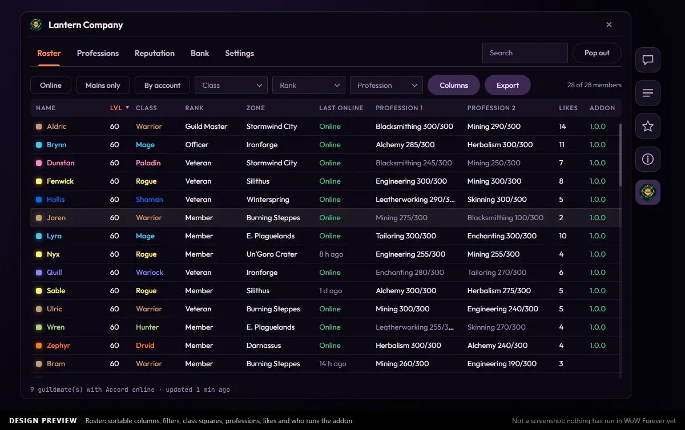
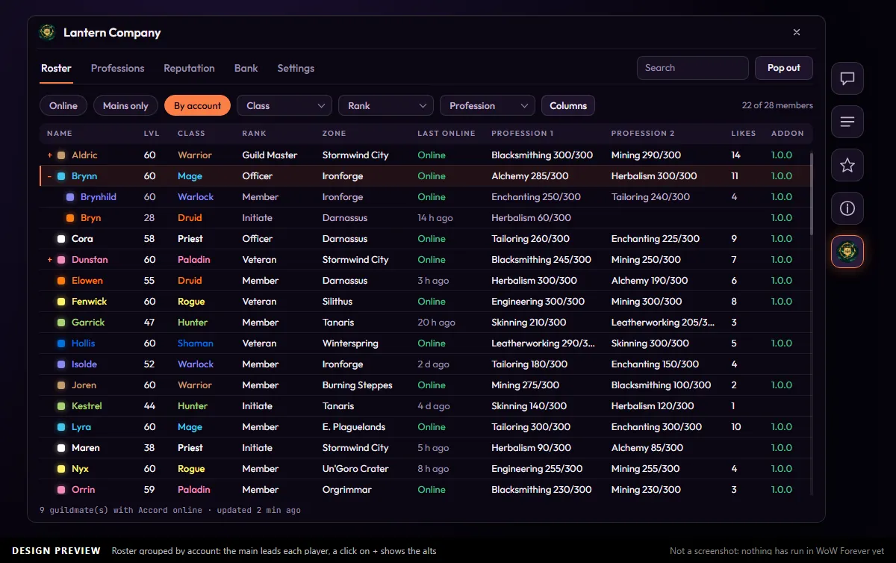
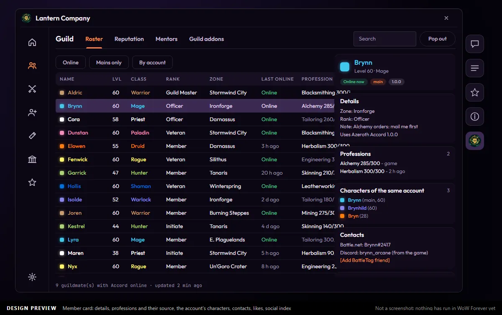
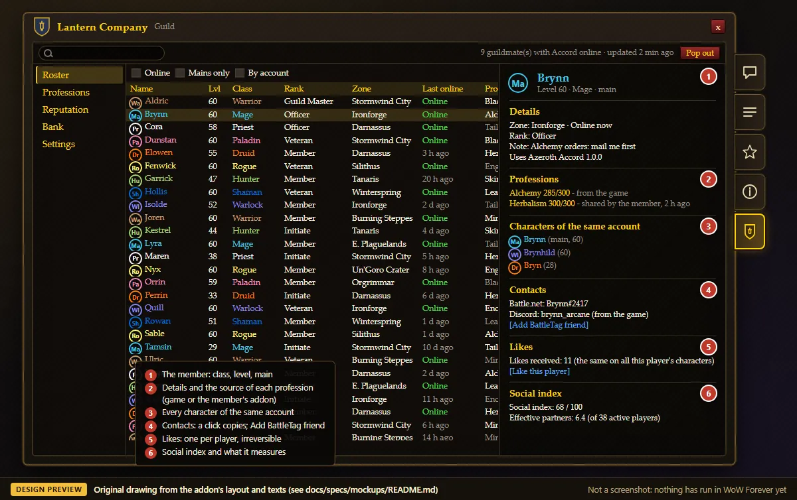

# Guild roster

> Available from the roster version (milestone M2). The Likes and Social columns arrive with milestone M4 (Likes: the player's total, green when you liked them, grey while your like is pending; Social: the social index, a dash under 5 hours of group play, shown only to officers and the Guild Master). The profession cells open the member's recipes from the professions version (milestone M3): see [[Professions and Recipes|Professions-and-Recipes]].

The **Roster** view is a table of every member: name, level, class, rank, zone, last online, **profession 1** and **profession 2**, likes, social index, Battle.net and Discord. Click a column header to sort (a second click reverses; the sorted column's title is in the accent colour with an arrow, and members with nothing in that column always go last); use the search box at the top right of the tabs (name or profession) and the filters: the buttons *Online*, *Mains only* and *By account* (lit while they are on) and the *Class*, *Rank* and *Profession* lists (the first entry of each shows everything again); *Columns* opens a list of checks to choose which columns to show, and your choices are remembered for each character. When the panel is narrow the filters continue on a second line. The table stays fast with a guild of 1000 members.

## The table

Click a title to sort, click it again to reverse. Every name has a small square in the colour of the class, and the name is written in that colour (in the light theme the name stays dark and only the square carries the colour). **By account** groups the table by player: the main leads, a click on + shows the alts.

*These pictures still show the previous look (the game's colours, the toolbar with check boxes and menus): the table now has the colours of the chosen theme, as described here. New pictures come before version `v0.6.0`.*

## The member card

Click a row to open the **member card**: beside the table in a wide panel, over it (with a *Back* button) in a narrow one; the cross closes it. The card has the member's name in the colour of the class, a few **badges** under it (*online* or *not in guild*, *main* or *alt* when the player has other characters, and the addon version) and one box per section. It shows zone, last online, rank, the public note (and the officers' note only if the game lets you read it), the addon version and the professions with where each piece of information comes from (the game, shared by the member and how old, or read from your own character); the boxes of the professions and of the other characters carry their count. Lines that do something (a link to another character, **[Make this my main]**, **[Like this player]**) are in the accent colour: click another character in the card to open its card, or a profession line to see that member's recipes. If the card is longer than the window, scroll it with the mouse wheel.

*These pictures still show the previous look (one list of lines, the game's colours): the card is now made of boxes with badges, as described above. New pictures come before version `v0.6.0`.*

*Design previews, not screenshots: drawn from the addon's own layout and texts with invented characters and items, because the addon has not been run in the game yet ([all previews](https://github.com/Finland6738/azeroth-accord/blob/main/docs/specs/mockups/previews/README.md)).*

## Characters of the same account

On your own characters the card offers **[Make this my main]**. The card lists **all the characters of the same Battle.net account on the realm**, also those outside the guild, for every member who uses the addon. Turn on *By account* in the table to see one row per player with the alts underneath (click **+** to show them).

A character that is not in the guild appears too, marked *not in guild*. The main is the one the player chose, otherwise the highest-level character.

For members without the addon, a public guild note written as `main: <name>` (my main is that character) or `alt: <name>` (that character is my alt) is shown as a hint, labelled *declared in the note*. A member who has the addon is never moved by a note.

The grouping cannot be faked: two characters count as one player only if **both** list each other, so listing someone else's character changes nothing.

## Contacts

The card shows the **BattleTag** and the **Discord** name of members who use the addon (the Discord name also for everybody when the game provides it, marked *from the game*). **Click a contact** to open a small window with the text already selected: press Ctrl+C to copy it, then Esc (or *Close*). **[Add BattleTag friend]** sends the game's own friend request; it works even if the other player does not use the addon. The table has a *Contacts* column (BT and DC) that you can show or hide.

Your own BattleTag is read from the game. Type your **Discord name** (user name only, up to 32 characters, no links) in [[Settings|Settings]] (`/accord settings`); it is used when the game does not show it already. Both are always shared with your guild.
