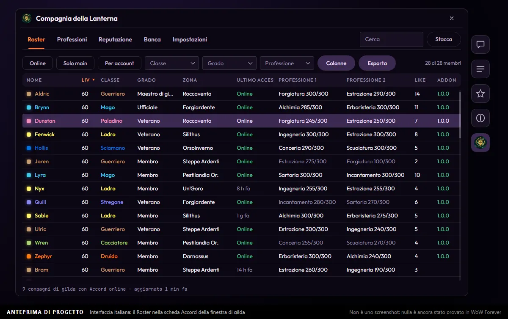

# Installazione

*English: [[Installation|Installation]]*

> **Non ancora disponibile.** La prima versione di prova (`v0.1.0`) arriva alla fine della milestone M1.

Quando sarà uscita:

1. Scarica lo zip dell'ultima versione dalla pagina *Releases* del repository.
2. Estrai la cartella `AzerothAccord` in `<WoW folder>/_forever_/Interface/AddOns/`.
3. Avvia il gioco; nella schermata dei personaggi apri *AddOn* e controlla che Azeroth Accord sia attivo.
4. Nel gioco apri la finestra della gilda: la scheda **Accord** è sotto le quattro schede del gioco. Puoi anche scrivere `/accord`.

L'interfaccia segue la lingua del client di gioco: inglese, e italiano in un client italiano (`itIT`).

*Anteprime di progetto, non screenshot: sono disegnate dal layout e dai testi dell'addon, con personaggi e oggetti inventati, perché l'addon non è ancora stato provato nel gioco ([tutte le anteprime](https://github.com/Finland6738/azeroth-accord/blob/main/docs/specs/mockups/previews/README.md), anche in italiano).*

Ogni membro che lo installa aggiunge i propri dati (personaggi, contatti, ricette): più compagni lo usano, più è completo.
