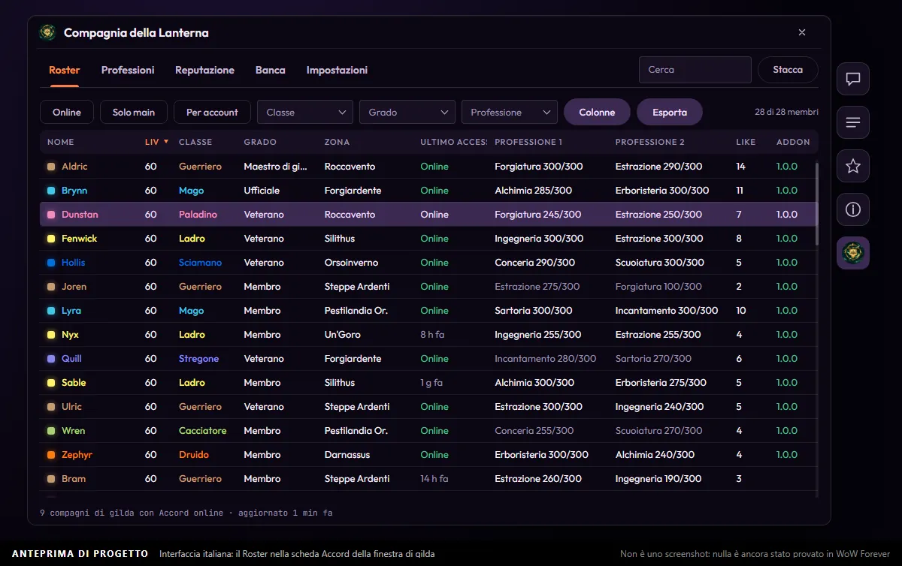

# Installation

*Italiano: [[Installazione|Installation-it]]*

> **Test version.** The first release is `v0.8.0`. It has been tested offline only: the in-game checks are not done yet, so expect problems and [report them](Reporting-Bugs-and-Feedback).

1. Download the zip of the latest release from the repository's *Releases* page.
2. Extract the `AzerothAccord` folder into `<WoW folder>/_forever_/Interface/AddOns/`.
3. Start the game; at the character screen, open *AddOns* and check that Azeroth Accord is enabled.
4. In game, open the guild window: the **Accord** tab is under the four tabs of the game. You can also type `/accord`.

The interface follows the language of your game client: English, and Italian in an Italian client (`itIT`).

*Design previews, not screenshots: drawn from the addon's own layout and texts with invented characters and items, because the addon has not been run in the game yet ([all previews](https://github.com/Finland6738/azeroth-accord/blob/main/docs/specs/mockups/previews/README.md)).*

Every member who installs it adds their own data (characters, contacts, recipes): the more guildmates use it, the more complete it is.
