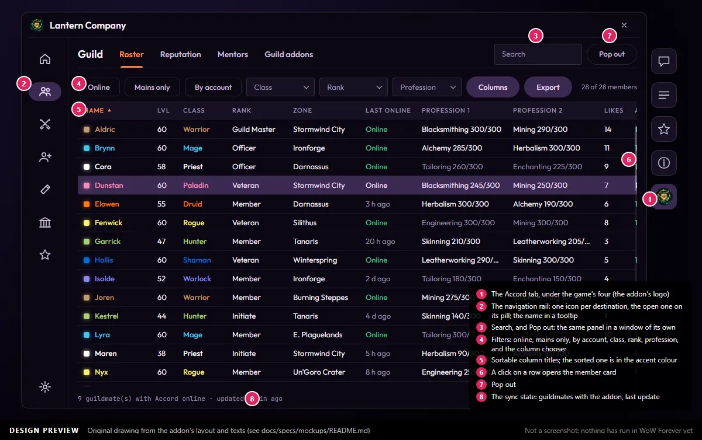
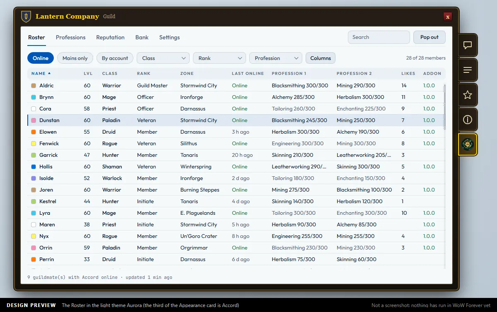
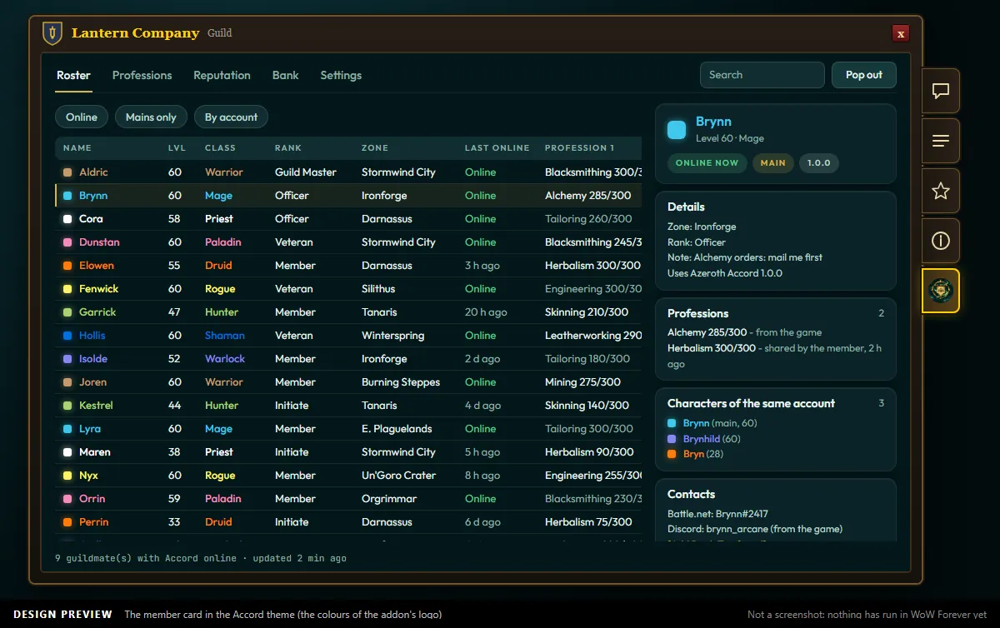
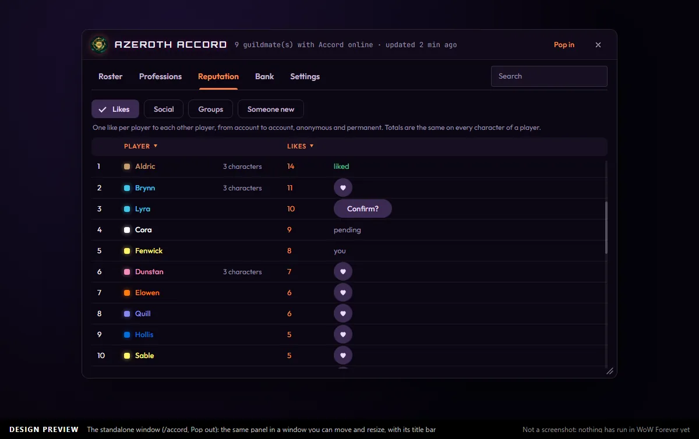

# Giro dell'interfaccia

*English: [[Interface Tour|Interface-Tour]]*

## La scheda Accord

Apri la finestra della gilda (tasto predefinito `J`). Sotto le quattro schede del gioco (Chat, Roster, Vantaggi della gilda, Info gilda) ce n'è una quinta con il logo di Accord: **Accord**. Il suo suggerimento dice *Azeroth Accord*.

*Anteprime di progetto, non screenshot: sono disegnate dal layout e dai testi dell'addon (qui in inglese), con personaggi e oggetti inventati, perché l'addon non è ancora stato provato nel gioco ([tutte le anteprime](https://github.com/Finland6738/azeroth-accord/blob/main/docs/specs/mockups/previews/README.md), anche in italiano).*

- Cliccarla apre la **finestra di Accord** al posto della finestra della gilda, che si chiude: la finestra della gilda è troppo piccola per le tabelle più larghe di Accord. La finestra di Accord si sposta, si ridimensiona e ricorda dove l'hai messa. *Impostazioni → Apri Accord dentro la finestra della gilda* riporta il pannello descritto qui sotto.
- Con quell'impostazione accesa, cliccarla mostra il pannello di Accord sopra la finestra della gilda (anche sopra la sua lista delle comunità), nei colori del tema, e finché è aperto **anche la finestra intorno ha il tema**: una cornice tematica con il nome della tua gilda, una croce tematica e le cinque schede a lato come tessere arrotondate (quella aperta ha una tessera piena di un colore tenue). Cliccare una qualsiasi scheda del gioco rimette l'aspetto del gioco e torna al suo contenuto; chiudere la finestra chiude il pannello.
- Quando ci sono richieste alla banca che aspettano gli ufficiali, la scheda porta un piccolo distintivo rosso con il loro numero.
- La scheda si vede solo quando la tua **gilda** è la comunità selezionata, e non nella finestra piccola (ridotta) della gilda.
- Il pannello non ha nulla di protetto: si apre e si chiude anche in combattimento e non cambia mai come funzionano le schede del gioco: l'addon rende soltanto trasparente la grafica della finestra del gioco finché il pannello è aperto e la rimette dopo.
- Se un aggiornamento del gioco cambia la finestra della gilda al punto che la scheda non si può collocare, la scheda semplicemente non compare: usa `/accord` per la finestra autonoma, e `/accord debug` dice perché.

## Il pannello

Il pannello ha **due livelli di navigazione**, uguali nella finestra della gilda e nella finestra autonoma *(dalla `v0.13.0`)*:

- **La barra di navigazione** lungo il lato sinistro: un'icona per ogni luogo dell'addon. Passa il mouse su un'icona per il suo nome; cliccala per andarci. Quella aperta ha l'icona piena con una forma arrotondata tenue dietro, e un'icona porta un piccolo numero rosso quando lì qualcosa aspetta (le richieste alla banca su *Economia*, le cose da fare su *Home*). **Impostazioni** è in fondo. Gli ufficiali e il Gran Maestro hanno anche **Ufficiali**; i membri non vedono quell'icona.
- **Una sola riga di schede** in cima a ogni luogo: prima il suo nome, poi una scheda per pagina; la pagina aperta è luminosa, con una breve linea sotto che scivola sulla scheda che clicchi. Un luogo con una sola pagina mostra solo il nome. Dentro una pagina non c'è mai una seconda riga di schede: ciò che vedi si sceglie con i filtri o con un menu **Mostra** (per esempio Schede, Oggetti, Richieste… della Banca).
- L'ultima pagina aperta è ricordata per ogni personaggio, e la barra apre ogni luogo sulla pagina dove l'hai lasciato.

| Icona | Luogo | Pagine |
|---|---|---|
| Casa | **Home** | [[Centro azioni|Action-Center-it]], Avvisi |
| Gilda | **Gilda** | [[Roster|Guild-Roster-it]], [[Reputazione|Likes-and-Social-Index-it]], Mentori, [[Addon della gilda|Guild-Addons-it]] |
| Spade | **Raid** | [[Season|Season-Roster-it]], [[Eventi|Events-it]], [[Raid|Raid-and-Loot-Addons-it]], [[Disponibilità|Availability-it]] |
| Aggiungi gruppo | **Gruppi** | [[Cercagruppi, Pubblica un gruppo, Il mio gruppo|Groups-it]], Raduni |
| Attrezzi | **Professioni** | [[Ricette|Professions-and-Recipes-it]] (e più avanti Ordini e Lista della spesa) |
| Banca | **Economia** | [[Banca|Guild-Bank-it]] (e più avanti il Mercato) |
| Festa | **Community** | [[Manuale|Guild-Handbook-it]] |
| Scudo | **Ufficiali** (solo ufficiali) | Inattivi, Coda, Cronologia, Prove ([[Roster di gilda|Guild-Roster-it]]) |
| Ingranaggio, in fondo | **Impostazioni** | [[Generali|Settings-it]], Cosa condivido, [[Info|About-it]] |

- A destra della riga: una casella **Cerca**, mentre la pagina aperta può cercare (ciò che scrivi va a quella pagina) e, nella finestra della gilda, **Stacca**, che sposta il pannello in una finestra sua, più grande. Se la riga è troppo stretta per tutte le schede, le ultime sono dietro **Altro**.
- Nella finestra della gilda una linea sottile in basso mostra lo **stato della sincronizzazione**, per esempio *3 compagni di gilda con Accord online · aggiornato 2 min fa* (la finestra autonoma lo mostra sotto il titolo).
- Se una pagina non riesce a disegnarsi, mostra invece un breve messaggio e le altre continuano a funzionare; cliccare di nuovo la sua scheda riprova.
- **Novità della `v0.9.0`:** le viste [[Centro azioni|Action-Center-it]], [[Gruppi|Groups-it]] e [[Addon della gilda|Guild-Addons-it]].
- **Dalla `v0.10.0`**: le viste [[Season|Season-Roster-it]], [[Eventi|Events-it]] e [[Disponibilità|Availability-it]].
- **Dalla `v0.11.0`**: le viste [[Raid|Raid-and-Loot-Addons-it]] e [[Manuale|Guild-Handbook-it]].
- **Dalla `v0.12.0`**: nessuna scheda nuova, ma il [[testo di reclutamento|Season-Roster-it]] nella vista Season, la pagina **Prove** degli Ufficiali ([[Roster di gilda|Guild-Roster-it]]), la [[lista di benvenuto|Action-Center-it]] e la modalità **Mentori** della Reputazione (una pagina di Gilda dalla `v0.13.0`) ([[Like e indice sociale|Likes-and-Social-Index-it]]).
- **Le viste del primo rilascio, `v0.8.0`**: **Roster**, **Professioni**, **Reputazione**, **Banca**, **Impostazioni**. La vista **Roster** arriva con la versione del roster e la vista **Impostazioni** (vedi [[Impostazioni|Settings-it]]; la stessa pagina è nella finestra delle impostazioni del gioco) con la versione di rilascio; vedi [[Roster di gilda|Guild-Roster-it]]. La vista **Professioni** (l'elenco delle ricette di un membro, aperto dal roster) arriva con la versione delle professioni; vedi [[Professioni e ricette|Professions-and-Recipes-it]]. La vista **Reputazione** (i like, una riga per giocatore ordinata per like, con il pulsante Like; il tuo indice sociale; la mappa dei gruppi per gli ufficiali; *Qualcuno di nuovo* con cui giocare) arriva con la versione della reputazione; vedi [[Like e indice sociale|Likes-and-Social-Index-it]]. La vista **Banca** (la banca di gilda scheda per scheda, il suo denaro, un elenco di oggetti con ricerca) arriva con la versione della banca (gli ufficiali vedono sulla scheda anche il numero di richieste in attesa); vedi [[Banca di gilda|Guild-Bank-it]]. Gli ufficiali hanno anche la scheda **Ufficiali**, con i giocatori inattivi e la cronologia del roster (vedi [[Roster di gilda|Guild-Roster-it]]).

## Ordinare gli elenchi

- **Ogni elenco a colonne è una tabella**: clicca il titolo di una colonna per ordinarla, cliccalo di nuovo per invertire. Il titolo ordinato è nel colore d'accento, con una freccia. Le righe senza nulla in quella colonna vanno in fondo; le colonne con i pulsanti non si ordinano.
- **Gli elenchi senza colonne** (le pagine del manuale, i mentori suggeriti) hanno un pulsante **Ordina per**: scegli l'ordine nel suo menu, e sceglilo di nuovo per invertirlo.
- Ogni elenco **ricorda il proprio ordine per ogni personaggio**.

## Pulsanti, filtri e righe

I controlli hanno lo stesso aspetto e lo stesso comportamento in ogni vista (le regole di Material 3 di Google, disegnate con i temi di Accord):

- **Pulsanti**: l'unico pulsante **pieno**, nel colore d'accento del tema, è l'azione principale di una vista o di una finestra (per esempio *Salva* o *Invia richiesta*); gli altri sono tenuemente pieni, contornati o di solo testo.
- I **filtri** sono riquadri arrotondati da accendere e spegnere: un filtro acceso è pieno e mostra una **spunta** (*Online*, *Solo main*, le schede della banca di gilda).
- Una scelta tra poche voci (il tema, il font) è una fila di pulsanti uniti, quello scelto pieno e con la spunta. Servono a scegliere, mai a spostarti in un'altra pagina.
- La **riga scelta** di un elenco (il membro di cui è aperta la scheda, il gruppo o la pagina del manuale scelti) è riempita dello stesso colore tenue.
- Il puntatore sopra un controllo lo ombreggia leggermente; un controllo che ora non si può usare è sbiadito.

## I temi

Il pannello ha tre temi, scelti in **Impostazioni → Aspetto** (vedi [[Impostazioni|Settings-it]]): **Nebula**, quello scuro predefinito, **Aurora**, uno chiaro, e **Accord**, scuro con il verde e l'oro del logo. Cambiano solo i colori: ogni vista ha lo stesso aspetto nei tre temi, e la scelta si vede subito.

*Anteprime di progetto, non screenshot: sono disegnate dal layout e dai testi dell'addon (qui in inglese), con personaggi e oggetti inventati, perché l'addon non è ancora stato provato nel gioco ([tutte le anteprime](https://github.com/Finland6738/azeroth-accord/blob/main/docs/specs/mockups/previews/README.md), anche in italiano).*

## La finestra autonoma

`/accord`, la voce del Compartimento AddOn, un tasto assegnato o **Stacca** aprono lo stesso pannello in una finestra propria, nei colori del tema:

- la **barra del titolo** in alto: il logo tondo di Accord, **AZEROTH ACCORD**, sotto lo stato della sincronizzazione, **Riaggancia** e il pulsante di chiusura. **Riaggancia** si vede mentre la finestra della gilda è aperta sulla tua gilda: rimette il pannello nella finestra della gilda e chiude questa. (L'addon non apre mai da solo la finestra della gilda del gioco.)
- sotto, la stessa **barra di navigazione**, la stessa **riga di schede** e la stessa casella **Cerca** della finestra della gilda;
- trascina la barra del titolo per spostare la finestra e il segno nell'angolo in basso a destra per ridimensionarla. Si apre a 1380 × 720 (meno su uno schermo più piccolo) e non si può rimpicciolire sotto 720 × 460; ricorda posizione e dimensione per ogni personaggio. Esc la chiude.

Cliccare la scheda Accord della finestra della gilda mentre questa finestra è aperta sposta il pannello lì e chiude la finestra, così il pannello non è mai in due posti. Vedi [[Comandi|Commands-it]].
