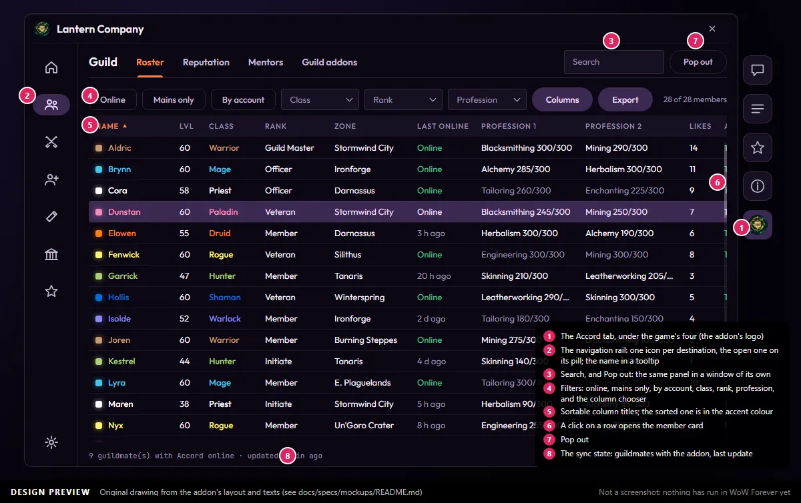
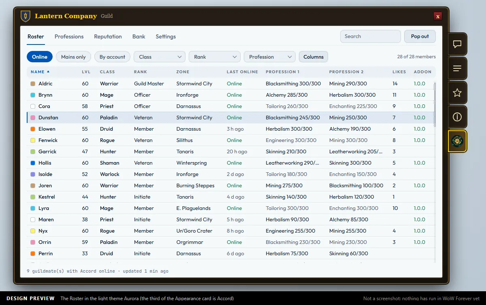
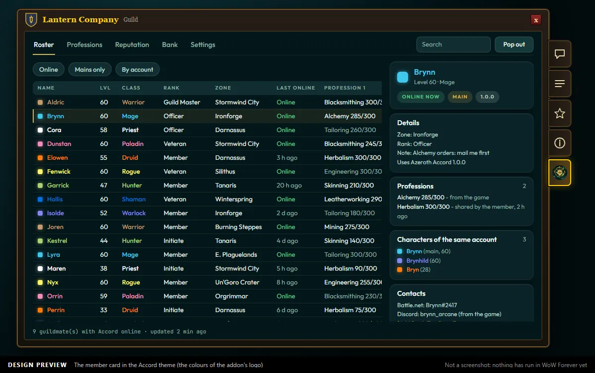
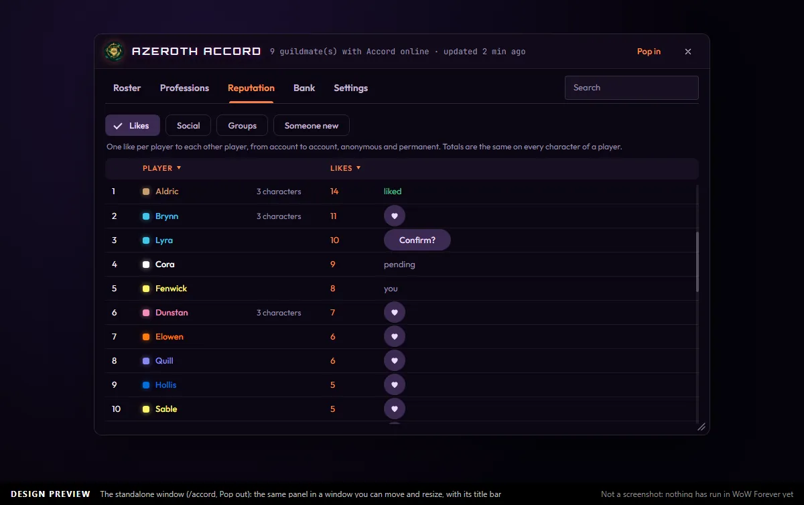

# Interface tour

*Italiano: [[Giro dell'interfaccia|Interface-Tour-it]]*

## The Accord tab

Open the guild window (default key `J`). Under the four tabs of the game (Chat, Roster, Guild Benefits, Guild Info) there is a fifth one with the Accord logo: **Accord**. Its tooltip says *Azeroth Accord*.

*Design previews, not screenshots: drawn from the addon's own layout and texts with invented characters and items, because the addon has not been run in the game yet ([all previews](https://github.com/Finland6738/azeroth-accord/blob/main/docs/specs/mockups/previews/README.md)).*

- Clicking it opens the **Accord window** in the place of the guild window, which closes: the guild window is too small for Accord's wider tables. The Accord window moves, resizes and remembers where you put it. *Settings → Open Accord inside the guild window* brings back the panel described next.
- With that setting on, clicking it shows the Accord panel over the guild window (its list of communities too), in the colours of the theme, and while it is open **the window around it wears the theme too**: a themed frame with the name of your guild, a themed cross, and the five side tabs as rounded tiles (the open one has the accent colour). Clicking any of the game's tabs puts the game's own look back and goes back to its content; closing the window closes the panel.
- When officers have bank requests waiting, the tab carries a small round mark with their number.
- The tab shows only while your **guild** is the selected community, and not in the small (minimized) guild window.
- The panel has nothing protected in it: it opens and closes in combat too, and it never changes how the game's own tabs work: the addon only makes the game's window art see-through while the panel is open and puts it back afterwards.
- If a game update changes the guild window so much that the tab cannot be placed, the tab simply does not appear: use `/accord` for the standalone window, and `/accord debug` says why.

## The panel

- **Tabs** along the top, each a rounded box with its icon (the open one glows in the theme's accent): **Action Center**, **Roster**, **Professions**, **Reputation**, **Bank**, **Groups**, **Season**, **Events**, **Availability**, **Raid**, **Handbook**, **Guild addons**, **Settings** (and **Officers** for officers). The tabs that do not fit beside the search box are behind **More**, the last tab: click it and choose a view; it shows the sum of their counts, and the open view always keeps its own tab. The open tab is bright with a short line under it, which slides to the tab you click. The last tab you opened is remembered for each character. The **Bank** tab shows a small count when bank requests wait for an officer.
- At the right of the tabs: a **Search** box, while the open view can search (what you type goes to that view), and, in the guild window, **Pop out**, which moves the panel into its own, larger window.
- In the guild window a thin line at the bottom shows the **sync state**, for example *3 guildmate(s) with Accord online · updated 2 min ago* (the standalone window shows it under its title).
- If a view ever fails to draw, it shows a short message instead and the other tabs keep working; clicking its tab again tries again.
- **New in `v0.9.0`:** the [[Action Center|Action-Center]], [[Groups|Groups]] and [[Guild addons|Guild-Addons]] views.
- **From `v0.10.0`**: the [[Season|Season-Roster]], [[Events|Events]] and [[Availability|Availability]] views.
- **From `v0.11.0`**: the [[Raid|Raid-and-Loot-Addons]] and [[Handbook|Guild-Handbook]] views.
- **The views of the first release, `v0.8.0`**: **Roster**, **Professions**, **Reputation**, **Bank**, **Settings** (officers also have **Officers**, with the inactive players, the queue of actions to do by hand and the roster timeline: see [[Guild Roster|Guild-Roster]]). The **Roster** view comes with the roster version, and the **Settings** view (see [[Settings|Settings]]; the same page is in the game's settings window) with the release version; see [[Guild Roster|Guild-Roster]]. The **Professions** view (a member's recipe list, opened from the roster) comes with the professions version; see [[Professions and Recipes|Professions-and-Recipes]]. The **Reputation** view (likes, one row per player sorted by likes, with the Like button; your social index; the group map for officers; *Someone new* to play with) comes with the reputation version; see [[Likes and Social Index|Likes-and-Social-Index]]. The **Bank** view (the guild bank tab by tab, its money, a searchable list of items) comes with the bank version (officers also see the number of waiting requests on the tab); see [[Guild Bank|Guild-Bank]].

## The themes

The panel comes in three themes, chosen in **Settings → Appearance** (see [[Settings|Settings]]): **Nebula**, the dark default, **Aurora**, a light one, and **Accord**, dark with the green and gold of the logo. They change colours only: every view looks the same in all three, and the choice shows at once.

*Design previews, not screenshots: drawn from the addon's own layout and texts with invented characters and items, because the addon has not been run in the game yet ([all previews](https://github.com/Finland6738/azeroth-accord/blob/main/docs/specs/mockups/previews/README.md)).*

## The standalone window

`/accord`, the AddOn Compartment entry, a key binding or **Pop out** open the same panel in a window of its own, in the colours of the theme:

- the **title bar** at the top: the round Accord logo, **AZEROTH ACCORD**, the sync state under it, **Pop in** and the close button. **Pop in** shows while the guild window is open on your guild: it puts the panel back into the guild window and closes this one. (The addon never opens the game's guild window by itself.)
- under it, the same **tabs** and **Search** box as in the guild window;
- drag the title bar to move the window, and the small mark in the bottom-right corner to resize it. It opens at 1380 × 720 (smaller on a smaller screen) and cannot be made smaller than 720 × 460; it remembers its place and size for each character. Esc closes it.

Clicking the Accord tab of the guild window while this window is open moves the panel there and closes the window, so the panel is never in two places. See [[Commands|Commands]].
