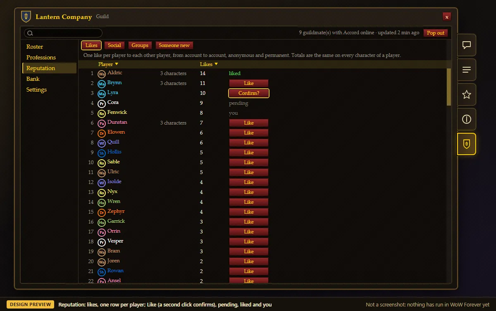
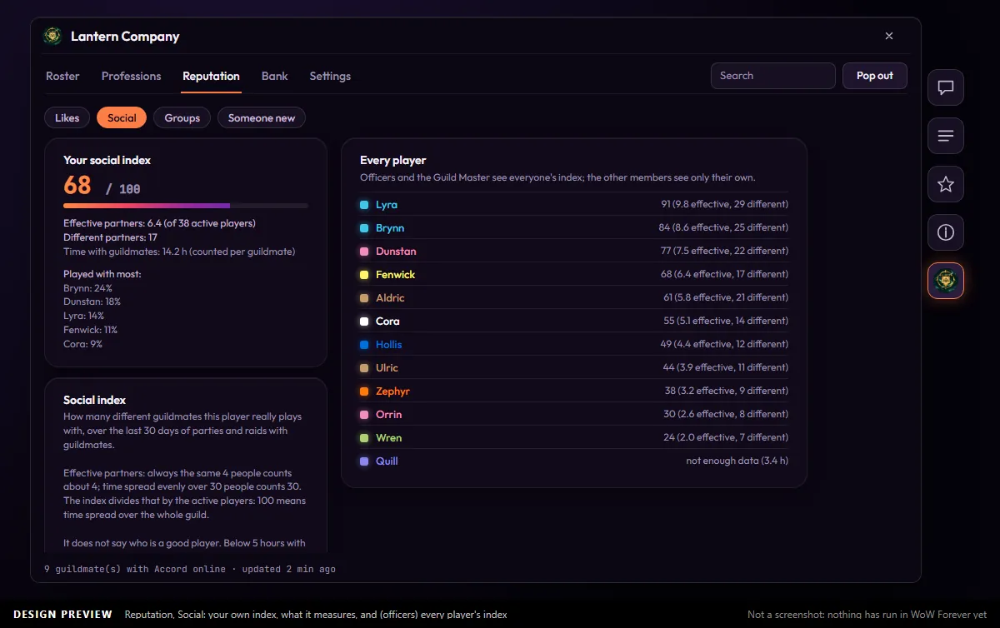
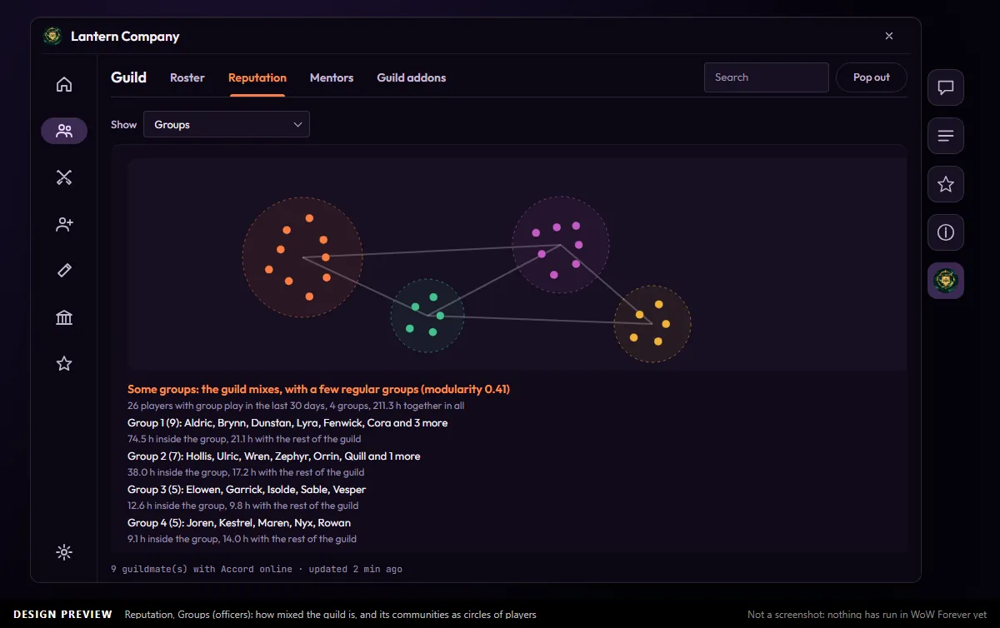
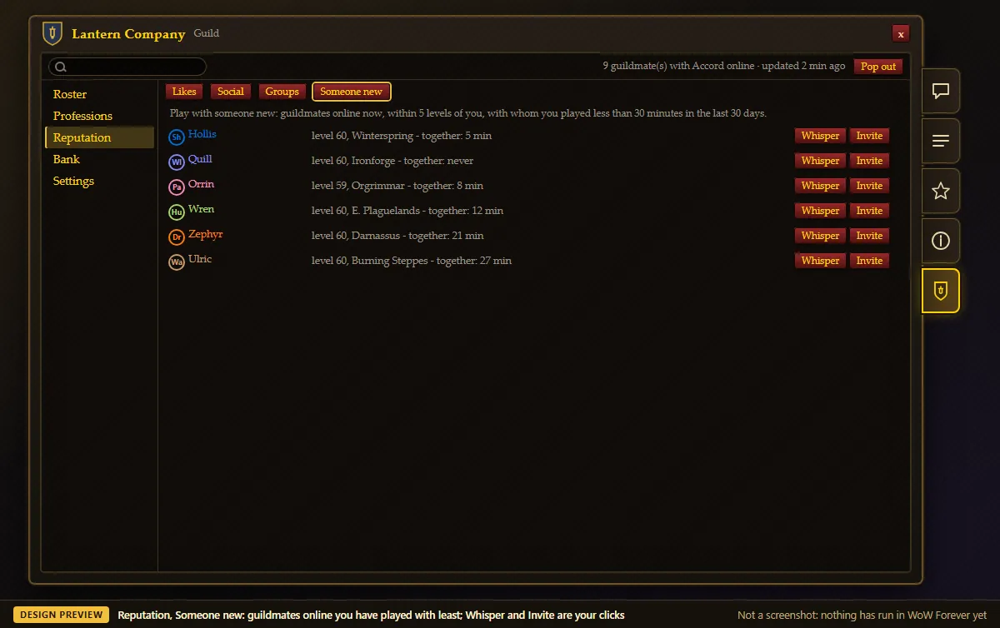

# Like e indice sociale

*English: [[Likes and Social Index|Likes-and-Social-Index]]*

> Disponibile dalla versione della reputazione (milestone M4): i like, l'indice sociale, la mappa dei gruppi e *Gioca con qualcuno di nuovo*. **La registrazione del gioco di gruppo è cominciata prima, nella milestone M2** (vedi sotto), così l'indice ha settimane di storia quando compare.

## Like

- Puoi dare **un like a ogni altro giocatore**: il like va dal tuo account al suo, e il totale si vede su tutti i suoi personaggi.
- Non puoi dare un like a te stesso o ai tuoi alt, e un like **non si può ritirare**.
- I like sono **anonimi**: tutti vedono solo i totali.
- Il tuo like è consegnato all'addon di un ufficiale online, che lo registra per la gilda. Se nessun ufficiale è online aspetta e compare come *in attesa*.

### Dare un like

- Sulla **scheda del membro** di un compagno (clicca la sua riga nel Roster): la sezione *Like* mostra il totale del giocatore e **[Dai un like]**. Cliccalo, poi clicca di nuovo entro pochi secondi per confermare: un like non si può ritirare.
- Nella vista **Reputazione** (`/accord reputation`), modalità **Like** (le modalità sono nel menu **Mostra** in alto nella vista): ogni giocatore della gilda, una riga per giocatore con tutti i suoi personaggi insieme, ordinata per like. Clicca **Like** due volte su una riga. Clicca le intestazioni per ordinare per nome o per like; la casella di ricerca trova un giocatore da uno qualsiasi dei suoi personaggi; cliccare una riga apre la sua scheda.
- Dopo la riga dice *in attesa* (ancora nessun ufficiale con l'addon online) o *dato*. I tuoi personaggi dicono *tu*.
- La colonna **Like** del Roster mostra il totale di ogni giocatore: verde quando gli hai dato un like, grigio finché il tuo like è in attesa.
- Se l'addon di un ufficiale rifiuta un like (è uno dei tuoi personaggi, o il giocatore ha lasciato la gilda), la chat dice perché.

### Come i like restano anonimi

- Il tuo addon sussurra il like a **un solo** ufficiale online con l'addon (mai al canale di gilda). L'addon di quell'ufficiale lo controlla e lo registra sotto un **codice anonimo** calcolato con un segreto che hanno solo gli addon degli ufficiali; la gilda riceve solo quel codice e il personaggio a cui hai dato il like. I membri non possono trasformare il codice in un nome.
- L'ufficiale che registra il tuo like può vedere che viene da te nel momento in cui arriva. Come nel gioco stesso, degli ufficiali ci si fida.
- L'addon ricorda **nel tuo computer** a quali giocatori hai già dato un like (così il pulsante sparisce su tutti i loro personaggi) e i like ancora in attesa. Nessun altro riceve quell'elenco.
- Un secondo like allo stesso giocatore è rifiutato, anche da un tuo alt, verso un suo alt, o dopo che hai reinstallato l'addon su un altro computer.
- Se un ufficiale se ne va e nessun altro ha il segreto, se ne crea uno nuovo: i like già dati restano, ma il controllo del secondo like allo stesso giocatore funziona solo per i like dati dopo.
- I like non possono essere inventati dai membri: gli addon della gilda accettano l'elenco dei like solo dagli ufficiali, e una voce non può mai essere cambiata o rimossa.

## Indice sociale

L'indice sociale mostra **con quanti compagni di gilda diversi qualcuno gioca davvero**, da 0 a 100. Conta i minuti passati in gruppo o in raid con compagni di gilda negli ultimi 30 giorni e li trasforma in **compagni effettivi**: giocare sempre con le stesse quattro persone vale circa 4, distribuire il tempo su trenta persone vale circa 30. L'indice divide questo numero per quello dei giocatori attivi.

Come si conta, con precisione: per gli ultimi 30 giorni, i minuti con il **giocatore** di ogni compagno (tutti i suoi personaggi insieme, e anche i tuoi); quando più addon hanno visto lo stesso gruppo, si usa il conteggio più alto. Il tempo si conta per compagno, quindi un'ora in un gruppo con quattro compagni di gilda vale quattro ore con compagni di gilda. Sotto le **5 ore** con compagni di gilda l'indice dice *dati insufficienti*. I giocatori attivi sono quelli con almeno un'ora con compagni di gilda nei 30 giorni. Il tuo addon lo calcola nel tuo computer, al massimo ogni dieci minuti, un po' alla volta così il gioco non scatta mai.

**Dove vederlo.** La tua scheda (clicca la tua riga nel Roster) e la modalità **Sociale** della vista Reputazione mostrano il tuo indice, i tuoi compagni effettivi sui giocatori attivi, con quanti compagni di gilda diversi hai giocato, il tuo tempo con compagni di gilda e i cinque con cui hai giocato di più, con la loro quota. Passa il mouse sull'indice per una breve spiegazione. Sotto le 5 ore dice *dati insufficienti*.

**Chi lo vede.** Ogni membro vede il **proprio** indice. Gli ufficiali e il Maestro di gilda vedono quello di **tutti**: sulle schede, nella colonna **Sociale** del Roster e in un elenco nella vista Reputazione. Se tutti i membri debbano vedere l'indice di tutti è ancora una questione aperta per il capogilda; fino ad allora vale questa regola.

## Mappa dei gruppi

Gli ufficiali e il Maestro di gilda hanno una modalità **Gruppi** nella vista Reputazione. Mostra:

- quanto è mescolata la gilda: *ben mescolata* (quasi tutti giocano con tutti), *qualche gruppo* o *gruppetti* (gruppi che giocano di rado insieme), con il numero che c'è dietro (la *modularità*: vicino a 0 vuol dire mescolata, 0,5 e più vuol dire gruppetti);
- un disegno, in una card: un cerchio di punti per ogni gruppo in un colore del tema scelto, un punto per giocatore (passa il mouse per il nome, clicca per la scheda);
- l'elenco dei gruppi con i loro giocatori e le ore passate dentro il gruppo e con il resto della gilda.

I gruppi si trovano in automatico dai minuti giocati insieme negli ultimi 30 giorni, allo stesso modo sul computer di ogni ufficiale.

## Gioca con qualcuno di nuovo

La modalità **Qualcuno di nuovo** della vista Reputazione suggerisce compagni di gilda **online adesso**, a non più di **5 livelli** da te, con cui hai giocato **meno di 30 minuti** negli ultimi 30 giorni (contano tutti i tuoi personaggi e tutti i loro), una riga per giocatore, prima quelli con cui non hai mai giocato. **Sussurra** apre la casella della chat con `/w Nome` da completare; **Invita** manda loro un invito al gruppo. L'addon non invia mai nulla da solo.

*Anteprime di progetto, non screenshot: sono disegnate dal layout e dai testi dell'addon (qui in inglese), con personaggi e oggetti inventati, perché l'addon non è ancora stato provato nel gioco ([tutte le anteprime](https://github.com/Finland6738/azeroth-accord/blob/main/docs/specs/mockups/previews/README.md), anche in italiano).*

## Mentori

> **Novità della `v0.12.0`**. Nulla è stato verificato nel gioco vero.

La pagina **Mentori** di **Gilda** (una modalità della vista Reputazione prima della `v0.13.0`) elenca i membri che si offrono di aiutare i nuovi; la vedono **tutti**.

- **Nessuno compare senza averlo scelto.** L'offerta è spenta: **Offriti come mentore ai nuovi membri** ti mette nell'elenco con un clic (da qui o dalla sua carta in *Cosa condivido*). Una sola offerta per account, sul personaggio con cui vuoi essere contattato.
- **Modifica** sceglie gli argomenti (raid, spedizioni, PvP, professioni, livellamento, addon) e una nota breve (80 byte).
- **Lascia l'elenco dei mentori** ti toglie quando vuoi, con un clic; l'uscita arriva agli altri come l'offerta.
- L'elenco mostra il personaggio, il main, gli argomenti, la nota e chi è in linea; filtra per argomento o cerca per nome. **Sussurra** apre soltanto la casella della chat.

I **mentori suggeriti** sono solo per gli ufficiali e il Guild Master: per ogni nuovo membro (in prova, o entrato negli ultimi 30 giorni) fino a tre tra chi si è offerto, in base al tempo giocato insieme, ai compagni in comune, alla mappa dei gruppi e alle ore in cui di solito si è in linea ([[Roster di gilda|Guild-Roster-it]], *Prove*). Di una coppia non si salva né si invia nulla, e né il mentore né il nuovo membro ricevono avvisi. Il tempo giocato insieme arriva all'addon di ogni membro: mostrare le coppie solo agli ufficiali è una regola dell'interfaccia.

## Cosa viene registrato (dalla versione del roster in poi)

Ogni minuto in cui sei in gruppo o in raid con almeno un compagno di gilda, l'addon aggiunge un minuto a ogni coppia di compagni di gilda nel gruppo, anche dentro le istanze. I minuti sono conservati per giorno, condivisi con la tua gilda una volta all'ora (e quando esci) e scartati dopo 90 giorni. Quando più giocatori con l'addon erano nello stesso gruppo, si usa il conteggio più alto, mai la somma. L'indice sociale, la mappa dei gruppi e i suggerimenti si calcolano da questi minuti; `/accord debug` stampa solo conteggi (mai nomi). I membri che il gioco nasconde agli addon dentro un'istanza vengono lasciati fuori invece che indovinati.
