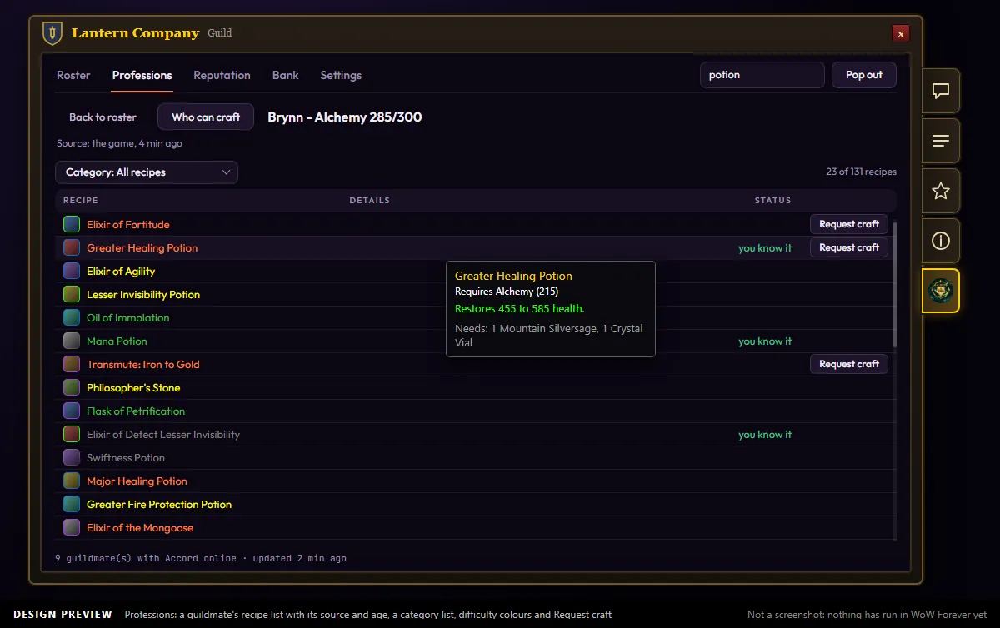

# Professioni e ricette

*English: [[Professions and Recipes|Professions-and-Recipes]]*

> Disponibile dalla versione delle professioni (milestone M3): elenchi di ricette, **chi può creare** e **Chiedi di crearlo**.

## Le ricette della gilda

La vista **Professioni** (`/accord professions`, o l'icona **Professioni** della barra di navigazione, pagina **Ricette**) si apre sulle **ricette della gilda**: scegli una professione nell'elenco sopra la tabella e vedi **tutte le ricette di quella professione**, imparate da qualcuno della gilda o no. Ogni riga ha l'icona e il nome della ricetta (nella lingua del tuo gioco) e **quanti personaggi della gilda possono crearla** ("2 possono crearlo", o "ancora nessuno"). Le ricette sono ordinate per nome. WoW Forever non dice agli addon il livello di abilità che una ricetta richiede, quindi la vista non lo mostra.

- **Clicca una ricetta** per vedere **chi può crearla**, subito sotto: prima i personaggi online, gli alt di uno stesso giocatore insieme, con **Chiedi di crearlo** accanto a chi è online. Un altro clic la chiude.
- **Clicca la professione di un membro** nella tabella del Roster o nella scheda del membro: questo elenco si apre su quella professione. Per ora un clic su un personaggio sotto una ricetta non apre nulla (l'elenco del singolo membro è spento, vedi sotto).
- Il secondo elenco sopra la tabella parte su *Qualcuno può crearla*: all'inizio vedi solo le ricette che qualcuno della gilda sa creare. Scegli *Tutte le ricette* per vedere tutta la professione, oppure *Nessuno può ancora crearla*, o le ricette che conosci o non conosci. Ogni professione che scegli riparte da *Qualcuno può crearla*, e un clic sulla scheda **Ricette** riporta sempre a questo elenco con il menu delle professioni. La casella di ricerca filtra per nome.
- Passa il mouse su una ricetta per vedere il suggerimento del gioco, subito accanto al nome.
- La riga sotto il titolo dice chi ha condiviso l'elenco completo e quanto è vecchio.

L'elenco completo viene dal gioco stesso: lo condivide il primo compagno di gilda che apre la finestra di quella professione con Azeroth Accord, e si condivide di nuovo solo quando il gioco mostra qualcosa di nuovo. Fino ad allora la vista mostra solo le ricette che qualcuno della gilda conosce, e lo dice. Niente viene da un elenco spedito con l'addon.

## Aprire le ricette di un membro

> **Spento per ora** (2026-11-27): un clic sulla professione di un membro apre le **Ricette della gilda** su quella professione, e un clic su un personaggio sotto una ricetta non apre nulla. Il testo qui sotto descrive l'elenco del singolo membro per quando tornerà.

Nella tabella del **Roster**, le celle **Professione 1** e **Professione 2** mostrano la professione e il suo livello (`Alchimia 285/300` quando il massimo è noto). Passa il mouse su una cella per vedere **da dove viene l'informazione** (il gioco, o l'addon del membro e quanto è vecchia) e cliccala: la vista **Professioni** si apre sull'elenco delle ricette di quel membro. Le righe delle professioni della **scheda del membro** fanno lo stesso.

L'elenco è una tabella con le colonne *Ricetta*, *Dettagli* e *Stato*: un'icona e il nome di ogni ricetta che il membro conosce, ordinate per nome, con il suggerimento del gioco quando passi il mouse su una ricetta. Sopra vedi il membro (nel colore della classe), la professione e il livello, **da dove viene l'elenco e quanto è vecchio** (per esempio "Fonte: condivisa dall'addon del membro, 3 g fa") e quante ricette corrispondono. Scorri gli elenchi lunghi con la rotella del mouse; l'elenco resta al suo posto quando arrivano nuovi dati.

- **Cerca**: scrivi nella casella di ricerca in alto nel pannello per filtrare per nome della ricetta.
- **Categoria**: l'elenco sopra la tabella offre *Ricette che conosco* e *Ricette che non conosco* (confrontate con il tuo elenco della stessa professione, dopo che hai aperto quella professione) e, quando il gioco le dice, le categorie delle ricette. Le ricette che conosci anche tu sono segnate "la conosci".
- **Torna al roster** riporta alla tabella.
- L'elenco parte dalle ricette che il membro **ha imparato e può creare**. Quando la gilda ha l'elenco completo della professione, scegli *Tutte le ricette* sopra la tabella per vederle tutte: quelle che il membro non ha imparato sono attenuate e segnate "non imparata".
- **Tutti i membri** mostra le ricette di quella professione per tutta la gilda (vedi *Le ricette della gilda*), a partire da quelle che qualcuno sa creare.

## Quando non c'è un elenco

Se il gioco non dà l'elenco e l'addon del membro non l'ha condiviso, il pannello dice perché e cosa fare: nessuno che abbia l'elenco è online (chiedi al membro di aprire la finestra della professione con Azeroth Accord, si condivide subito), il membro non usa l'addon, oppure l'elenco è in richiesta. Quando apri le ricette di un membro e l'addon non ha ancora il suo elenco, lo chiede con un sussurro (al membro se è online, altrimenti a un ufficiale) e l'elenco compare qualche secondo dopo.

## Le tue ricette

Le tue ricette si condividono quando apri la finestra della professione con l'addon: Azeroth Accord legge l'elenco un paio di secondi dopo che la finestra si apre (o cambia) e lo pubblica ai compagni che hanno l'addon. La stessa lettura dà alla gilda anche l'**elenco completo** della professione (vedi *Le ricette della gilda*). Una finestra che mostra le ricette di un altro (un link di professione dalla chat) non si legge mai. Si ripubblica solo quando qualcosa è cambiato (una nuova ricetta, un nuovo livello di abilità), e al massimo una volta ogni 10 minuti per professione. Anche Cucina, Primo soccorso e Pesca sono condivise, così "chi può creare" trova il tuo cuoco; non compaiono nelle colonne delle professioni del roster, che mostrano le due professioni principali.

## Chi può creare

Apri la vista **Professioni** (`/accord professions`, o la pagina **Ricette** dell'icona **Professioni**), scegli la professione e **clicca una ricetta**: sotto compaiono i personaggi che possono crearla, **prima i membri online**, con i personaggi di un giocatore insieme. La casella di ricerca a destra delle schede filtra le ricette per nome. Clicca un membro per vedere tutte le sue ricette. La ricerca copre i membri **di cui l'elenco delle ricette è noto**; se non compare nessuno, apri le ricette di qualche membro (l'addon le chiede).

## Chiedi di crearlo

Accanto a ogni ricetta di un membro **online** (nel suo elenco, o sotto una ricetta della gilda) c'è un pulsante **Chiedi di crearlo**. Apre la casella della chat con un sussurro a quel membro già scritto, con il link della ricetta: *"Ciao! Potresti creare [ricetta] per me? Grazie!"*. **Azeroth Accord non lo invia mai**: lo leggi, lo cambi se vuoi e premi Invio. Il pulsante non si vede per i membri offline (un sussurro non li raggiungerebbe), per le tue ricette e sulla riga di intestazione di una ricetta. Dalla `v0.9.0` il [[Centro azioni|Action-Center-it]] tiene un promemoria della richiesta per 7 giorni, solo sul tuo computer.

## Gli ordini di crafting

> **In arrivo con la milestone M13, nascosti finché M13 non è completa**: l'addon pubblicato non mostra ancora niente di tutto questo, e nulla di ciò che segue è stato provato nel gioco vero.

**Chiedi di crearlo** (*Request craft*) aprirà la finestra **Nuovo ordine** invece del solo sussurro: scegli l'artigiano (anche offline: vedrà l'ordine al prossimo accesso), quanti, chi porta i materiali, un prezzo a parole tue, una nota e, se vuoi, il giorno entro cui ti serve. *Sussurra anche a* tiene il messaggio di prima, spento di predefinito. L'ordine lo vede tutta la gilda.

La pagina **Ordini** di **Professioni** (una modalità della vista Mercato prima di M13.7) elenca gli ordini, *Per me*, *I miei* o *Tutti*, e a richiesta anche i chiusi. Un ordine passa per **richiesto, accettato, in lavorazione, pronto, consegnato**, oppure finisce **annullato**:

| Chi | Passi |
|---|---|
| L'artigiano | *Accetta* o *Rifiuta*, poi *Ci lavoro*, *Pronto*, *Consegnato* (e *Rifiuta* fino ad allora) |
| Il compratore | *Annulla ordine* in ogni momento prima di confermare; *Ricevuto* quando ha l'oggetto |

Ogni passo chiede un secondo clic (**Conferma**). Un ordine è **consegnato solo quando lo confermano entrambi**: con una conferma sola resta *pronto* e dice chi manca. Ognuno dei due scrive solo la propria parte; nessun altro, ufficiali compresi, può cambiare un ordine. **Accord non sposta mai oro né oggetti**: li scambi o li spedisci tu, e il prezzo è solo il testo che hai scritto.

Un ordine che nessuno accetta scade dopo 14 giorni; uno con un giorno "entro", 7 giorni dopo quel giorno; uno accettato senza giorno, dopo 60 giorni senza un passo. Gli ordini chiusi si cancellano dopo 30 giorni. Puoi avere al massimo 10 ordini aperti. Il [[Centro azioni|Action-Center-it]] mostra ciò che aspetta te. Le richieste fatte prima come sussurri compaiono una volta sotto *Dalle tue richieste precedenti*, con *Crea l'ordine* e *Scarta*: niente si pubblica senza un tuo clic.

## La lista dei desideri

> **In arrivo con la milestone M13, nascosta finché M13 non è completa**: l'addon rilasciato non mostra ancora nulla di questo, e quanto segue non è stato provato nel gioco.

Nella vista **Mercato** (`/accord market`, una pagina di **Economia**), *Desideri* nel suo menu **Mostra** raccoglie ciò che vorresti avere. Aggiungi un oggetto incollandone il link, scrivendone il numero o il nome di un oggetto che il tuo gioco conosce già; scegli quanti e per quanti giorni (14 se non dici altro, al massimo 30) e, se vuoi, una nota per tutta la lista. Puoi desiderare fino a 30 oggetti. **Tutta la gilda vede la tua lista**, e ogni voce sparisce da sola dopo i suoi giorni.

Sotto la tua lista ci sono i desideri della gilda, per oggetto, con chi è online per primo. *Ne ho* apre la casella della chat con un sussurro già scritto ("Ciao! Ho Panno di lino per la tua lista dei desideri."): lo mandi **tu**. La colonna *Tuoi* dice quanti ne hai (borse, banca, posta e alt, vedi la [lista della spesa](#la-lista-della-spesa)), così sai se puoi aiutare. La lista non ha prezzi: non è una vendita.

## La domanda di materiali

> **In arrivo con la milestone M13, nascosta finché M13 non è completa.**

Il chip *Domanda* somma i materiali che servono agli [ordini di crafting](#gli-ordini-di-crafting) aperti (richiesti, accettati o in lavorazione), una riga per materiale, con quanti ne mostrava la banca di gilda all'ultima visita e quanti ne hai tu (*Tuoi*). Passa su una riga per vedere quali ordini lo chiedono. Cambia da sola quando un ordine è pronto o chiuso.

L'addon chiede al gioco i materiali di una ricetta e non li inventa mai. Se una riga dice che alcuni materiali sono sconosciuti, apri una volta quella professione con un tuo personaggio. Conta anche quanto manca agli [[obiettivi di gilda|Guild-Bank-it]] aperti in oggetti.

## La lista della spesa

> **In arrivo con la milestone M13, nascosta finché M13 non è completa**: l'addon rilasciato non mostra ancora nulla di questo, e quanto segue non è stato provato nel gioco.

La **Lista della spesa** è una pagina di **Professioni**; nelle ricette della gilda anche **Lista della spesa** la apre, e ogni ricetta ha **Alla lista** (una in più a ogni clic; non serve conoscere la ricetta). Nella pagina puoi aggiungere anche da una professione e dalle sue ricette (la casella di ricerca le filtra), scegliere **quante volte** creare ogni ricetta (da 1 a 999; una ricetta che dà più pezzi dice quanti ne escono), usare **-**, **+** e **Togli**, o **Svuota lista**. Fino a 50 ricette, di qualsiasi professione. La lista è del tuo computer: ogni personaggio vede la stessa.

Accord somma i materiali che il gioco dà per quelle ricette, una riga per materiale: una barra **posseduti / necessari**, i numeri (`12 / 40`), quanti **mancano**, quanti ne mostrava la **banca di gilda** all'ultima visita e, se usi Auctionator, il **prezzo** d'asta. Prima i mancanti. Passa su una riga per vedere dove li hai, ognuno con la sua età: le tue borse, la tua banca, la tua posta e i tuoi **alt** dello stesso reame e fazione (come Accord li ha visti l'ultima volta su questo computer; un alt che non ha mai aperto la banca con Accord dice *mai letta*). La banca di gilda non si somma mai a ciò che possiedi.

- **Scomponi i materiali intermedi**: un materiale che una ricetta crea (un rotolo di stoffa di seta) si sostituisce con ciò di cui è fatto, solo per la parte che non hai ancora. La riga del rotolo resta, attenuata, con "1 posseduti, 5 scomposti".
- **Solo i mancanti**, **Conta gli alt** e **Conta la posta** cambiano ciò che si vede e si conta. La posta si legge quando apri la cassetta; il contrassegno non conta, e gli oggetti spediti a un alt contano quando quell'alt apre la cassetta.
- La lista **si aggiorna mentre raccogli e compri**.
- **Chiedi alla gilda** mette i materiali mancanti nella tua [lista dei desideri](#la-lista-dei-desideri), dopo una finestra che mostra esattamente che cosa vedrà la gilda.
- **Chiedi alla banca** elenca i materiali mancanti che la banca di gilda mostra; **Richiedi** apre il modulo delle richieste della banca già compilato con l'oggetto, la quantità che ti manca (non oltre quanto mostra la banca) e il motivo "Lista della spesa: ...". Lo controlli e premi *Invia richiesta*, una richiesta per volta.

Nulla della lista o dei tuoi conteggi lascia il tuo computer finché non premi uno di quei due pulsanti, e anche allora solo ciò che manca. Accord non compra, non spedisce e non sposta nulla. Se una riga dice che i materiali di alcune ricette sono sconosciuti, apri una volta quella professione con un personaggio di questo computer.

## Bacheca compro/vendo

> **In arrivo con la milestone M13, nascosta finché M13 non è completa**: l'addon rilasciato non mostra ancora nulla di questo, e niente di quanto segue è stato provato nel gioco vero.

Nella vista **Mercato**, *Bacheca* nel suo menu **Mostra** raccoglie gli annunci della gilda: *WTS* (vendo) e *WTB* (compro). **Nuovo annuncio** chiede se vendi o compri, l'oggetto (un link incollato, il suo numero o il nome di un oggetto che il tuo gioco conosce già), quanti, per quanti giorni (3 se non dici altro, al massimo 7), un prezzo scritto a parole tue e una nota. Puoi avere al massimo 10 annunci aperti, e **li vede tutta la gilda**. Un annuncio non si modifica: per cambiare il prezzo ritiralo e pubblicane un altro. Alla fine dei suoi giorni sparisce da solo.

Se un annuncio ti interessa premi **Mi interessa**: l'autore vede il tuo nome (**Sussurra** apre la casella della chat se vuoi parlargli). Poi vi incontrate e scambiate **nel gioco, a mano**. A scambio fatto confermate tutti e due: l'autore ti sceglie e preme **Affare fatto con ...**, tu premi **Affare fatto**. L'affare è **concluso solo con le due conferme**; con una sola l'annuncio resta aperto per tutti e dice chi manca. Finché l'altro non ha confermato puoi usare **Annulla conferma** o **Non mi interessa**. Un affare concluso resta visibile 7 giorni. Ogni passo chiede un secondo clic (**Conferma**).

**Accord non commercia e non sposta mai oro né oggetti**: i prezzi sono quelli scritti dall'autore, quindi controlla la finestra di scambio. I chip mostrano *Vendo*, *Compro* o tutti, e **Solo dove posso aiutare** tiene gli oggetti cercati che possiedi e quelli in vendita che stanno nella tua lista dei desideri o della spesa. **Nascondi annunci** nasconde gli annunci di una persona solo sul tuo computer; da *Impostazioni* tornano. Non ci sono voti ai giocatori né moderazione degli ufficiali.

## Se manca qualcosa

- **L'elenco di un membro non c'è**: il gioco non dà sempre gli elenchi delle ricette, e l'addon di un membro condivide il suo solo dopo che apre la finestra della professione con Azeroth Accord. Il pannello lo dice, e chiede da solo l'elenco finché è online qualcuno che lo ha.
- **Una ricetta compare come "Ricetta 1234"**: il gioco non ha ancora dato il suo nome; compare tra un attimo.
- **"Chi può creare" non trova nessuno**: cerca tra i membri di cui l'elenco è noto. Apri le ricette di qualche membro (l'addon le chiede) e cerca di nuovo.

Vedi anche le [[Domande frequenti|FAQ-it]].
