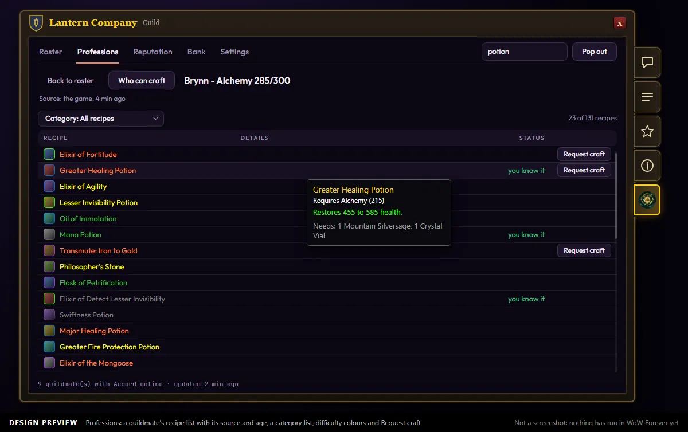
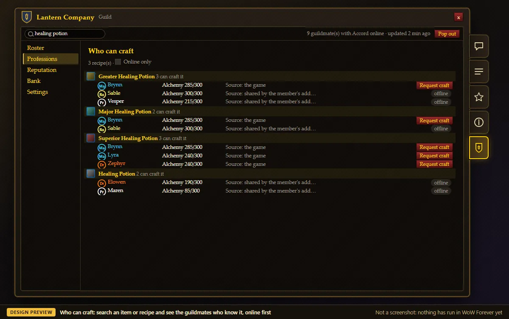

# Professions and recipes

*Italiano: [[Professioni e ricette|Professions-and-Recipes-it]]*

> Available from the professions version (milestone M3): recipe lists, **who can craft** and **Request craft**.

## Guild recipes

The **Professions** view (`/accord professions`, or the **Professions** tab) opens on the **guild's recipes**: pick a profession in the list above the table and you see **every recipe of that profession**, learned by somebody in the guild or not. Each line has the recipe's icon and name (in your game's language) and **how many guild characters can craft it** ("2 can craft it", or "nobody yet"). Recipes are sorted by name. WoW Forever does not tell addons the skill level a recipe needs, so the view does not show it.

- **Click a recipe** to see **who can craft it**, right under it: online characters first, the alts of one player together, with **Request craft** next to the ones who are online. Click it again to close it.
- **Click a character** to open **their recipes** of that profession: at first the ones they learned and can craft. The list above the table also offers *All recipes* (the ones they miss are dimmed and marked "not learned") and *Not learned by …*. **Back to guild recipes** returns.
- The second list above the table starts on *Somebody can craft it*: at first you see only the recipes somebody in the guild can craft. Choose *All recipes* to see the whole profession, or *Nobody can craft it yet*, or the recipes you know or do not know. Every profession you pick starts again on *Somebody can craft it*, and a click on the **Professions** tab always brings back this list with the profession menu. The search box filters by name.
- Hover a recipe to see the game's tooltip, right next to its name.
- The line under the title says who shared the full list and how old it is.

The full list comes from the game itself: the first guildmate who opens that profession's window with Azeroth Accord shares it, and it is shared again only when the game shows something new. Until then the view shows only the recipes somebody in the guild knows, and says so. Nothing comes from a list shipped with the addon.

## Opening a member's recipes

In the **Roster** table, the **Profession 1** and **Profession 2** cells show the profession and its rank (`Alchemy 285/300` when the maximum is known). Hover a cell to see **where the information comes from** (the game, or the member's addon and how old) and click it: the **Professions** view opens on that member's recipe list. The profession lines of the **member card** do the same.

The list is a table with the columns *Recipe*, *Details* and *Status*: an icon and the name of every recipe the member knows, sorted by name, with the game's own tooltip when you hover a recipe. Above it you see the member (in the colour of the class), the profession and the rank, **where the list comes from and how old it is** (for example "Source: shared by the member's addon, 3 d ago"), and how many recipes match. Scroll long lists with the mouse wheel; the list keeps its place when new data arrives.

- **Search**: type in the search box at the top of the panel to filter by recipe name.
- **Category**: the list above the table offers *Recipes I know* and *Recipes I do not know* (compared with your own list of the same profession, once you have opened that profession yourself) and, when the game tells it, the recipe categories. Recipes you know too are marked "you know it".
- **Back to roster** returns to the table, and **Who can craft** opens the search below.
- The list starts on the recipes the member **learned and can craft**. When the guild has the profession's full list, choose *All recipes* above the table to see every recipe of the profession: the ones the member has not learned are dimmed and marked "not learned".
- **All members** shows the recipes of that profession for the whole guild (see *Guild recipes*), starting with the ones somebody can craft.

## When there is no list

If the game does not give the list and the member's addon has not shared it, the panel says why and what to do: nobody who has the list is online (ask the member to open their profession window with Azeroth Accord, it is shared at once), the member does not use the addon, or the list is being requested. When you open a member's recipes and the addon does not have their list yet, it asks for it by whisper (to the member if they are online, else to an officer) and the list appears a few seconds later.

## Your own recipes

Your own recipes are shared when you open your profession window with the addon: Azeroth Accord reads the list a couple of seconds after the window opens (or changes) and publishes it to your guildmates who have the addon. The same reading also gives the guild the profession's **full list** (see *Guild recipes*). A window that shows somebody else's recipes (a profession link from the chat) is never read. It is published again only when something changed (a new recipe, a new skill rank), and at most once every 10 minutes per profession. Cooking, First Aid and Fishing are shared too, so "who can craft" finds your cook; they do not appear in the profession columns of the roster, which show the two main professions.

## Who can craft

Open the **Professions** view (`/accord professions`, or the **Professions** tab), click **Who can craft** and type the name of an item or a recipe in the search box at the right of the tabs (at least two letters; you can also paste an item link). The view lists the recipes that match and, under each one, the members who can craft it: **online members first**, then by name, with the characters of one player together (the alts a little to the right). Each line says the profession and rank and where the list comes from and how old it is. The button **Online only** (lit while it is on) keeps just the members who are online now. Click a member to see all their recipes; **Back to the search** returns to the search, and **Guild recipes** to the guild's recipes.

The search covers the members **whose recipe list is known**: lists shared by guildmates who use Azeroth Accord, and lists the game gave you when you opened a member's recipes. If nobody is found, open a few members' recipes (the addon asks for them) and search again.

*Design previews, not screenshots: drawn from the addon's own layout and texts with invented characters and items, because the addon has not been run in the game yet ([all previews](https://github.com/Finland6738/azeroth-accord/blob/main/docs/specs/mockups/previews/README.md)).*

## Request craft

Next to every recipe of an **online** member (in their list, or under the recipe in *Who can craft*) there is a **Request craft** button. It opens the chat box with a whisper to that member already written, with the recipe link in it: *"Hello! Could you craft [recipe] for me? Thank you!"*. **Azeroth Accord never sends it**: you read it, change it if you like and press Enter. The button is not shown for offline members (a whisper would not reach them), for your own recipes, or on the recipe's header line. From `v0.9.0` the [[Action Center|Action-Center]] keeps a reminder of the request for 7 days, on your computer only.

## If something is missing

- **The list of a member is not there**: the game does not always give recipe lists, and a member's addon shares theirs only after they open the profession window with Azeroth Accord. The panel says so, and asks for the list by itself while somebody who has it is online.
- **A recipe shows as "Recipe 1234"**: the game has not given its name yet; it appears in a moment.
- **"Who can craft" finds nobody**: it searches the members whose list is known. Open a few members' recipes (the addon asks for them) and search again.

See also the [[FAQ]].
