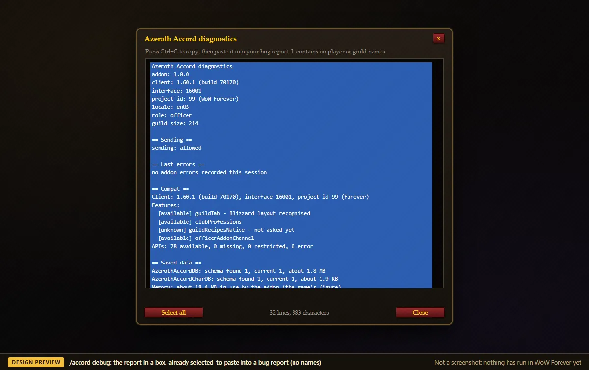

# Segnalare bug e dare feedback

*English: [[Reporting Bugs and Feedback|Reporting-Bugs-and-Feedback]]*

Apri una segnalazione (*issue*) nel repository con il modulo *Bug report*, oppure condividi idee e domande nelle discussioni Feedback. I risultati delle prove nel gioco vero hanno un modulo proprio, *In-game test report*. I moduli sono in inglese.

## Il rapporto

Scrivi `/accord debug` nel gioco. Si apre una casella con il rapporto già selezionato: premi **Ctrl+C**, chiudi la casella e incolla il testo nel modulo. Mostra quante righe e quanti caratteri ha; è tagliato a 30.000 caratteri (si taglia la fine; le sezioni importanti vengono prima).

**Non contiene nomi di giocatori, gilde, BattleTag o Discord, né il codice dell'account, né gli id dei personaggi, né le cartelle del tuo PC.** Se un messaggio di errore dell'addon nomina un compagno, la tua gilda o te, il nome è sostituito da `<player>` o `<guild>` prima di entrare nel rapporto. Sostituisci con un segnaposto come `<player>` ogni altro nome che incolli tu.

Il rapporto comincia con i dati che il modulo *Bug report* chiede, con gli stessi nomi, così puoi copiarli:

| Riga del rapporto | Campo del modulo |
|---|---|
| `addon:` | Addon version (versione dell'addon) |
| `client:` e `locale:` (più `interface:` e `project id:`) | Game client (client di gioco) |
| `role:` (member, officer o guild master) | Your role when it happened (il tuo ruolo quando è successo) |
| `guild size:` | Guild size (dimensione della gilda, facoltativa; conta per lentezza e memoria) |

Poi elenca:

- se l'addon può inviare adesso (o aspetta per un blocco della chat o una restrizione, per esempio durante un boss);
- gli ultimi errori dell'addon, con le cartelle del tuo computer tolte;
- **Features**: quali parti del gioco l'addon ha potuto usare nel tuo client (`available`), non ha potuto usare (`missing`), o non ha ancora potuto controllare (`unknown`, per esempio la banca di gilda prima che tu la apra);
- **APIs**: ogni funzione del gioco che l'addon usa e se ha funzionato;
- **Saved data**: la dimensione dei dati salvati (account, personaggio e gilda attuale, per tipo di dato) e **Memory**: la memoria che il gioco dice usata dall'addon;
- una sezione per ogni parte dell'addon (sync, store, roster, likes, bank...) con solo conteggi e stati.

Incolla il rapporto intero: un rapporto con le prime righe tagliate non si può abbinare a una versione. Se il gioco mostra anche una finestra di errore Lua, incolla anche il suo testo.

## Cosa mandare dove

- Qualcosa non funziona: una issue *Bug report*.
- Funziona ma potrebbe essere meglio, o hai una domanda: una discussione Feedback.
- Hai fatto una prova della checklist nel gioco: una issue *In-game test report*, con l'id della prova (per esempio `M3 step 4`) e, meglio ancora, il rapporto.
