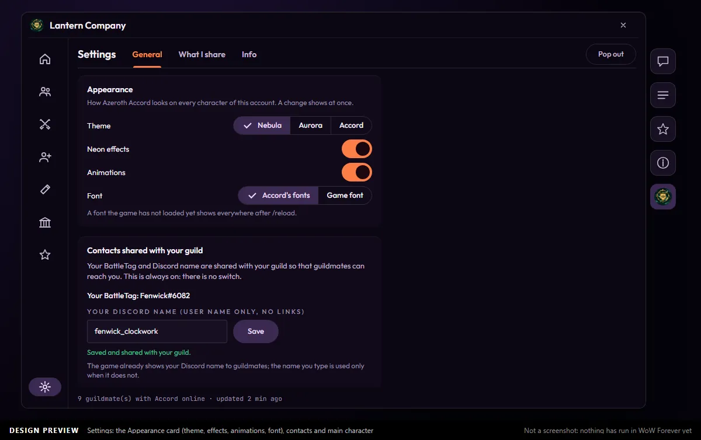
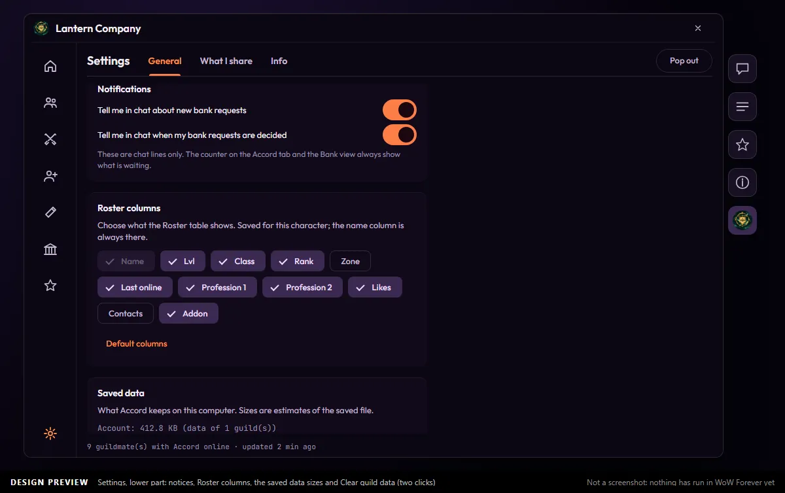

# Impostazioni

*English: [[Settings|Settings]]*

Aprile con `/accord settings`, o dalla scheda **Impostazioni** del pannello. La stessa pagina è anche nella finestra delle impostazioni del gioco, sotto *Opzioni → AddOn → Azeroth Accord*. Una modifica fatta in un posto si vede subito nell'altro, e ogni modifica è salvata appena la fai.

La pagina scorre con la rotella del mouse.

*Anteprime di progetto, non screenshot: sono disegnate dal layout e dai testi dell'addon (qui in inglese), con personaggi e oggetti inventati, perché l'addon non è ancora stato provato nel gioco ([tutte le anteprime](https://github.com/Finland6738/azeroth-accord/blob/main/docs/specs/mockups/previews/README.md), anche in italiano).*

## Aspetto

La prima card decide come appare Azeroth Accord. La scelta è salvata **per account**, quindi tutti i tuoi personaggi hanno lo stesso aspetto, e una modifica si vede subito, senza `/reload`.

| Opzione | Scelte | Predefinito |
|---|---|---|
| Tema | **Nebula** (scuro, viola e arancione), **Aurora** (chiaro, blu e verde acqua), **Accord** (scuro, verde e oro, i colori del logo) | Nebula |
| Effetti neon | sì / no: i bagliori dei temi scuri; spenti danno colori piatti, un po' più leggeri per il computer | sì |
| Animazioni | sì / no: dissolvenze, scorrimenti e la pressione dei pulsanti; spente rendono ogni cambiamento immediato | sì |
| Carattere | **Caratteri di Accord** (Orbitron, Outfit, JetBrains Mono) o **Carattere del gioco** | Caratteri di Accord |

Passa il mouse su un interruttore per una breve spiegazione. Un carattere che il gioco non ha ancora caricato si vede ovunque dopo `/reload` (il gioco legge i nuovi file di caratteri solo allora). I colori delle classi e degli oggetti sono quelli del gioco e non cambiano con il tema; nel tema chiaro il nome di un giocatore è scuro e il quadratino accanto porta il colore della classe.

## Contatti condivisi con la gilda

- Il tuo **BattleTag** è letto dal gioco e mostrato qui.
- Scrivi il tuo **nome Discord** (solo il nome utente, da 2 a 32 caratteri, senza spazi e senza link) e premi *Salva*. Si usa solo quando il gioco non mostra già il tuo nome Discord ai compagni.

Entrambi sono **sempre condivisi con la tua gilda**, così i compagni possono raggiungerti: non c'è un interruttore. Niente esce dalla gilda. Vedi [[Privacy e dati|Privacy-and-Data-it]].

## Personaggio principale

Scegli quale dei tuoi personaggi è il tuo **main**. Guida i tuoi personaggi nel Roster raggruppato e nella scheda del membro ([[Roster di gilda|Guild-Roster-it]]). Finché non ne scegli uno, guida il personaggio di livello più alto. Il menu elenca i personaggi del tuo account in questo reame.

## Notifiche

| Opzione | Chi la vede | Predefinito |
|---|---|---|
| Avvisami in chat delle nuove richieste alla banca | solo gli ufficiali | sì |
| Avvisami in chat quando le mie richieste alla banca sono decise | tutti | sì |

Ogni opzione è un interruttore. Sono singole righe in chat (mai un diluvio all'accesso). Spegnerle non nasconde nulla: il contatore sulla scheda Accord e la vista Banca mostrano sempre cosa è in attesa ([[Banca di gilda|Guild-Bank-it]]).

## Colonne del roster

Clicca i chip delle colonne che la tabella del Roster mostra (un chip pieno è mostrato); la colonna del nome c'è sempre. *Colonne predefinite* le rimette a posto. La scelta è salvata **per personaggio**.

## Dati salvati

Mostra quanto sono grandi i dati salvati dall'addon nel tuo computer (stime del file salvato): l'account, questo personaggio e la gilda attuale, con una riga per ogni tipo di dato della gilda e il suo numero di record. Non contiene nomi.

**Cancella i dati della gilda** dimentica tutto ciò che l'addon ha sulla gilda attuale e chiede ai compagni di rimandarlo. Cliccalo una volta per vedere quanto si libererà, poi clicca di nuovo entro 8 secondi per cancellare (altrimenti si annulla).

**Conserva** ciò che solo il tuo computer conosce e la gilda non può rimandare: i tuoi like (così non puoi dare due volte lo stesso like), la chiave dei like della gilda se sei ufficiale, lo storico del denaro della banca e gli avvisi della banca già visti. Non tocca mai i dati dell'account (i tuoi personaggi, il tuo main, il tuo nome Discord), le tue impostazioni o i dati di un'altra gilda. Si può usare tranquillamente quando i dati sembrano sbagliati o troppo grandi; la gilda li riempie di nuovo entro pochi minuti, quando ci sono compagni online.
