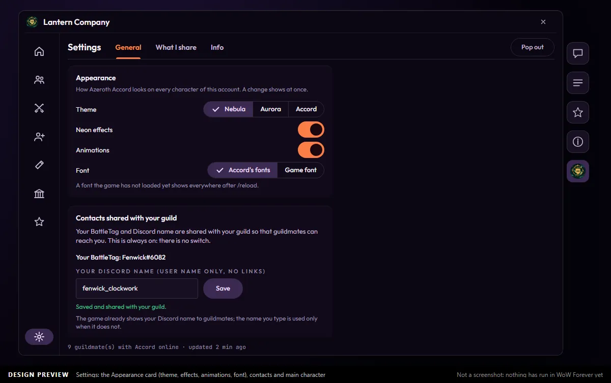
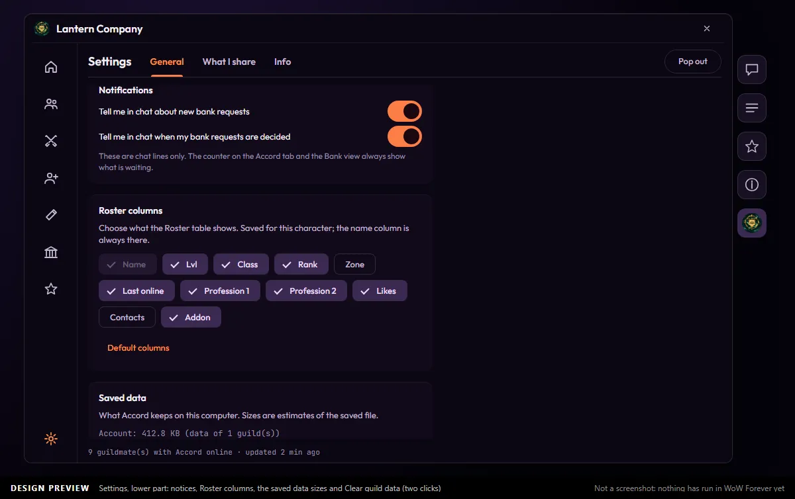

# Settings

*Italiano: [[Impostazioni|Settings-it]]*

Open it with `/accord settings`, or from the **Settings** tab of the panel. The same page is also in the game's own settings window, under *Options → AddOns → Azeroth Accord*. A change made in one place shows in the other at once, and every change is saved as you make it.

The page scrolls with the mouse wheel.

*Design previews, not screenshots: drawn from the addon's own layout and texts with invented characters and items, because the addon has not been run in the game yet ([all previews](https://github.com/Finland6738/azeroth-accord/blob/main/docs/specs/mockups/previews/README.md)).*

## Appearance

The first card sets how Azeroth Accord looks. The choice is saved **per account**, so every character of yours looks the same, and a change shows at once, without `/reload`.

| Option | Choices | Default |
|---|---|---|
| Theme | **Nebula** (dark, violet and orange), **Aurora** (light, blue and teal), **Accord** (dark, green and gold, the colours of the logo) | Nebula |
| Neon effects | on / off: the glows of the dark themes; off gives flat colours, a little lighter for the computer | on |
| Animations | on / off: fades, slides and the press of the buttons; off makes every change immediate | on |
| Font | **Accord's fonts** (Orbitron, Outfit, JetBrains Mono) or the **game font** | Accord's fonts |

Hover a switch for a short explanation. A font the game has not loaded yet shows everywhere after `/reload` (the game reads new font files only then). Class colours and item colours are the game's own and do not change with the theme; on the light theme a player's name is dark and the small square next to it carries the class colour.

## Contacts shared with your guild

- Your **BattleTag** is read from the game and shown here.
- Type your **Discord name** (user name only, 2 to 32 characters, no spaces, no links) and press *Save*. It is used only when the game does not already show your Discord name to your guildmates.

Both are **always shared with your guild**, so guildmates can reach you: there is no switch. Nothing leaves the guild. See [[Privacy and Data|Privacy-and-Data]].

From `v0.9.0` this card also has **Share my addon list** (on by default), the same switch as on the *What I share* page: see [[Guild addons|Guild-Addons]].

## Main character

Pick which of your characters is your **main**. It leads your characters in the grouped Roster and on the member card ([[Guild Roster|Guild-Roster]]). Until you pick one, the highest-level character leads. The menu lists the characters of your account on this realm.

## Absence

Tell your officers when you will be back: type the **return date** (YYYY-MM-DD, at most 180 days ahead) and press **Save**; **Clear** removes it. Until that day, included, officers do not count you as inactive. Only officers see it, and no reason is asked. The card shows what **your** account declared. The same from the chat: `/accord away 2026-12-31`, `/accord away off`. See *Declared absences* in [[Guild Roster|Guild-Roster]].

## Notifications

| Option | Who sees it | Default |
|---|---|---|
| Tell me in chat about new bank requests | officers only | on |
| Tell me in chat when my bank requests are decided | everyone | on |

Each option is a switch. From `v0.9.0` the same card also lets you choose whether the bank notices come as a chat line, a box on screen or a sound, and every notice is kept in the history ([[Action Center|Action-Center]]). It will also have the **quiet hours**: when notices wait ([[Action Center|Action-Center]]), and the switch of the chat line of the **summary at login**. These are single chat lines (never a flood at login). Switching them off does not hide anything: the counter on the Accord tab and the Bank view always show what is waiting ([[Guild Bank|Guild-Bank]]).

## Roster columns

Click the chips of the columns the Roster table shows (a filled chip is shown); the name column is always there. *Default columns* puts them back. The choice is saved **per character**.

## Saved data

Shows how big the addon's saved data is on your computer (estimates of the saved file): the account, this character and the current guild, with one line per kind of data of the guild and its number of records. It contains no names.

**Clear guild data** forgets everything the addon holds about the current guild and asks your guildmates to send it again. Click it once to see how much will be freed, then click again within 8 seconds to clear (otherwise it is cancelled).

It **keeps** what only your computer knows and the guild cannot send back: your likes (so you cannot give the same like twice), the guild's likes key if you are an officer, the bank's money history and which notices you have already seen (from `v0.9.0` the history of notices is emptied). It never touches your account data (your characters, your main, your Discord name), your settings or the data of another guild. It is safe to use when the data looks wrong or too big; the guild refills it within a few minutes of guildmates being online.

## What I share

The **What I share** page, between *Settings* and *Info* at the top of the panel, shows everything **this character** publishes to your guild, as it was last sent. It does not guess: each card reads the records your client holds under this character's name, the same ones it sent (or is about to send) to your guildmates.

Every card says **who receives** the data, **when it goes out** and **what it contains now**, with how long ago it was updated and its revision number.

| Card | What it shows |
|---|---|
| Your characters | the first four characters of your account code (never the whole code), each character with realm, class, level and *In this guild*, *Other guild: X* or *No guild* plus the day it was last seen, your main and the addon version |
| Contacts | your BattleTag and Discord name; always shared, there is no switch |
| Recipes | each profession: name, rank and the number of recipes |
| Time played together | the last 7 days: how many pairs and minutes per day. The pairs name your guildmates, not only you |
| Loaded addons *(from `v0.9.0`)* | how many addons your list holds and the first five, with the switch **Share my addon list**; the list reaches the whole guild, and Accord shows who uses an addon only to officers ([[Guild addons|Guild-Addons]]) |
| Guild bank snapshots | the tabs you read (name, number of items), the money and the logs |
| Your bank requests | your latest 5 requests and their status |
| Likes | how many likes your account has given (kept only on this computer) |
| Sync summary | the addon version and a fingerprint of the records you hold, never their content |
| Absence | the return date you declared; to the officers only, no switch (*Clear* removes it) |
| Officer data | officers only: the like-ledger entries and guild settings you wrote |
| Officer tools | officers only: the roster changes this character observed, the absences you set and the inactivity tiers you chose; to the officers only |

Your other characters are not listed as published by this one: each publishes its own records when you log in with it.

### The switches

**Record time played together** (on by default) is the one switch of `v0.8.0`; from `v0.9.0` there is also **Share my addon list** (on by default; off, your lists are withdrawn from the guild's table, [[Guild addons|Guild-Addons]]). With **Record time played together** off, this client stops counting and publishing co-play and writes no new records. Records already published stay until they expire (90 days), and your guildmates' clients still observe the groups this character is in; the card says so. Recipes and bank snapshots have no switch because they are the feature itself, and your characters, BattleTag and Discord are always shared ([[Privacy and data|Privacy-and-Data]]).

## Backup and restore

The **Backup** card at the bottom of the page (or `/accord backup`) moves **your own** data to another computer, for example after you reinstall the game or when you play from a second PC. Most of what Accord shows comes back from your guildmates by itself; the backup carries what only your computer knows.

What is in it:

- your characters (name, class, level, guild and when they were last seen) and the main you chose on each realm;
- these settings: theme, effects, animations, font, notices and your Discord name;
- your own records in each guild you know: your alt list, your contacts and your recipe lists;
- the **account token**, so your likes continue as before (the same pseudonym: a like you already gave is not counted twice).

What is **never** in it: other players' data of any kind (their alts, contacts, recipes, likes), the time played together, the bank (snapshots, logs and requests), the guild's settings and the position of the window. They belong to the guild, or to this computer, and come back from the guild.

**Export** opens a box with the whole text already selected: press **Ctrl+C**, then paste it into a text file you keep. It is one long line that starts with `AZACCORD1:`.

> **Keep this text private: it holds your account token.** Someone who publishes your token blocks your likes until they stop. Do not paste it in a chat, a forum or a bug report.

**Import**, on the other computer: log in with any character of the account, open the card, press **Import**, paste the text (**Ctrl+V**) and press **Check**. Nothing changes yet. A valid text shows what it would change: the token (kept or replaced), the characters it adds, the main, each setting that differs (old → new) and, for each guild, how many of your records it restores and how many stay because this computer already has a newer version. A record is never replaced by an older one. Press **Import** to apply it, or **Cancel** to go back. Accord then publishes your own records again.

A text is refused, and nothing changes, when:

| Message | Why |
|---|---|
| *This is not an Azeroth Accord backup.* | the text is empty, too long (over 256 KB) or does not start like a backup |
| *This backup was made by a newer version of Azeroth Accord. Update the addon and try again.* | the text comes from a newer Accord |
| *The backup is damaged or incomplete: copy the whole text again.* | a piece is missing or a character changed in the copy |
| *This backup contains data Accord cannot use (…). Nothing was changed.* | a part of it is not valid (the token, the characters, the main, the settings or the records) |
| *This backup belongs to another account. Nothing was changed.* | the token is not this computer's and this computer knows characters the backup does not list |

Spaces and line breaks added by the copy do not matter. There is no backup in demo mode, and no import while the saved data was written by a newer version of Accord (it is read-only then).
